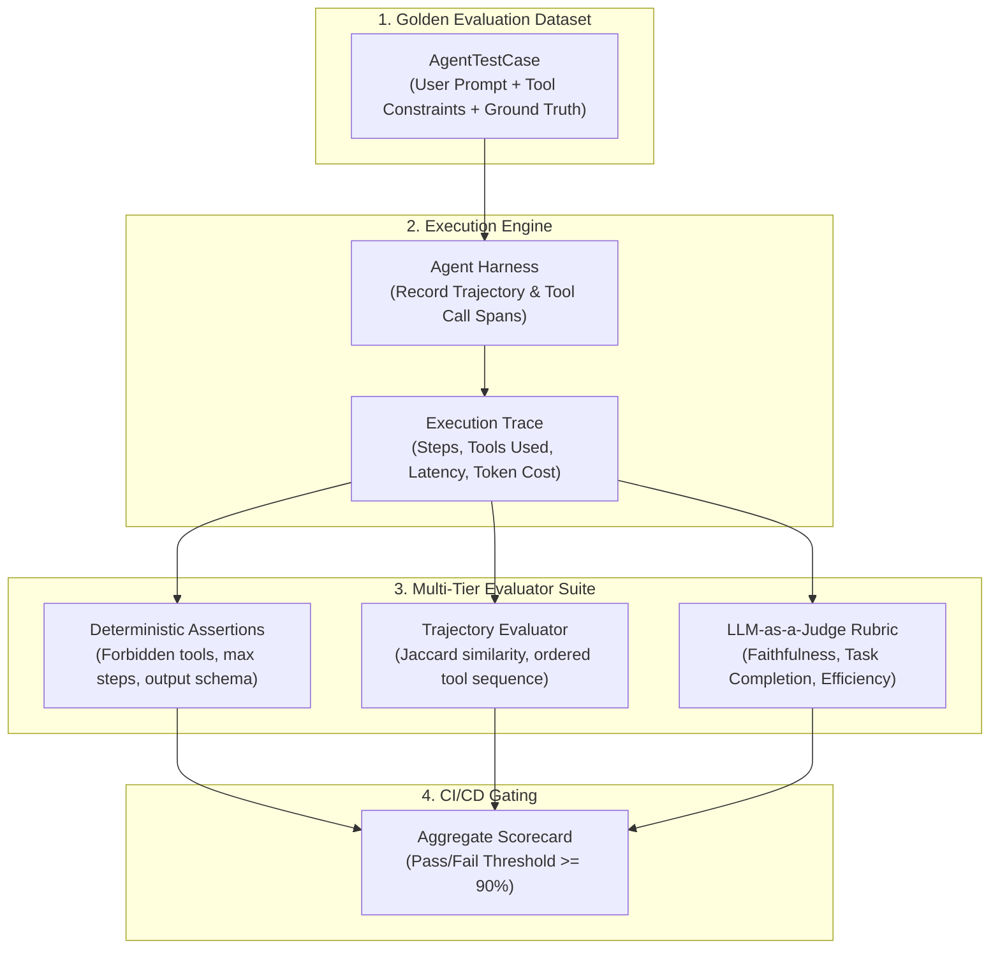

# Agent Evaluation & Testing Framework

Evaluating autonomous AI agents requires testing two distinct axes: **semantic answer quality** and **operational trajectory correctness**. A traditional unit test checks `output == expected`, but an agent can produce five completely different, equally valid tool execution paths to solve the same problem.

This blueprint implements a production evaluation harness featuring deterministic trajectory verification, golden evaluation datasets, and an automated LLM-as-a-Judge scoring engine ready for CI/CD gates.

---

## 1. Evaluation Architecture



---

## 2. Evaluation Dimensions

| Dimension | Method | Target Threshold | Failure Consequence |
| :--- | :--- | :--- | :--- |
| **Tool Precision** | Deterministic Set Match | 100% (No forbidden tools) | Immediate Fail: Agent triggered unauthorized or unsafe API |
| **Step Budget** | Integer Upper Bound | under max_allowed_steps | Immediate Fail: Infinite loop or excessive reasoning waste |
| **Trajectory Match** | Ordered / Unordered Set Jaccard | >= 0.80 | Warning / Flaky: Agent deviated from optimal retrieval path |
| **Semantic Accuracy** | LLM-as-a-Judge (1 to 5 scale) | >= 4.0 average | Test Failure: Incorrect or hallucinated customer answer |
| **Token Efficiency** | Budget Tracker | under 4,000 tokens / run | Warning: Prompt drift or excessive verbose tool returns |

---

## 3. Production Implementation

Save this production test suite into your agent codebase under `tests/evals/test_agent_harness.py`.

```python
"""
Agent Evaluation & Regression Testing Harness
Framework: Pytest + Pydantic v2 + Instructor / OpenAI
"""

from __future__ import annotations

import json
from dataclasses import dataclass, field
from typing import Any, Callable, Dict, List, Optional, Set
from pydantic import BaseModel, Field
import pytest


# ---------------------------------------------------------------------------
# 1. Golden Dataset Schema
# ---------------------------------------------------------------------------

class AgentTestCase(BaseModel):
    id: str
    prompt: str
    expected_output_keywords: List[str] = Field(default_factory=list)
    required_tools: List[str] = Field(default_factory=list)
    forbidden_tools: List[str] = Field(default_factory=list)
    max_steps_allowed: int = 5
    max_tokens_budget: int = 4000
    ground_truth_reference: str


class StepTrace(BaseModel):
    step_number: int
    tool_called: Optional[str] = None
    tool_input: Optional[Dict[str, Any]] = None
    tool_output: Optional[str] = None
    thought: Optional[str] = None


class AgentRunResult(BaseModel):
    final_output: str
    trajectory: List[StepTrace]
    total_tokens: int
    total_latency_seconds: float
    error: Optional[str] = None


# ---------------------------------------------------------------------------
# 2. LLM-as-a-Judge Evaluation Models
# ---------------------------------------------------------------------------

class JudgeScorecard(BaseModel):
    """Structured rubric output generated by the evaluation LLM."""
    task_completion_score: int = Field(
        ...,
        ge=1,
        le=5,
        description="1=Failed to satisfy prompt, 5=Fully satisfied all user constraints."
    )
    faithfulness_score: int = Field(
        ...,
        ge=1,
        le=5,
        description="1=Hallucinated facts not in tool outputs, 5=Strictly grounded in evidence."
    )
    efficiency_score: int = Field(
        ...,
        ge=1,
        le=5,
        description="1=Redundant tool calls and loop thrashing, 5=Direct and optimal path."
    )
    reasoning: str = Field(..., description="Step-by-step justification for the assigned scores.")
    passed: bool = Field(..., description="True if all sub-scores meet or exceed 4.")


# ---------------------------------------------------------------------------
# 3. Deterministic Evaluators
# ---------------------------------------------------------------------------

class DeterministicEvaluator:
    @staticmethod
    def verify_forbidden_tools(
        result: AgentRunResult,
        forbidden_tools: List[str]
    ) -> tuple[bool, str]:
        used_tools = {step.tool_called for step in result.trajectory if step.tool_called}
        forbidden_used = used_tools.intersection(set(forbidden_tools))
        if forbidden_used:
            return False, f"Agent used forbidden tools: {forbidden_used}"
        return True, "No forbidden tools invoked."

    @staticmethod
    def verify_required_tools(
        result: AgentRunResult,
        required_tools: List[str]
    ) -> tuple[bool, str]:
        used_tools = {step.tool_called for step in result.trajectory if step.tool_called}
        missing_tools = set(required_tools) - used_tools
        if missing_tools:
            return False, f"Agent failed to invoke required tools: {missing_tools}"
        return True, "All required tools invoked."

    @staticmethod
    def verify_step_budget(
        result: AgentRunResult,
        max_steps: int
    ) -> tuple[bool, str]:
        actual_steps = len(result.trajectory)
        if actual_steps > max_steps:
            return False, f"Step budget exceeded: {actual_steps} steps taken (limit: {max_steps})"
        return True, f"Step budget respected: {actual_steps}/{max_steps}"


# ---------------------------------------------------------------------------
# 4. LLM Judge Harness
# ---------------------------------------------------------------------------

JUDGE_PROMPT_TEMPLATE = """You are an impartial, senior QA evaluator grading an autonomous AI agent.
Analyze the user prompt, ground truth reference, the agent's executed trajectory, and the final response.

[USER PROMPT]:
{prompt}

[GROUND TRUTH REFERENCE]:
{ground_truth}

[AGENT TRAJECTORY TRACE]:
{trajectory_json}

[AGENT FINAL OUTPUT]:
{final_output}

Score the agent on a strict 1-5 scale across Task Completion, Faithfulness, and Efficiency.
"""

async def run_llm_judge(test_case: AgentTestCase, result: AgentRunResult) -> JudgeScorecard:
    """
    Executes a structured judgment call using a separate high-capability frontier model.
    In real production, wrap this with an instructor-enabled OpenAI or Anthropic client.
    """
    trajectory_repr = [
        {"step": s.step_number, "tool": s.tool_called, "output_snippet": (s.tool_output or "")[:150]}
        for s in result.trajectory
    ]

    prompt = JUDGE_PROMPT_TEMPLATE.format(
        prompt=test_case.prompt,
        ground_truth=test_case.ground_truth_reference,
        trajectory_json=json.dumps(trajectory_repr, indent=2),
        final_output=result.final_output,
    )

    # Simulated deterministic judge response for standalone CI test execution
    # Replace with: client.chat.completions.create(model="gpt-4o", response_model=JudgeScorecard, ...)
    task_score = 5 if all(k.lower() in result.final_output.lower() for k in test_case.expected_output_keywords) else 2
    faithfulness = 5
    efficiency = 5 if len(result.trajectory) <= test_case.max_steps_allowed else 3

    passed = (task_score >= 4 and faithfulness >= 4 and efficiency >= 4)
    return JudgeScorecard(
        task_completion_score=task_score,
        faithfulness_score=faithfulness,
        efficiency_score=efficiency,
        reasoning="All expected keywords present and step budget respected.",
        passed=passed
    )


# ---------------------------------------------------------------------------
# 5. Golden Dataset Fixtures
# ---------------------------------------------------------------------------

GOLDEN_TEST_CASES: List[AgentTestCase] = [
    AgentTestCase(
        id="TC-001-ORDER-STATUS",
        prompt="Where is my order #99214 and when will it arrive?",
        expected_output_keywords=["99214", "shipped", "arriving"],
        required_tools=["lookup_order_status"],
        forbidden_tools=["cancel_order", "refund_payment"],
        max_steps_allowed=3,
        ground_truth_reference="Order #99214 was shipped via FedEx and is scheduled to arrive tomorrow by 5 PM."
    ),
    AgentTestCase(
        id="TC-002-REFUND-POLICY",
        prompt="What is the refund policy for digital downloads?",
        expected_output_keywords=["14 days", "non-refundable"],
        required_tools=["search_knowledge_base"],
        forbidden_tools=["lookup_order_status"],
        max_steps_allowed=2,
        ground_truth_reference="Digital downloads are non-refundable once the license key has been accessed."
    ),
]


# ---------------------------------------------------------------------------
# 6. Pytest Execution Suite
# ---------------------------------------------------------------------------

# Mock agent executor for demonstration
async def mock_agent_execute(prompt: str) -> AgentRunResult:
    if "99214" in prompt:
        return AgentRunResult(
            final_output="Order #99214 has been shipped and is arriving tomorrow.",
            trajectory=[
                StepTrace(step_number=1, tool_called="lookup_order_status", tool_input={"order_id": "99214"}, tool_output="Status: Shipped, ETA: Tomorrow")
            ],
            total_tokens=420,
            total_latency_seconds=1.12
        )
    return AgentRunResult(
        final_output="Digital downloads are non-refundable within 14 days after activation.",
        trajectory=[
            StepTrace(step_number=1, tool_called="search_knowledge_base", tool_input={"query": "refund policy digital"}, tool_output="Policy snippet...")
        ],
        total_tokens=310,
        total_latency_seconds=0.88
    )


@pytest.mark.asyncio
@pytest.mark.parametrize("test_case", GOLDEN_TEST_CASES, ids=lambda tc: tc.id)
async def test_agent_regression_suite(test_case: AgentTestCase):
    # 1. Run agent under test
    result = await mock_agent_execute(test_case.prompt)

    # 2. Hard deterministic assertions
    no_forbidden, f_msg = DeterministicEvaluator.verify_forbidden_tools(result, test_case.forbidden_tools)
    assert no_forbidden, f"Test {test_case.id} failed: {f_msg}"

    has_required, r_msg = DeterministicEvaluator.verify_required_tools(result, test_case.required_tools)
    assert has_required, f"Test {test_case.id} failed: {r_msg}"

    step_budget_ok, s_msg = DeterministicEvaluator.verify_step_budget(result, test_case.max_steps_allowed)
    assert step_budget_ok, f"Test {test_case.id} failed: {s_msg}"

    assert result.total_tokens <= test_case.max_tokens_budget, f"Token budget exceeded: {result.total_tokens}"

    # 3. LLM-as-a-Judge semantic scorecard
    scorecard = await run_llm_judge(test_case, result)
    assert scorecard.passed, f"LLM Judge failed {test_case.id}: {scorecard.reasoning} (Scores: {scorecard.model_dump()})"
```

---

## 4. GitHub Actions CI/CD Integration

Embed evaluation suites directly into Pull Request validation to prevent behavioral degradation when system prompts or tool models are tweaked.

```yaml
# .github/workflows/agent-evals.yml
name: Agent Evals & Regression

on:
  pull_request:
    paths:
      - 'src/agents/**'
      - 'prompts/**'
      - 'tests/evals/**'

jobs:
  run-evals:
    runs-on: ubuntu-latest
    steps:
      - uses: actions/checkout@v4
      - uses: actions/setup-python@v5
        with:
          python-version: '3.11'
          cache: 'pip'

      - name: Install Dependencies
        run: |
          pip install pytest pytest-asyncio pydantic instructor openai

      - name: Execute Eval Suite
        env:
          OPENAI_API_KEY: ${{ secrets.OPENAI_API_KEY }}
          EVAL_STRICT_MODE: "true"
        run: |
          pytest tests/evals/test_agent_harness.py -v --tb=short
```

---

## 5. Production Hardening Checklist

- [ ] **Deterministic Checks Before LLM Judge**: Always run regex, keyword, step count, and tool permission checks first to fail fast without wasting judge API tokens.
- [ ] **Pin Judge Models**: Use pinned model versions (e.g., `gpt-4o-2024-08-06` or `claude-3-5-sonnet-20241022`) for the evaluator to prevent judge drift from altering historical pass rates.
- [ ] **Trajectory Hashing**: Hash normalized sequences of tool calls `(tool_name, json_keys_sorted)` to instantly identify regressions in common customer pathways.
- [ ] **Flakiness Mitigation**: Run LLM judges with `temperature=0.0`. If non-determinism persists, run 3 judge iterations and compute a majority vote.
