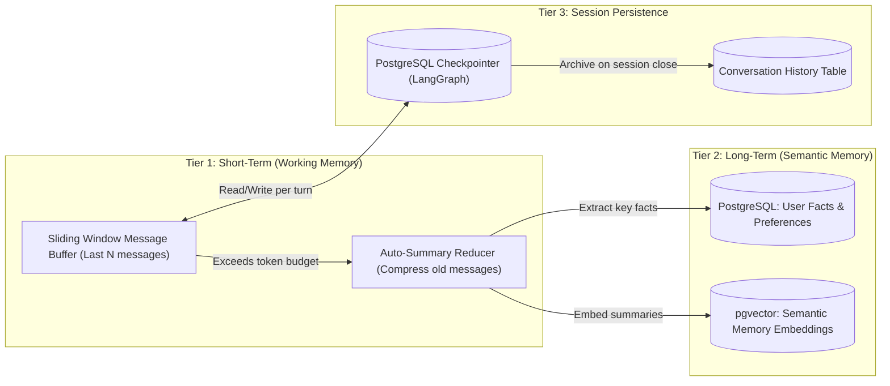

# 🧠 Agent Memory & Conversation Persistence

Production blueprint covering the three tiers of agent memory: **Short-Term (Working Memory)**, **Long-Term (Semantic Recall)**, and **Session/Thread Persistence**. Without proper memory architecture, agents forget context mid-conversation, repeat themselves, or hallucinate past interactions.

---

## 1. The Three Memory Tiers



---

## 2. Tier 1: Sliding Window + Auto-Summary

Prevent context window overflow by keeping only the last N messages and summarizing older ones.

```python
from langchain_core.messages import BaseMessage, SystemMessage, HumanMessage, AIMessage
from langchain_openai import ChatOpenAI


class ConversationMemory:
    """Production conversation memory with sliding window and auto-summarization."""
    
    def __init__(self, max_messages: int = 20, summary_threshold: int = 15):
        self.messages: list[BaseMessage] = []
        self.summary: str = ""
        self.max_messages = max_messages
        self.summary_threshold = summary_threshold
        self.summarizer = ChatOpenAI(model="gpt-4o-mini", temperature=0)
    
    def add_message(self, message: BaseMessage):
        self.messages.append(message)
        
        # Trigger auto-summary when buffer exceeds threshold
        if len(self.messages) > self.summary_threshold:
            self._compress()
    
    def _compress(self):
        """Summarize oldest messages and keep only recent ones."""
        # Split: old messages to summarize, recent messages to keep
        cutoff = len(self.messages) - (self.max_messages // 2)
        old_messages = self.messages[:cutoff]
        self.messages = self.messages[cutoff:]
        
        # Generate summary of old messages
        summary_prompt = f"""Summarize the following conversation history into key facts, decisions, and context.
Be concise but preserve all important details the AI agent needs to maintain continuity.

Previous summary: {self.summary or 'None'}

Messages to summarize:
{self._format_messages(old_messages)}"""
        
        response = self.summarizer.invoke([HumanMessage(content=summary_prompt)])
        self.summary = response.content
    
    def get_context(self, system_prompt: str = "") -> list[BaseMessage]:
        """Return the full context for LLM invocation."""
        context = []
        
        # System prompt with embedded summary
        full_system = system_prompt
        if self.summary:
            full_system += f"\n\nPrevious conversation summary:\n{self.summary}"
        context.append(SystemMessage(content=full_system))
        
        # Recent messages
        context.extend(self.messages)
        return context
    
    @staticmethod
    def _format_messages(messages: list[BaseMessage]) -> str:
        return "\n".join([f"{m.type}: {m.content}" for m in messages])
```

---

## 3. Tier 2: Long-Term Semantic Memory (PostgreSQL + pgvector)

Store and retrieve user-specific facts and preferences that persist across sessions.

```sql
-- Long-term memory store
CREATE TABLE agent_memories (
    id UUID PRIMARY KEY DEFAULT gen_random_uuid(),
    user_id VARCHAR(128) NOT NULL,
    memory_type VARCHAR(32) NOT NULL,  -- 'fact', 'preference', 'context'
    content TEXT NOT NULL,
    embedding VECTOR(1536),
    importance_score FLOAT DEFAULT 0.5,
    access_count INT DEFAULT 0,
    last_accessed_at TIMESTAMP WITH TIME ZONE DEFAULT NOW(),
    created_at TIMESTAMP WITH TIME ZONE DEFAULT NOW()
);

CREATE INDEX idx_memories_user ON agent_memories(user_id);
CREATE INDEX idx_memories_vector ON agent_memories USING hnsw (embedding vector_cosine_ops);
```

```python
import asyncpg
from openai import AsyncOpenAI


class LongTermMemory:
    """Semantic memory store using PostgreSQL + pgvector."""
    
    def __init__(self, pool: asyncpg.Pool, openai_client: AsyncOpenAI):
        self.pool = pool
        self.openai = openai_client
    
    async def store(self, user_id: str, content: str, memory_type: str = "fact"):
        """Store a new memory with its embedding."""
        embedding = await self._embed(content)
        
        await self.pool.execute(
            """INSERT INTO agent_memories (user_id, memory_type, content, embedding)
               VALUES ($1, $2, $3, $4)""",
            user_id, memory_type, content, str(embedding)
        )
    
    async def recall(self, user_id: str, query: str, limit: int = 5) -> list[str]:
        """Retrieve relevant memories for the current context."""
        query_embedding = await self._embed(query)
        
        rows = await self.pool.fetch(
            """SELECT content, 1 - (embedding <=> $1::vector) AS similarity
               FROM agent_memories
               WHERE user_id = $2 AND 1 - (embedding <=> $1::vector) > 0.7
               ORDER BY similarity DESC
               LIMIT $3""",
            str(query_embedding), user_id, limit
        )
        
        # Update access metadata
        for row in rows:
            await self.pool.execute(
                """UPDATE agent_memories 
                   SET access_count = access_count + 1, last_accessed_at = NOW()
                   WHERE content = $1 AND user_id = $2""",
                row["content"], user_id
            )
        
        return [row["content"] for row in rows]
    
    async def _embed(self, text: str) -> list[float]:
        response = await self.openai.embeddings.create(
            model="text-embedding-3-small", input=text
        )
        return response.data[0].embedding
```

---

## 4. Tier 3: Session Persistence & History

```sql
-- Conversation history archive (for analytics and replay)
CREATE TABLE conversation_sessions (
    id UUID PRIMARY KEY DEFAULT gen_random_uuid(),
    user_id VARCHAR(128) NOT NULL,
    thread_id VARCHAR(128) NOT NULL UNIQUE,
    title VARCHAR(256),
    message_count INT DEFAULT 0,
    total_tokens_used INT DEFAULT 0,
    started_at TIMESTAMP WITH TIME ZONE DEFAULT NOW(),
    ended_at TIMESTAMP WITH TIME ZONE,
    summary TEXT
);

CREATE TABLE conversation_messages (
    id UUID PRIMARY KEY DEFAULT gen_random_uuid(),
    session_id UUID REFERENCES conversation_sessions(id) ON DELETE CASCADE,
    role VARCHAR(16) NOT NULL,  -- 'user', 'assistant', 'tool', 'system'
    content TEXT NOT NULL,
    tool_calls JSONB,
    tokens_used INT,
    created_at TIMESTAMP WITH TIME ZONE DEFAULT NOW()
);

CREATE INDEX idx_conv_sessions_user ON conversation_sessions(user_id);
CREATE INDEX idx_conv_messages_session ON conversation_messages(session_id, created_at);
```

---

## 5. Integrated Agent with All Three Tiers

```python
async def agent_turn(user_id: str, thread_id: str, user_message: str):
    """Process a single agent turn with full memory integration."""
    
    # 1. Load short-term memory (from checkpoint or buffer)
    conversation = ConversationMemory(max_messages=20)
    
    # 2. Recall relevant long-term memories
    memories = await long_term_memory.recall(user_id, user_message, limit=3)
    memory_context = "\n".join([f"- {m}" for m in memories]) if memories else "No prior memories."
    
    system_prompt = f"""You are a helpful assistant with memory of past interactions.

Relevant memories about this user:
{memory_context}

Use these memories to personalize your response. If the user shares new preferences or facts, acknowledge them."""
    
    # 3. Get LLM response
    conversation.add_message(HumanMessage(content=user_message))
    context = conversation.get_context(system_prompt)
    
    response = await llm.ainvoke(context)
    conversation.add_message(AIMessage(content=response.content))
    
    # 4. Extract and store new facts for long-term memory
    # (In production: use a lightweight extraction prompt to identify new user facts)
    
    return response.content
```

---

## 6. Production Rules

1. **Never store raw message history beyond 50 turns.** Auto-summarize and archive. Unbounded history causes context window overflow and ballooning PostgreSQL checkpoint sizes.
2. **Memory recall must be filtered by `user_id`.** Cross-user memory leakage is a critical privacy/security violation.
3. **Implement memory decay.** Memories with `access_count = 0` and `last_accessed_at > 90 days` should be automatically pruned or archived.
4. **Separate hot memory (pgvector) from cold storage (S3/archive).** Keep only actively relevant memories in the vector index.
