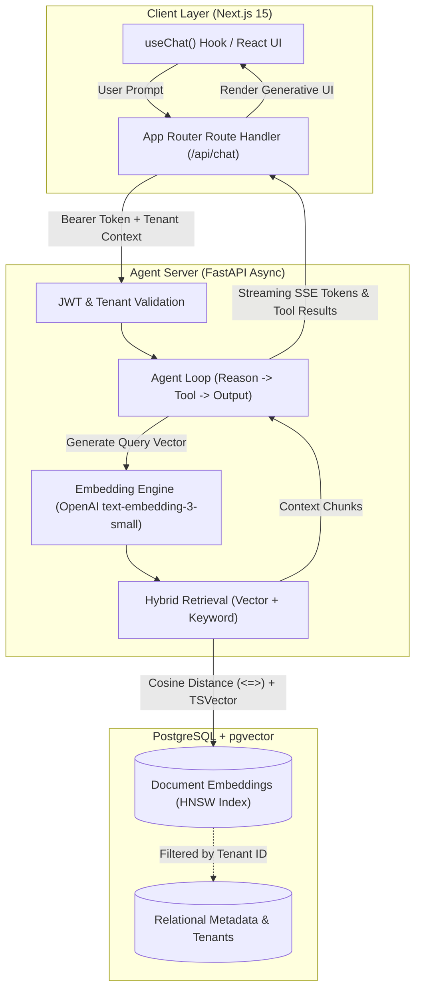

# 🤖 AI Agent & Production RAG Architecture

Enterprise-grade architecture blueprint for decoupled, multi-tenant, streaming AI agents using **Next.js (App Router + Vercel AI SDK)**, **FastAPI (Async Python)**, and **PostgreSQL with `pgvector`**.

---

## 1. System Overview & Problem Statement

Building production-ready Retrieval-Augmented Generation (RAG) and agentic workflows requires decoupling frontend responsiveness from heavy data pipelines:
- **Client & Streaming Layer (Next.js):** Handles real-time UI rendering, tool call parsing, and streaming responses over Server-Sent Events (SSE).
- **Agent Orchestration (FastAPI):** Python backend managing tool execution, embeddings, and context window assembly.
- **Unified Vector & Relational Store (PostgreSQL + `pgvector`):** Replaces standalone vector DBs by storing structured business entities, tenant metadata, and embeddings together with ACID guarantees and hybrid search (BM25 + Cosine similarity).

---

## 2. End-to-End Architecture Flow



---

## 3. Database Schema (`pgvector` + Hybrid Search)

Run the following SQL migration on PostgreSQL 15+ to configure the vector extension, multi-tenant tables, and HNSW index:

```sql
-- 1. Enable pgvector extension
CREATE EXTENSION IF NOT EXISTS vector;

-- 2. Documents table with tenant isolation
CREATE TABLE document_embeddings (
    id UUID PRIMARY KEY DEFAULT gen_random_uuid(),
    tenant_id VARCHAR(64) NOT NULL,
    document_id VARCHAR(128) NOT NULL,
    chunk_index INT NOT NULL,
    content TEXT NOT NULL,
    tsv TSVECTOR GENERATED ALWAYS AS (to_tsvector('english', content)) STORED,
    embedding VECTOR(1536), -- Dimension for text-embedding-3-small
    metadata JSONB DEFAULT '{}'::jsonb,
    created_at TIMESTAMP WITH TIME ZONE DEFAULT NOW()
);

-- 3. High-Performance HNSW vector index (Cosine Distance)
CREATE INDEX ON document_embeddings 
USING hnsw (embedding vector_cosine_ops)
WITH (m = 16, ef_construction = 64);

-- 4. Inverted index for full-text keyword search
CREATE INDEX idx_doc_tsv ON document_embeddings USING gin(tsv);

-- 5. Tenant index for multi-tenant isolation
CREATE INDEX idx_doc_tenant ON document_embeddings(tenant_id);
```

---

## 4. FastAPI Streaming & Hybrid Retrieval Implementation

### Backend Router & RAG Search (`agent_service.py`)

```python
import os
import asyncpg
from typing import List, Dict, Any
from fastapi import FastAPI, HTTPException, Depends
from fastapi.responses import StreamingResponse
from pydantic import BaseModel
from openai import AsyncOpenAI

app = FastAPI(title="AI Agent RAG Service")
openai_client = AsyncOpenAI(api_key=os.getenv("OPENAI_API_KEY"))

class ChatRequest(BaseModel):
    tenant_id: str
    message: str

async def get_db_pool():
    return await asyncpg.create_pool(os.getenv("DATABASE_URL"))

async def generate_embedding(text: str) -> List[float]:
    response = await openai_client.embeddings.create(
        model="text-embedding-3-small",
        input=text
    )
    return response.data[0].embedding

async def hybrid_search(pool, tenant_id: str, query_embedding: List[float], query_text: str, limit: int = 5):
    query_str = "[" + ",".join(map(str, query_embedding)) + "]"
    sql = """
        SELECT content, metadata,
               (1 - (embedding <=> $1::vector)) AS vector_similarity,
               ts_rank(tsv, plainto_tsquery('english', $2)) AS text_rank
        FROM document_embeddings
        WHERE tenant_id = $3
        ORDER BY (1 - (embedding <=> $1::vector)) * 0.7 + 
                 ts_rank(tsv, plainto_tsquery('english', $2)) * 0.3 DESC
        LIMIT $4;
    """
    async with pool.acquire() as conn:
        rows = await conn.fetch(sql, query_str, query_text, tenant_id, limit)
        return [dict(r) for r in rows]

@app.post("/api/agent/stream")
async def stream_agent_response(payload: ChatRequest):
    # 1. Embed query
    query_vector = await generate_embedding(payload.message)
    
    # 2. Retrieve grounded context
    pool = await get_db_pool()
    chunks = await hybrid_search(pool, payload.tenant_id, query_vector, payload.message)
    context = "\n---\n".join([c["content"] for c in chunks])

    system_prompt = f"""You are a precise corporate AI assistant. 
Answer using ONLY the following grounded documentation context:
{context}

If the answer cannot be determined strictly from the context, state: 'No verified source data found.'"""

    async def token_generator():
        stream = await openai_client.chat.completions.create(
            model="gpt-4o",
            messages=[
                {"role": "system", "content": system_prompt},
                {"role": "user", "content": payload.message}
            ],
            stream=True
        )
        async for chunk in stream:
            content = chunk.choices[0].delta.content or ""
            if content:
                yield f"data: {content}\n\n"
        yield "data: [DONE]\n\n"

    return StreamingResponse(token_generator(), media_type="text/event-stream")
```

---

## 5. Next.js Frontend Integration (Vercel AI SDK)

Client Component consuming the stream with real-time UI updates (`ChatInterface.tsx`):

```tsx
'use client';

import React, { useState } from 'react';
import { useChat } from '@ai-sdk/react';

export default function AgentChatWidget({ tenantId = "org_alpha" }: { tenantId?: string }) {
  const { messages, input, handleInputChange, handleSubmit, isLoading } = useChat({
    api: '/api/chat',
    body: { tenant_id: tenantId },
  });

  return (
    <div style={{
      maxWidth: '720px',
      margin: '0 auto',
      border: '1px solid #2d3748',
      borderRadius: '8px',
      padding: '16px',
      background: '#1a202c',
      color: '#e2e8f0',
      fontFamily: 'system-ui, sans-serif'
    }}>
      <div style={{ maxHeight: '450px', overflowY: 'auto', marginBottom: '16px' }}>
        {messages.length === 0 && (
          <p style={{ color: '#a0aec0', fontSize: '14px' }}>Ask any question against your enterprise knowledge base...</p>
        )}
        {messages.map((m) => (
          <div key={m.id} style={{
            margin: '8px 0',
            padding: '10px 14px',
            borderRadius: '6px',
            background: m.role === 'user' ? '#2b6cb0' : '#2d3748',
            alignSelf: m.role === 'user' ? 'flex-end' : 'flex-start'
          }}>
            <strong style={{ fontSize: '12px', textTransform: 'uppercase', opacity: 0.8 }}>{m.role}</strong>
            <p style={{ margin: '4px 0 0 0', whiteSpace: 'pre-wrap', fontSize: '14px' }}>{m.content}</p>
          </div>
        ))}
      </div>

      <form onSubmit={handleSubmit} style={{ display: 'flex', gap: '8px' }}>
        <input
          value={input}
          onChange={handleInputChange}
          placeholder="Ask enterprise agent..."
          style={{
            flex: 1,
            padding: '10px 14px',
            borderRadius: '6px',
            border: '1px solid #4a5568',
            background: '#2d3748',
            color: '#fff',
            outline: 'none'
          }}
        />
        <button
          type="submit"
          disabled={isLoading}
          style={{
            padding: '10px 18px',
            borderRadius: '6px',
            border: 'none',
            background: isLoading ? '#718096' : '#3182ce',
            color: '#fff',
            fontWeight: 'bold',
            cursor: isLoading ? 'not-allowed' : 'pointer'
          }}
        >
          {isLoading ? 'Generating...' : 'Send'}
        </button>
      </form>
    </div>
  );
}
```

---

## 6. Enterprise Trade-Offs & Security Considerations

| Criteria | Choice: PostgreSQL + `pgvector` | Dedicated Vector DB (Pinecone / Milvus) |
| :--- | :--- | :--- |
| **Operational Overhead** | **Low:** Single DB for metadata, users, sessions, and embeddings. | **High:** Two databases to sync, cross-system eventual consistency. |
| **Data Leak Prevention** | **Native SQL Filters:** Enforce `WHERE tenant_id = $1` on every query. | Must rely on proprietary namespace/metadata filtering. |
| **Scale Limit** | Suitable for up to ~50 million vector rows per cluster with HNSW. | Built for 100M+ vectors with distributed clustering. |
| **Latency** | Single-digit millisecond query latency with tuned HNSW indexes. | Low latency, but adds network hops outside relational boundary. |

---

## 7. Production Deployment Checklist
1. **Index Optimization:** Set `maintenance_work_mem = '2GB'` during HNSW index construction to ensure fast index creation.
2. **Connection Pooling:** Use `pgbouncer` or `asyncpg` connection pools to prevent database connection exhaustion during bursts of concurrent agent queries.
3. **Observability:** Track OpenTelemetry spans around retrieval latency, embedding token counts, and completion tokens using Langfuse or Arize Phoenix.
