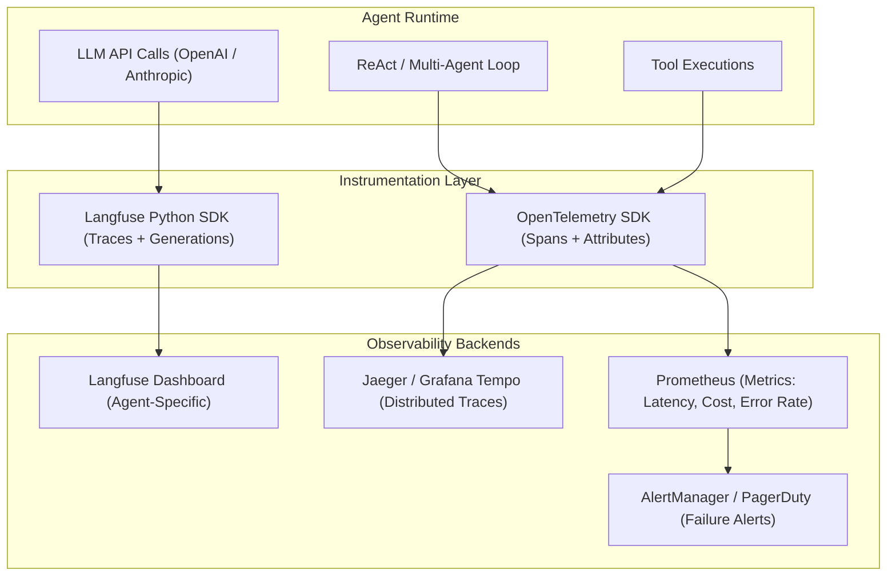

# 📡 Agent Observability & Tracing

Production blueprint for instrumenting AI agents with full-stack observability: **distributed tracing** (every LLM call, tool execution, and routing decision), **token cost accounting**, **latency histograms**, and **failure alerting**.

---

## 1. Why Agent Observability is Non-Negotiable

Traditional backend services fail loudly (500 errors, stack traces). AI agents **fail silently**: they return polite but wrong answers, loop inefficiently, or hallucinate tool arguments. Without tracing, you cannot debug why an agent gave a bad answer, which tool returned garbage data, or why a run cost 10x more tokens than expected.

---

## 2. Observability Stack Architecture



---

## 3. Langfuse Integration (Agent-Native Tracing)

Langfuse is purpose-built for LLM observability. It captures traces, generations, and scores with minimal code.

```python
import os
from langfuse import Langfuse
from langfuse.decorators import observe, langfuse_context
from openai import OpenAI

# Initialize Langfuse client
langfuse = Langfuse(
    public_key=os.getenv("LANGFUSE_PUBLIC_KEY"),
    secret_key=os.getenv("LANGFUSE_SECRET_KEY"),
    host=os.getenv("LANGFUSE_HOST", "https://cloud.langfuse.com"),
)

client = OpenAI()


@observe(as_type="generation")
def llm_call(messages: list, model: str = "gpt-4o") -> str:
    """Traced LLM generation — automatically captures tokens, latency, cost."""
    response = client.chat.completions.create(model=model, messages=messages)
    
    # Update Langfuse with model metadata
    langfuse_context.update_current_observation(
        model=model,
        usage={
            "input_tokens": response.usage.prompt_tokens,
            "output_tokens": response.usage.completion_tokens,
        },
    )
    
    return response.choices[0].message.content


@observe()
def tool_execution(tool_name: str, args: dict) -> str:
    """Traced tool execution — captures arguments, output, and errors."""
    langfuse_context.update_current_observation(
        metadata={"tool_name": tool_name, "arguments": args}
    )
    
    # Execute the actual tool
    result = execute_tool(tool_name, args)
    return result


@observe(name="agent-run")
def run_agent(user_query: str, user_id: str) -> str:
    """Top-level traced agent run — groups all sub-operations."""
    langfuse_context.update_current_trace(
        user_id=user_id,
        metadata={"query_length": len(user_query)},
        tags=["production", "v2"],
    )
    
    # Agent loop
    messages = [
        {"role": "system", "content": "You are a helpful assistant with tool access."},
        {"role": "user", "content": user_query},
    ]
    
    for step in range(5):
        response = llm_call(messages)
        # ... tool calling logic ...
    
    # Score the run (for evaluation dashboards)
    langfuse_context.score_current_trace(
        name="user_satisfaction",
        value=1.0,  # Set from user feedback
    )
    
    return response
```

---

## 4. OpenTelemetry Integration (Infrastructure-Level)

For teams already using Jaeger, Grafana Tempo, or Datadog, instrument with standard OTEL spans.

```python
from opentelemetry import trace
from opentelemetry.sdk.trace import TracerProvider
from opentelemetry.sdk.trace.export import BatchSpanProcessor
from opentelemetry.exporter.otlp.proto.grpc.trace_exporter import OTLPSpanExporter
from opentelemetry.sdk.resources import Resource

# Setup OTEL
resource = Resource.create({"service.name": "ai-agent-service", "service.version": "2.1.0"})
provider = TracerProvider(resource=resource)
processor = BatchSpanProcessor(OTLPSpanExporter(endpoint="http://localhost:4317"))
provider.add_span_processor(processor)
trace.set_tracer_provider(provider)

tracer = trace.get_tracer("ai-agent")


def traced_agent_step(step_num: int, messages: list, model: str = "gpt-4o"):
    """Wrap each agent step in an OTEL span."""
    
    with tracer.start_as_current_span(
        f"agent.reasoning.step_{step_num}",
        attributes={
            "agent.model": model,
            "agent.step": step_num,
            "agent.message_count": len(messages),
        }
    ) as span:
        try:
            response = client.chat.completions.create(model=model, messages=messages)
            
            span.set_attribute("agent.input_tokens", response.usage.prompt_tokens)
            span.set_attribute("agent.output_tokens", response.usage.completion_tokens)
            span.set_attribute("agent.has_tool_calls", bool(response.choices[0].message.tool_calls))
            
            return response
        except Exception as e:
            span.set_status(trace.StatusCode.ERROR, str(e))
            span.record_exception(e)
            raise


def traced_tool_execution(tool_name: str, args: dict):
    """Wrap tool execution in an OTEL span."""
    
    with tracer.start_as_current_span(
        f"agent.tool.{tool_name}",
        attributes={
            "tool.name": tool_name,
            "tool.arguments": str(args)[:500],
        }
    ) as span:
        import time
        start = time.time()
        
        try:
            result = execute_tool(tool_name, args)
            elapsed = (time.time() - start) * 1000
            
            span.set_attribute("tool.success", True)
            span.set_attribute("tool.latency_ms", elapsed)
            span.set_attribute("tool.output_length", len(str(result)))
            
            return result
        except Exception as e:
            span.set_attribute("tool.success", False)
            span.set_status(trace.StatusCode.ERROR, str(e))
            span.record_exception(e)
            raise
```

---

## 5. Key Metrics to Track

| Metric | Type | Alert Threshold | Why It Matters |
| :--- | :--- | :--- | :--- |
| `agent.run.duration_ms` | Histogram | p99 > 30s | Detect slow agent runs before users complain |
| `agent.run.total_tokens` | Counter | Single run > 50K tokens | Catch runaway loops burning money |
| `agent.run.steps_count` | Histogram | > 8 steps per run | Signal that the agent is looping or confused |
| `agent.tool.error_rate` | Gauge | > 10% over 5min window | Broken external API or misconfigured tool |
| `agent.tool.latency_ms` | Histogram | p95 > 5s for any tool | Slow tools block the entire agent loop |
| `agent.routing.destination` | Counter (per worker) | N/A | Understand which workers are overloaded |
| `agent.cost.usd_per_run` | Gauge | > \$0.50 per run | Cost anomaly detection |

---

## 6. Production Rules

1. **Trace every LLM call, tool execution, and routing decision.** If it is not traced, it did not happen. You cannot debug agent failures from logs alone.
2. **Attach `user_id` and `thread_id` to every trace.** This enables per-user debugging and compliance auditing.
3. **Alert on token budget breaches.** A single confused agent run can cost \$5+ in tokens. Set hard alerts at your per-run cost ceiling.
4. **Use Langfuse scores for continuous evaluation.** Track `faithfulness`, `relevance`, and `user_satisfaction` scores over time to detect quality regression before users report it.
5. **Export traces to both Langfuse (LLM-specific) and OTEL (infrastructure).** They serve different audiences: Langfuse for prompt engineers and AI developers, OTEL/Grafana for SRE and platform teams.
