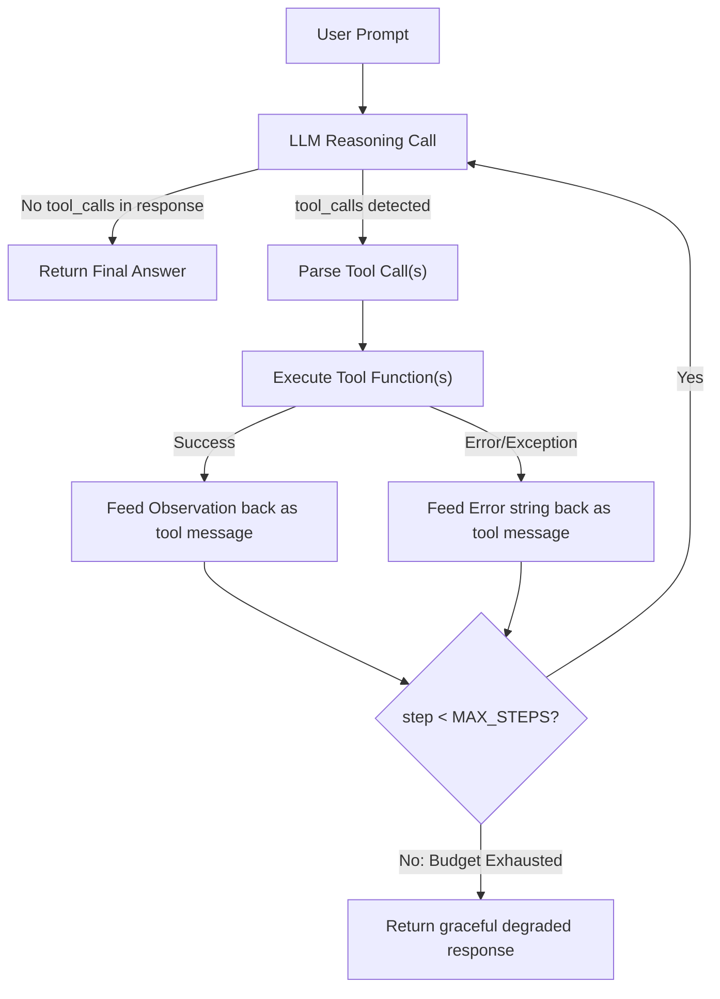

# 🔧 ReAct Tool-Calling Execution Engine

A production blueprint for implementing the **ReAct (Reasoning + Acting)** pattern: a controlled execution loop where an LLM interleaves internal reasoning with external tool calls, processes observations, and iterates until a final answer is produced.

---

## 1. How the ReAct Loop Works



---

## 2. Complete Production Implementation

```python
import json
import logging
import uuid
from typing import Callable, Dict, List, Any, Optional
from openai import AsyncOpenAI
from pydantic import BaseModel

# Structured audit logging
logging.basicConfig(level=logging.INFO, format="%(asctime)s [%(levelname)s] %(message)s")
logger = logging.getLogger("ReActAgent")


class ToolResult(BaseModel):
    """Structured tool execution result for observability."""
    tool_name: str
    tool_call_id: str
    arguments: dict
    output: str
    success: bool
    latency_ms: float


class ProductionReActAgent:
    """
    A production-grade ReAct agent with:
    - Hard step budget limits (prevents infinite loops)
    - Structured error-to-context feedback (tools failing don't crash the agent)
    - Parallel tool execution support
    - Full audit trail logging
    """
    
    def __init__(
        self,
        client: AsyncOpenAI,
        model: str = "gpt-4o",
        tools: Dict[str, Callable] = None,
        tool_schemas: List[dict] = None,
        max_steps: int = 8,
        system_prompt: str = None,
    ):
        self.client = client
        self.model = model
        self.tools = tools or {}
        self.tool_schemas = tool_schemas or []
        self.max_steps = max_steps
        self.system_prompt = system_prompt
        self.execution_trace: List[ToolResult] = []

    async def run(self, user_prompt: str) -> str:
        """Execute the full ReAct loop and return the final answer."""
        
        run_id = str(uuid.uuid4())[:8]
        messages = []
        
        if self.system_prompt:
            messages.append({"role": "system", "content": self.system_prompt})
        messages.append({"role": "user", "content": user_prompt})
        
        self.execution_trace = []

        for step in range(1, self.max_steps + 1):
            logger.info(f"[{run_id}] === ReAct Step {step}/{self.max_steps} ===")
            
            # ── 1. REASONING PHASE: LLM decides what to do ──
            try:
                response = await self.client.chat.completions.create(
                    model=self.model,
                    messages=messages,
                    tools=self.tool_schemas if self.tool_schemas else None,
                    tool_choice="auto" if self.tool_schemas else None,
                )
            except Exception as e:
                logger.error(f"[{run_id}] LLM API call failed: {e}")
                return f"Agent halted: LLM provider error ({type(e).__name__})"
            
            response_message = response.choices[0].message
            messages.append(response_message)
            
            # ── 2. TERMINATION CHECK: No tool calls = final answer ──
            if not response_message.tool_calls:
                logger.info(f"[{run_id}] Agent produced final answer at step {step}")
                return response_message.content
            
            # ── 3. ACTION PHASE: Execute each tool call ──
            for tool_call in response_message.tool_calls:
                import time
                start_time = time.time()
                
                tool_name = tool_call.function.name
                tool_id = tool_call.id
                
                # Parse arguments safely
                try:
                    tool_args = json.loads(tool_call.function.arguments)
                except json.JSONDecodeError as e:
                    observation = f"Error: Malformed JSON arguments: {str(e)}"
                    messages.append({"role": "tool", "tool_call_id": tool_id, "content": observation})
                    self.execution_trace.append(ToolResult(
                        tool_name=tool_name, tool_call_id=tool_id,
                        arguments={}, output=observation, success=False,
                        latency_ms=(time.time() - start_time) * 1000
                    ))
                    continue
                
                logger.info(f"[{run_id}] Action -> {tool_name}({json.dumps(tool_args)[:200]})")
                
                # Execute with error containment
                if tool_name not in self.tools:
                    observation = f"Error: Tool '{tool_name}' does not exist. Available: {list(self.tools.keys())}"
                    success = False
                else:
                    try:
                        result = self.tools[tool_name](**tool_args)
                        # Handle async tools
                        if hasattr(result, '__await__'):
                            result = await result
                        observation = str(result)
                        success = True
                        logger.info(f"[{run_id}] Observation <- {tool_name} returned {len(observation)} chars")
                    except Exception as e:
                        observation = f"Error executing {tool_name}: {type(e).__name__}: {str(e)}. Try a different approach."
                        success = False
                        logger.exception(f"[{run_id}] Tool {tool_name} crashed")
                
                # ── 4. OBSERVATION PHASE: Feed result back to LLM ──
                messages.append({"role": "tool", "tool_call_id": tool_id, "content": observation})
                
                elapsed_ms = (time.time() - start_time) * 1000
                self.execution_trace.append(ToolResult(
                    tool_name=tool_name, tool_call_id=tool_id,
                    arguments=tool_args, output=observation[:500],
                    success=success, latency_ms=elapsed_ms
                ))
        
        # Step budget exhausted
        logger.warning(f"[{run_id}] Agent hit MAX_STEPS={self.max_steps} without final answer")
        return "I reached my execution step limit. Here is what I found so far: " + (
            response_message.content or "No partial results available."
        )

    def get_trace(self) -> List[dict]:
        """Export execution trace for observability dashboards."""
        return [t.model_dump() for t in self.execution_trace]
```

---

## 3. Tool Schema Definition (Pydantic to OpenAI Format)

```python
def create_tool_schema(name: str, description: str, parameters: dict) -> dict:
    """Helper to create OpenAI-compatible tool schemas."""
    return {
        "type": "function",
        "function": {
            "name": name,
            "description": description,
            "parameters": {
                "type": "object",
                "properties": parameters,
                "required": list(parameters.keys()),
            }
        }
    }

# Example: Define tools
TOOL_SCHEMAS = [
    create_tool_schema(
        "search_web",
        "Search the internet for current information on a topic",
        {"query": {"type": "string", "description": "The search query"}}
    ),
    create_tool_schema(
        "query_database",
        "Execute a read-only SQL query against the analytics database",
        {"sql": {"type": "string", "description": "The SQL SELECT query to execute"}}
    ),
    create_tool_schema(
        "calculate",
        "Evaluate a mathematical expression",
        {"expression": {"type": "string", "description": "Mathematical expression (e.g. '2 + 2 * 3')"}}
    ),
]
```

---

## 4. Usage Example

```python
import asyncio
from openai import AsyncOpenAI


# Define actual tool implementations
def search_web(query: str) -> str:
    # In production: call SerpAPI, Tavily, or Brave Search
    return f"Search results for '{query}': [Result 1: ...] [Result 2: ...]"

def query_database(sql: str) -> str:
    # In production: execute against read-only replica with parameterized queries
    return f"Query executed. Rows returned: 42. Sample: ..."

def calculate(expression: str) -> str:
    try:
        return str(eval(expression))  # Use a safe math parser in production
    except Exception as e:
        raise ValueError(f"Invalid expression: {e}")


async def main():
    agent = ProductionReActAgent(
        client=AsyncOpenAI(),
        model="gpt-4o",
        tools={"search_web": search_web, "query_database": query_database, "calculate": calculate},
        tool_schemas=TOOL_SCHEMAS,
        max_steps=8,
        system_prompt="You are a helpful data analyst. Use tools to answer questions accurately.",
    )
    
    answer = await agent.run("What is the current market cap of NVIDIA and how does it compare to Apple?")
    print(f"\nFinal Answer:\n{answer}")
    print(f"\nExecution Trace:\n{json.dumps(agent.get_trace(), indent=2)}")

asyncio.run(main())
```

---

## 5. Production Hardening Rules

1. **`max_steps` is non-negotiable.** A confused LLM will loop forever calling the same failing tool. Default to 5-8 steps; raise only for complex multi-hop research tasks.
2. **Never crash on tool failure.** Catch all exceptions, stringify the error, and feed it back as a tool message. Modern LLMs self-correct when they see error feedback.
3. **Truncate massive tool outputs.** If a tool returns 50KB of data, trim to the first 2000 chars before injecting into messages. Context window overflow silently degrades quality.
4. **Log the full execution trace** (tool name, args, output, latency, success/fail) for every run. Ship traces to your observability platform for debugging production incidents.
5. **Use async throughout.** In production APIs, blocking `openai.Client` will exhaust your FastAPI worker pool under load. Always use `AsyncOpenAI`.
