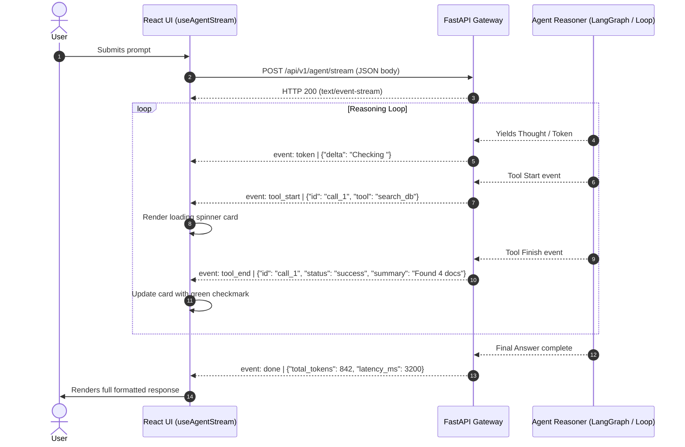

# Real-Time Streaming Agent UI & Protocol

Autonomous agents often take 5 to 30 seconds to reason, call external APIs, and synthesize answers. Keeping users engaged requires streaming token-by-token text while rendering live visual status indicators for each tool execution (e.g., searching vector DB, querying Stripe, executing SQL).

This blueprint provides the complete end-to-end streaming architecture: a **typed Server-Sent Events (SSE) protocol**, a **FastAPI streaming generator**, and a **custom React streaming hook with collapsible tool cards**.

---

## 1. Streaming Architecture



---

## 2. Event Stream Specification

Each message over the `text/event-stream` wire is formatted with an `event:` name followed by a `data:` JSON payload.

| Event Type | Payload Format | Description |
| :--- | :--- | :--- |
| `token` | `{"delta": "string"}` | Streaming token delta for the agent's visible thought or answer. |
| `tool_start` | `{"id": "str", "name": "str", "args": {}}` | Indicates a tool has started execution. Triggers client loading state. |
| `tool_end` | `{"id": "str", "status": "success"\|"error", "output": "str"}` | Reports tool execution result or error. Closes the loading state. |
| `error` | `{"code": "str", "message": "str"}` | Raised when a fatal execution error occurs. |
| `done` | `{"total_tokens": int, "latency_ms": int}` | Terminal event. Tells the client to close the stream. |

---

## 3. Backend: FastAPI SSE Generator

```python
"""
FastAPI Server-Sent Events (SSE) Agent Streamer
File: backend/streaming_agent.py
"""

from __future__ import annotations

import asyncio
import json
from typing import AsyncGenerator
from fastapi import FastAPI, HTTPException
from fastapi.responses import StreamingResponse
from pydantic import BaseModel

app = FastAPI(title="Streaming Agent API")


class AgentRequest(BaseModel):
    prompt: str
    thread_id: str


def format_sse(event: str, data: dict) -> str:
    """Encodes a payload as a valid Server-Sent Event."""
    return f"event: {event}\ndata: {json.dumps(data)}\n\n"


async def mock_agent_event_stream(prompt: str) -> AsyncGenerator[str, None]:
    """
    Simulates an agent's multi-step execution loop emitting typed SSE events.
    In real production, hook this into your LangGraph .astream_events(version="v2").
    """
    try:
        # Step 1: Initial token stream
        yield format_sse("token", {"delta": "Analyzing your request... "})
        await asyncio.sleep(0.5)

        # Step 2: Tool execution started
        tool_id = "call_vector_idx_88"
        yield format_sse("tool_start", {
            "id": tool_id,
            "name": "vector_search",
            "args": {"query": prompt, "top_k": 3}
        })
        await asyncio.sleep(1.2)  # Simulating tool work

        # Step 3: Tool execution finished
        yield format_sse("tool_end", {
            "id": tool_id,
            "status": "success",
            "output": "Retrieved 3 policy documents related to customer inquiries."
        })
        await asyncio.sleep(0.4)

        # Step 4: Stream final answer tokens
        final_answer = "Based on company guidelines, returns are accepted within 30 days with receipt."
        for word in final_answer.split(" "):
            yield format_sse("token", {"delta": word + " "})
            await asyncio.sleep(0.08)

        # Step 5: Terminal event
        yield format_sse("done", {
            "total_tokens": 348,
            "latency_ms": 2180
        })

    except Exception as exc:
        yield format_sse("error", {"code": "AGENT_STREAM_ERROR", "message": str(exc)})


@app.post("/api/v1/agent/stream")
async def stream_agent(request: AgentRequest):
    if not request.prompt.strip():
        raise HTTPException(status_code=400, detail="Prompt cannot be empty.")

    return StreamingResponse(
        mock_agent_event_stream(request.prompt),
        media_type="text/event-stream",
        headers={
            "Cache-Control": "no-cache",
            "Connection": "keep-alive",
            "X-Accel-Buffering": "no",  # Disables NGINX proxy buffering
        }
    )
```

---

## 4. Frontend: Custom React Hook (`useAgentStream`)

```typescript
// src/hooks/useAgentStream.ts
import { useState, useRef, useCallback } from 'react';

export interface ToolExecution {
  id: string;
  name: string;
  args?: Record<string, unknown>;
  status: 'pending' | 'success' | 'error';
  output?: string;
}

export interface AgentStreamState {
  tokens: string;
  tools: ToolExecution[];
  isStreaming: boolean;
  error: string | null;
  metrics: { totalTokens?: number; latencyMs?: number } | null;
}

export function useAgentStream() {
  const [state, setState] = useState<AgentStreamState>({
    tokens: '',
    tools: [],
    isStreaming: false,
    error: null,
    metrics: null,
  });

  const abortControllerRef = useRef<AbortController | null>(null);

  const startStream = useCallback(async (prompt: string, threadId: string) => {
    // Abort previous stream if active
    if (abortControllerRef.current) {
      abortControllerRef.current.abort();
    }
    abortControllerRef.current = new AbortController();

    setState({
      tokens: '',
      tools: [],
      isStreaming: true,
      error: null,
      metrics: null,
    });

    try {
      const response = await fetch('/api/v1/agent/stream', {
        method: 'POST',
        headers: { 'Content-Type': 'application/json' },
        body: JSON.stringify({ prompt, thread_id: threadId }),
        signal: abortControllerRef.current.signal,
      });

      if (!response.ok || !response.body) {
        throw new Error(`HTTP error: ${response.status} ${response.statusText}`);
      }

      const reader = response.body.getReader();
      const decoder = new TextDecoder('utf-8');
      let buffer = '';

      while (true) {
        const { value, done } = await reader.read();
        if (done) break;

        buffer += decoder.decode(value, { stream: true });
        const lines = buffer.split('\n\n');
        buffer = lines.pop() || ''; // Keep incomplete trailing fragment in buffer

        for (const block of lines) {
          const eventLine = block.split('\n').find((l) => l.startsWith('event: '));
          const dataLine = block.split('\n').find((l) => l.startsWith('data: '));

          if (!eventLine || !dataLine) continue;

          const eventType = eventLine.replace('event: ', '').trim();
          const data = JSON.parse(dataLine.replace('data: ', '').trim());

          setState((prev) => {
            if (eventType === 'token') {
              return { ...prev, tokens: prev.tokens + data.delta };
            }
            if (eventType === 'tool_start') {
              return {
                ...prev,
                tools: [
                  ...prev.tools,
                  { id: data.id, name: data.name, args: data.args, status: 'pending' },
                ],
              };
            }
            if (eventType === 'tool_end') {
              return {
                ...prev,
                tools: prev.tools.map((t) =>
                  t.id === data.id
                    ? { ...t, status: data.status, output: data.output }
                    : t
                ),
              };
            }
            if (eventType === 'done') {
              return {
                ...prev,
                metrics: { totalTokens: data.total_tokens, latencyMs: data.latency_ms },
              };
            }
            if (eventType === 'error') {
              return { ...prev, error: data.message };
            }
            return prev;
          });
        }
      }
    } catch (err: unknown) {
      if ((err as Error).name !== 'AbortError') {
        setState((prev) => ({ ...prev, error: (err as Error).message }));
      }
    } finally {
      setState((prev) => ({ ...prev, isStreaming: false }));
    }
  }, []);

  const stopStream = useCallback(() => {
    if (abortControllerRef.current) {
      abortControllerRef.current.abort();
      abortControllerRef.current = null;
    }
  }, []);

  return { ...state, startStream, stopStream };
}
```

---

## 5. UI Component: Live Agent Response with Tool Cards

```tsx
// src/components/AgentResponseView.tsx
import React, { useState } from 'react';
import { useAgentStream, ToolExecution } from '../hooks/useAgentStream';

export function AgentResponseView() {
  const [input, setInput] = useState('');
  const { tokens, tools, isStreaming, error, metrics, startStream, stopStream } = useAgentStream();

  const handleSubmit = (e: React.FormEvent) => {
    e.preventDefault();
    if (!input.trim() || isStreaming) return;
    startStream(input, 'session-123');
  };

  return (
    <div className="max-w-3xl mx-auto p-6 space-y-6 bg-slate-900 text-slate-100 rounded-xl border border-slate-800 shadow-2xl">
      <h2 className="text-xl font-bold border-b border-slate-800 pb-3">Agent Reasoning Console</h2>

      {/* Tool Call Cards */}
      {tools.length > 0 && (
        <div className="space-y-2">
          <p className="text-xs font-semibold tracking-wider text-slate-400 uppercase">Agent Actions</p>
          {tools.map((tool) => (
            <ToolCard key={tool.id} tool={tool} />
          ))}
        </div>
      )}

      {/* Streaming Tokens Output */}
      {tokens && (
        <div className="p-4 bg-slate-950 rounded-lg border border-slate-800 font-mono text-sm leading-relaxed whitespace-pre-wrap">
          {tokens}
          {isStreaming && <span className="inline-block w-2 h-4 ml-1 bg-emerald-400 animate-pulse" />}
        </div>
      )}

      {/* Metrics Banner */}
      {metrics && (
        <div className="flex gap-4 text-xs text-slate-500 font-mono">
          <span>Tokens: {metrics.totalTokens}</span>
          <span>Latency: {metrics.latencyMs}ms</span>
        </div>
      )}

      {error && <div className="p-3 bg-rose-950/40 border border-rose-800 text-rose-300 rounded text-sm">{error}</div>}

      {/* Input Bar */}
      <form onSubmit={handleSubmit} className="flex gap-2">
        <input
          type="text"
          value={input}
          onChange={(e) => setInput(e.target.value)}
          placeholder="Ask the agent a question..."
          className="flex-1 bg-slate-800 border border-slate-700 px-4 py-2.5 rounded-lg text-sm focus:outline-none focus:ring-2 focus:ring-emerald-500"
        />
        {isStreaming ? (
          <button
            type="button"
            onClick={stopStream}
            className="px-4 py-2.5 bg-rose-600 hover:bg-rose-500 font-semibold text-sm rounded-lg transition"
          >
            Stop
          </button>
        ) : (
          <button
            type="submit"
            className="px-5 py-2.5 bg-emerald-600 hover:bg-emerald-500 font-semibold text-sm rounded-lg transition"
          >
            Execute
          </button>
        )}
      </form>
    </div>
  );
}

function ToolCard({ tool }: { tool: ToolExecution }) {
  const [isOpen, setIsOpen] = useState(false);

  return (
    <div className="border border-slate-800 bg-slate-950 rounded-lg p-3 text-xs">
      <div className="flex items-center justify-between cursor-pointer" onClick={() => setIsOpen(!isOpen)}>
        <div className="flex items-center gap-2">
          {tool.status === 'pending' && <span className="w-2 h-2 rounded-full bg-amber-400 animate-ping" />}
          {tool.status === 'success' && <span className="w-2 h-2 rounded-full bg-emerald-400" />}
          {tool.status === 'error' && <span className="w-2 h-2 rounded-full bg-rose-500" />}
          <span className="font-mono font-semibold text-slate-300">{tool.name}</span>
        </div>
        <span className="text-slate-500">{isOpen ? '▲ Hide' : '▼ Details'}</span>
      </div>

      {isOpen && (
        <div className="mt-2 pt-2 border-t border-slate-900 space-y-1 font-mono text-slate-400">
          <div>Args: {JSON.stringify(tool.args)}</div>
          {tool.output && <div className="text-emerald-400">Result: {tool.output}</div>}
        </div>
      )}
    </div>
  );
}
```

---

## 6. Production Hardening Checklist

- [ ] **Disable Proxy Buffering**: Always include `X-Accel-Buffering: no` in SSE response headers to prevent reverse proxies (e.g., NGINX, Cloudflare) from holding chunks until the stream closes.
- [ ] **Chunk Reassembly**: TCP chunk boundaries rarely align with SSE line breaks. Maintain an internal string buffer on the client that only flushes upon encountering `\n\n`.
- [ ] **Heartbeat Keep-Alive**: Send a comment chunk `:\n\n` every 15 seconds if long-running tools cause idle TCP disconnects.
- [ ] **Client Disconnect Detection**: Use FastAPI's `request.is_disconnected()` in the generator loop to abort downstream LLM generation when the user closes their browser tab.
