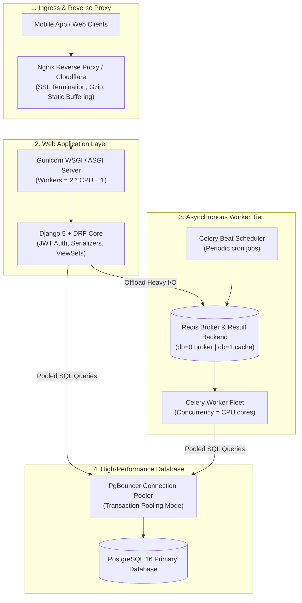

# Django Enterprise Architecture: DRF, Celery & PgBouncer

Django is Python's most mature and battery-included web framework, but out-of-the-box configurations create severe performance bottlenecks under high concurrency: synchronous request-thread blocking, unbound PostgreSQL connection proliferation, and unchecked N+1 database queries.

This blueprint implements an enterprise **Django 5 Production Architecture** leveraging **Django REST Framework (DRF)**, **Celery distributed background workers**, **PgBouncer connection pooling**, and **Gunicorn process supervisors**.

---

## 1. System Architecture



---

## 2. Production Celery Setup & Transaction Safety

A classic production disaster is dispatching a Celery task inside a database transaction before the transaction commits. The worker starts executing immediately, attempts to query the record, and fails because the database row hasn't committed yet.

Always dispatch Celery tasks via `transaction.on_commit()`:

```python
"""
Celery Application Configuration
File: core/celery.py
"""

import os
from celery import Celery

os.environ.setdefault("DJANGO_SETTINGS_MODULE", "core.settings.production")

app = Celery("enterprise_django")

# Load configuration from Django settings using CELERY_ namespace
app.config_from_object("django.conf:settings", namespace="CELERY")

# Auto-discover task modules in all installed apps
app.autodiscover_tasks()

app.conf.update(
    task_serializer="json",
    accept_content=["json"],
    result_serializer="json",
    timezone="UTC",
    enable_utc=True,
    task_track_started=True,
    task_time_limit=300,            # 5 minute hard timeout
    task_soft_time_limit=240,       # 4 minute graceful timeout
    worker_prefetch_multiplier=1,   # Fair scheduling for uneven tasks
    worker_max_tasks_per_child=1000 # Mitigate Python memory leaks
)
```

```python
"""
Reliable Background Task with Exponential Backoff
File: apps/orders/tasks.py
"""

from celery import shared_task
from django.db import transaction
import structlog

logger = structlog.get_logger(__name__)


@shared_task(
    bind=True,
    autoretry_for=(Exception,),
    retry_backoff=True,
    retry_backoff_max=600,
    max_retries=5,
    rate_limit="100/m"
)
def process_order_fulfillment(self, order_id: str):
    """
    Executes order fulfillment asynchronously with exponential retry backoff.
    """
    from apps.orders.models import Order

    logger.info("Starting order fulfillment", order_id=order_id, attempt=self.request.retries)

    with transaction.atomic():
        order = Order.objects.select_for_update().get(id=order_id)
        if order.status == Order.Status.FULFILLED:
            logger.info("Order already fulfilled. Skipping.", order_id=order_id)
            return

        # Perform third-party API fulfillment call
        # ...
        order.status = Order.Status.FULFILLED
        order.save(update_fields=["status", "updated_at"])

    logger.info("Order fulfillment complete", order_id=order_id)
```

```python
"""
Order ViewSet with on_commit Task Dispatch
File: apps/orders/views.py
"""

from rest_framework import viewsets, status
from rest_framework.response import Response
from django.db import transaction
from .models import Order
from .serializers import OrderSerializer
from .tasks import process_order_fulfillment

class OrderViewSet(viewsets.ModelViewSet):
    queryset = Order.objects.all().select_related("user")
    serializer_class = OrderSerializer

    def create(self, request, *args, **kwargs):
        serializer = self.get_serializer(data=request.data)
        serializer.is_valid(raise_exception=True)

        with transaction.atomic():
            order = serializer.save(user=request.user)

            # CRITICAL: Dispatch task ONLY after database transaction commits!
            transaction.on_commit(
                lambda: process_order_fulfillment.delay(str(order.id))
            )

        return Response(serializer.data, status=status.HTTP_201_CREATED)
```

---

## 3. Database Connection Pooling via PgBouncer

Django opens a dedicated TCP database connection for every worker process. With 32 Gunicorn workers and 16 Celery workers, connections quickly exceed PostgreSQL `max_connections` limits. **PgBouncer** sits in front of Postgres, multiplexing hundreds of application workers over a tight pool of 20 physical database connections.

```ini
; /etc/pgbouncer/pgbouncer.ini
[databases]
enterprise_db = host=127.0.0.1 port=5432 dbname=production_db

[pgbouncer]
listen_port = 6432
listen_addr = 0.0.0.0
auth_type = scram-sha-256
auth_file = /etc/pgbouncer/userlist.txt
logfile = /var/log/pgbouncer/pgbouncer.log
pidfile = /var/run/pgbouncer/pgbouncer.pid

; Transaction pooling mode: connection returned immediately after transaction commits
pool_mode = transaction
max_client_conn = 1000
default_pool_size = 20
min_pool_size = 5
reserve_pool_size = 5
reserve_pool_timeout = 5
server_idle_timeout = 600
```

---

## 4. Production Gunicorn Configuration

Save this supervisor configuration under `config/gunicorn.conf.py`:

```python
"""
Gunicorn Production Server Configuration
File: config/gunicorn.conf.py
"""

import multiprocessing

bind = "0.0.0.0:8000"
# Recommended worker formula: 2 * CPU cores + 1
workers = multiprocessing.cpu_count() * 2 + 1
worker_class = "gthread"
threads = 4
worker_connections = 1000
timeout = 30
keepalive = 5

# Memory management: restart workers periodically to prevent leaks
max_requests = 2000
max_requests_jitter = 400

# Logging
accesslog = "-"
errorlog = "-"
loglevel = "info"
capture_output = True
enable_stdio_inheritance = True
```

---

## 5. Production Hardening Checklist

- [ ] **Eliminate N+1 Queries**: Never loop through foreign key relations in DRF serializers without `select_related()` (for 1-to-1 and ForeignKey) or `prefetch_related()` (for ManyToMany). Use `django-silk` in staging to profile query counts.
- [ ] **Enforce `CONN_MAX_AGE`**: When using PgBouncer in transaction mode, set `CONN_MAX_AGE = 0` in `DATABASES["default"]` to prevent client-side prepared statement conflicts.
- [ ] **Secure Cookie Policies**: Set `SESSION_COOKIE_SECURE = True`, `CSRF_COOKIE_SECURE = True`, and `SECURE_HSTS_SECONDS = 31536000` to prevent session hijacking.
- [ ] **Structured JSON Logging**: Replace standard text logs with `structlog` formatting JSON logs with trace IDs for seamless ingestion into Datadog, Grafana Loki, or Elasticsearch.
