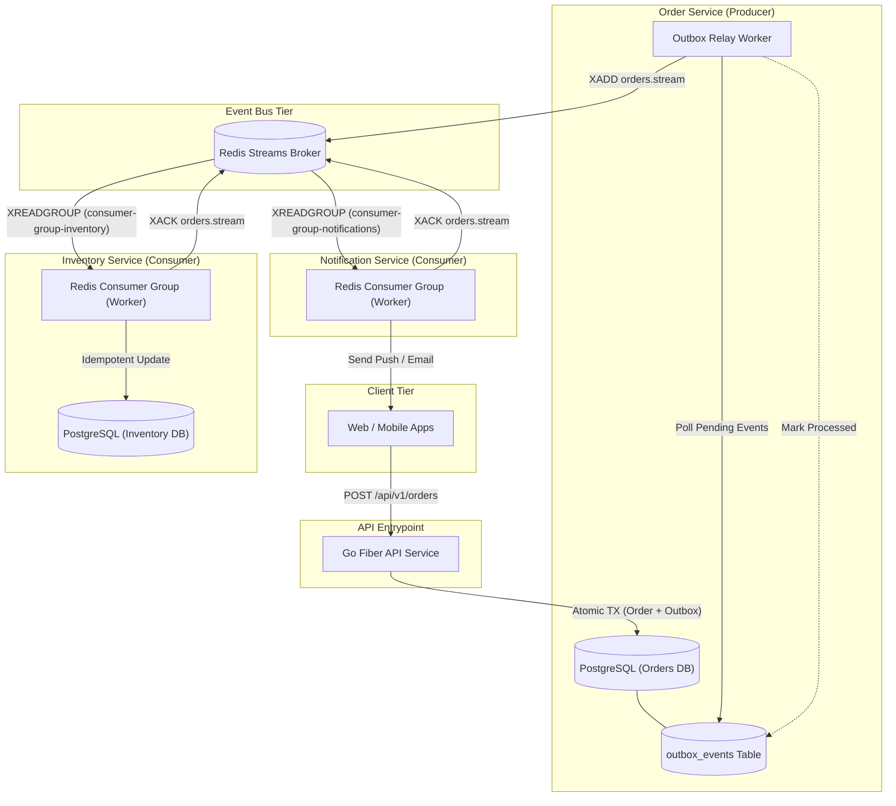

# 🚀 Go (Fiber) & Redis Event-Driven Microservices Architecture

An enterprise architectural blueprint for building high-throughput, low-latency microservices using **Go (Fiber v3)**, **Redis Streams (Event Bus)**, **PostgreSQL (Database-per-Service)**, and the **Transactional Outbox Pattern**.

---

## 1. System Overview & Problem Statement

Synchronous REST or RPC chains across microservices create tight coupling, cascading latency, and single points of failure. This architecture pattern solves that with:
- **High-Concurrency Ingestion (Go Fiber):** Minimal HTTP allocation footprint leveraging `fasthttp` under the hood.
- **Asynchronous Event Spine (Redis Streams):** Real-time consumer groups with at-least-once delivery, consumer offset acknowledgments, and message persistence.
- **Database-per-Service (PostgreSQL):** Isolated domain schemas ensuring loose coupling.
- **Transactional Outbox Pattern:** Zero dual-write failures (guarantees DB transaction and event emission succeed atomically).

---

## 2. High-Level Architecture Flow



---

## 3. Recommended Hexagonal Clean Architecture Directory

Every service in the cluster implements a clean port-and-adapter layout:

```text
order-service/
├── cmd/
│   └── api/
│       └── main.go          # Bootstrap, DI wire-up, graceful shutdown
├── internal/
│   ├── domain/              # Pure business entities & interfaces (Zero external imports)
│   │   ├── order.go
│   │   └── repository.go
│   ├── usecase/             # Application rules (CreateOrder, CancelOrder)
│   │   └── order_usecase.go
│   ├── delivery/
│   │   └── http/            # Go Fiber handlers, routes & input validators
│   │       └── order_handler.go
│   └── repository/          # PostgreSQL (pgx) + Redis Outbox implementations
│       ├── postgres_order.go
│       └── outbox_worker.go
├── migrations/              # SQL DDL migrations
├── Dockerfile
└── go.mod
```

---

## 4. Database Schema: Transactional Outbox (`migrations/001_orders.sql`)

```sql
-- 1. Orders Domain Table
CREATE TABLE orders (
    id UUID PRIMARY KEY DEFAULT gen_random_uuid(),
    customer_id UUID NOT NULL,
    total_amount NUMERIC(12, 2) NOT NULL,
    status VARCHAR(32) NOT NULL DEFAULT 'PENDING',
    created_at TIMESTAMP WITH TIME ZONE DEFAULT NOW()
);

-- 2. Transactional Outbox Table
CREATE TABLE outbox_events (
    id UUID PRIMARY KEY DEFAULT gen_random_uuid(),
    aggregate_type VARCHAR(64) NOT NULL, -- e.g. 'Order'
    aggregate_id UUID NOT NULL,
    event_type VARCHAR(64) NOT NULL,     -- e.g. 'OrderCreated'
    payload JSONB NOT NULL,
    status VARCHAR(16) NOT NULL DEFAULT 'PENDING', -- 'PENDING', 'PROCESSED', 'FAILED'
    retry_count INT NOT NULL DEFAULT 0,
    created_at TIMESTAMP WITH TIME ZONE DEFAULT NOW(),
    processed_at TIMESTAMP WITH TIME ZONE
);

CREATE INDEX idx_outbox_pending ON outbox_events(status, created_at) WHERE status = 'PENDING';
```

---

## 5. Go Fiber Producer Implementation (`order_handler.go`)

### Atomic Transaction (Order + Outbox)

```go
package http

import (
    "context"
    "encoding/json"
    "github.com/gofiber/fiber/v2"
    "github.com/jackc/pgx/v5/pgxpool"
    "github.com/google/uuid"
)

type CreateOrderRequest struct {
    CustomerID  string  `json:"customer_id" validate:"required"`
    TotalAmount float64 `json:"total_amount" validate:"required,gt=0"`
}

type OrderHandler struct {
    dbPool *pgxpool.Pool
}

func NewOrderHandler(pool *pgxpool.Pool) *OrderHandler {
    return &OrderHandler{dbPool: pool}
}

func (h *OrderHandler) CreateOrder(c *fiber.Ctx) error {
    var req CreateOrderRequest
    if err := c.BodyParser(&req); err != nil {
        return c.Status(fiber.StatusBadRequest).JSON(fiber.Map{"error": "Invalid request body"})
    }

    ctx := context.Background()
    tx, err := h.dbPool.Begin(ctx)
    if err != nil {
        return c.Status(fiber.StatusInternalServerError).JSON(fiber.Map{"error": "Failed to start transaction"})
    }
    defer tx.Rollback(ctx)

    // 1. Insert Order
    orderID := uuid.New()
    _, err = tx.Exec(ctx,
        `INSERT INTO orders (id, customer_id, total_amount, status) VALUES ($1, $2, $3, 'PENDING')`,
        orderID, req.CustomerID, req.TotalAmount,
    )
    if err != nil {
        return c.Status(fiber.StatusInternalServerError).JSON(fiber.Map{"error": "Could not insert order"})
    }

    // 2. Insert Outbox Event (Atomic inside SAME transaction)
    eventPayload, _ := json.Marshal(map[string]interface{}{
        "order_id":     orderID,
        "customer_id":  req.CustomerID,
        "total_amount": req.TotalAmount,
    })

    _, err = tx.Exec(ctx,
        `INSERT INTO outbox_events (aggregate_type, aggregate_id, event_type, payload) VALUES ($1, $2, $3, $4)`,
        "Order", orderID, "OrderCreated", eventPayload,
    )
    if err != nil {
        return c.Status(fiber.StatusInternalServerError).JSON(fiber.Map{"error": "Could not register outbox event"})
    }

    if err := tx.Commit(ctx); err != nil {
        return c.Status(fiber.StatusInternalServerError).JSON(fiber.Map{"error": "Transaction commit failed"})
    }

    return c.Status(fiber.StatusCreated).JSON(fiber.Map{
        "status":   "success",
        "order_id": orderID,
    })
}
```

---

## 6. Redis Streams Outbox Publisher & Consumer

### Outbox Relay Worker (Publisher)

```go
package worker

import (
    "context"
    "time"
    "github.com/jackc/pgx/v5/pgxpool"
    "github.com/redis/go-redis/v9"
)

func StartOutboxRelay(ctx context.Context, db *pgxpool.Pool, rdb *redis.Client) {
    ticker := time.NewTicker(250 * time.Millisecond)
    defer ticker.Stop()

    for {
        select {
        case <-ctx.Done():
            return
        case <-ticker.C:
            processPendingOutbox(ctx, db, rdb)
        }
    }
}

func processPendingOutbox(ctx context.Context, db *pgxpool.Pool, rdb *redis.Client) {
    rows, err := db.Query(ctx, `
        SELECT id, event_type, payload 
        FROM outbox_events 
        WHERE status = 'PENDING' 
        ORDER BY created_at ASC 
        LIMIT 50 FOR UPDATE SKIP LOCKED
    `)
    if err != nil {
        return
    }
    defer rows.Close()

    for rows.Next() {
        var eventID string
        var eventType string
        var payload []byte
        if err := rows.Scan(&eventID, &eventType, &payload); err != nil {
            continue
        }

        // Publish to Redis Stream
        err = rdb.XAdd(ctx, &redis.XAddArgs{
            Stream: "orders.events",
            Values: map[string]interface{}{
                "event_id":   eventID,
                "event_type": eventType,
                "data":       string(payload),
            },
        }).Err()

        if err == nil {
            db.Exec(ctx, `UPDATE outbox_events SET status = 'PROCESSED', processed_at = NOW() WHERE id = $1`, eventID)
        }
    }
}
```

### Stream Consumer Group (Inventory Service)

```go
package consumer

import (
    "context"
    "fmt"
    "time"
    "github.com/redis/go-redis/v9"
)

func ConsumeOrderEvents(ctx context.Context, rdb *redis.Client, consumerID string) {
    // 1. Ensure consumer group exists
    rdb.XGroupCreateMkStream(ctx, "orders.events", "inventory-group", "0").Err()

    for {
        select {
        case <-ctx.Done():
            return
        default:
            streams, err := rdb.XReadGroup(ctx, &redis.XReadGroupArgs{
                Group:    "inventory-group",
                Consumer: consumerID,
                Streams:  []string{"orders.events", ">"},
                Count:    10,
                Block:    2 * time.Second,
            }).Result()

            if err != nil {
                continue
            }

            for _, stream := range streams {
                for _, message := range stream.Messages {
                    // 2. Process idempotently
                    fmt.Printf("Processing Event: %s, Payload: %v\n", message.ID, message.Values)
                    
                    // 3. Acknowledge message upon successful processing
                    rdb.XAck(ctx, "orders.events", "inventory-group", message.ID)
                }
            }
        }
    }
}
```

---

## 7. Production Hardening & Observability

1. **Idempotency Safeguard:** Consumers must maintain a `processed_events (event_id UNIQUE)` table to guard against duplicate deliveries during consumer crash restarts.
2. **Dead-Letter Streams (DLQ):** Messages exceeding max retry thresholds should be written to `orders.events.dlq` for operator investigation rather than blocking the stream.
3. **Structured Logging:** Use Go 1.21+ native `log/slog` with JSON formatting to correlate logs using a unified `trace_id`.
4. **Graceful Shutdown:** Capture `os.Interrupt` and `syscall.SIGTERM` to allow Fiber to finish active HTTP requests and consumer workers to complete their inflight message batches before closing DB connection pools.
