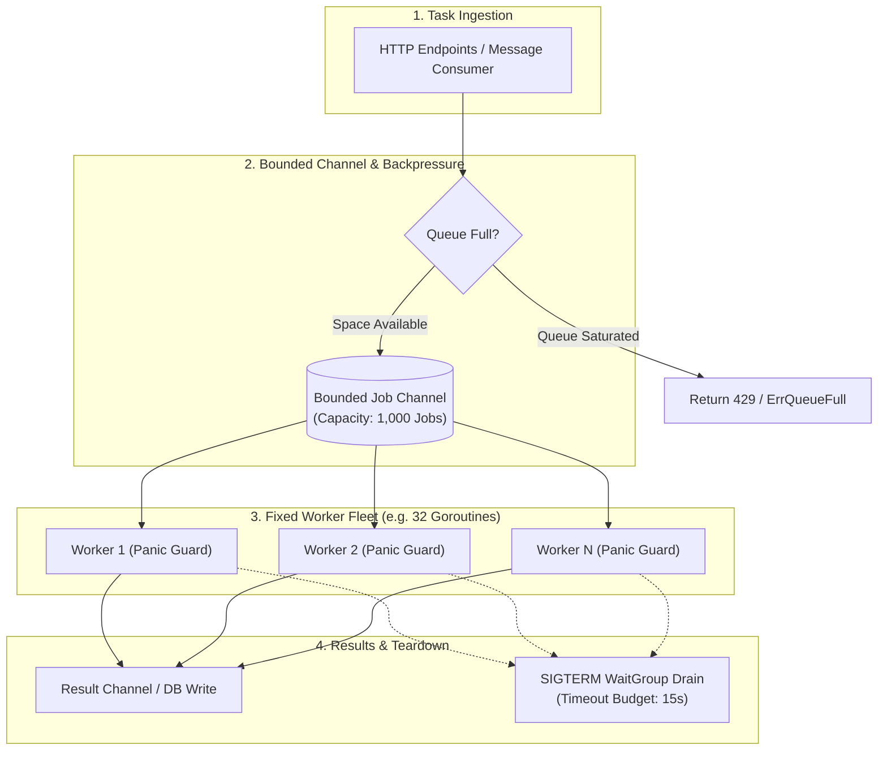

# Go High-Concurrency Bounded Worker Pool

<div style={{ display: 'flex', gap: '8px', flexWrap: 'wrap', margin: '1rem 0 2rem 0' }}>
  <span style={{ background: 'rgba(6, 182, 212, 0.15)', border: '1px solid rgba(6, 182, 212, 0.4)', borderRadius: '6px', padding: '3px 10px', fontSize: '12px', fontWeight: 700, color: '#00f0ff' }}>Go 1.22+</span>
  <span style={{ background: 'rgba(139, 92, 246, 0.15)', border: '1px solid rgba(139, 92, 246, 0.4)', borderRadius: '6px', padding: '3px 10px', fontSize: '12px', fontWeight: 700, color: '#c084fc' }}>Generics [TJob, TResult]</span>
  <span style={{ background: 'rgba(16, 185, 129, 0.15)', border: '1px solid rgba(16, 185, 129, 0.4)', borderRadius: '6px', padding: '3px 10px', fontSize: '12px', fontWeight: 700, color: '#34d399' }}>🟢 Production Ready</span>
  <span style={{ background: 'rgba(255, 255, 255, 0.06)', border: '1px solid rgba(255, 255, 255, 0.15)', borderRadius: '6px', padding: '3px 10px', fontSize: '12px', fontFamily: 'monospace', color: '#cbd5e1' }}>npx software-blueprints add backend-go-worker-pool</span>
</div>

Spawning uncontrolled goroutines (`go process(req)`) for every incoming request is a classic Go anti-pattern that leads to Out-Of-Memory (OOM) crashes under spike loads and connection exhaustion on downstream databases.

This blueprint implements a **production-grade Bounded Worker Pool** in Go utilizing modern Generics, configurable queue backpressure, worker-level panic isolation, and graceful shutdown draining upon receiving `SIGTERM`/`SIGINT`.

---

## 1. System Architecture



---

## 2. Production Code Implementation (`pkg/workerpool/pool.go`)

Save this generic, self-contained worker pool package:

```go
package workerpool

import (
	"context"
	"errors"
	"fmt"
	"log"
	"sync"
	"sync/atomic"
	"time"
)

var (
	ErrPoolStopped = errors.New("worker pool has been stopped")
	ErrQueueFull   = errors.New("worker pool job queue is saturated (backpressure)")
)

// Task represents a discrete unit of execution.
type Task[TJob any, TResult any] struct {
	ID      string
	Payload TJob
	Execute func(ctx context.Context, payload TJob) (TResult, error)
}

// Result captures the outcome or panic from task execution.
type Result[TResult any] struct {
	TaskID    string
	Data      TResult
	Err       error
	Duration  time.Duration
}

// Config defines worker pool parameters.
type Config struct {
	Workers   int           // Number of parallel worker goroutines
	QueueSize int           // Bounded buffer capacity
	Timeout   time.Duration // Per-task execution deadline
}

// Pool coordinates worker execution.
type Pool[TJob any, TResult any] struct {
	cfg        Config
	tasks      chan Task[TJob, TResult]
	results    chan Result[TResult]
	wg         sync.WaitGroup
	ctx        context.Context
	cancel     context.CancelFunc
	isStopped  atomic.Bool
	activeJobs atomic.Int64
}

// NewPool initializes and immediately starts worker goroutines.
func NewPool[TJob any, TResult any](cfg Config) *Pool[TJob, TResult] {
	if cfg.Workers <= 0 {
		cfg.Workers = 16
	}
	if cfg.QueueSize <= 0 {
		cfg.QueueSize = 1000
	}
	if cfg.Timeout <= 0 {
		cfg.Timeout = 30 * time.Second
	}

	ctx, cancel := context.WithCancel(context.Background())

	p := &Pool[TJob, TResult]{
		cfg:     cfg,
		tasks:   make(chan Task[TJob, TResult], cfg.QueueSize),
		results: make(chan Result[TResult], cfg.QueueSize),
		ctx:     ctx,
		cancel:  cancel,
	}

	// Launch worker fleet
	for i := 0; i < p.cfg.Workers; i++ {
		p.wg.Add(1)
		go p.workerLoop(i)
	}

	return p
}

// Submit enqueues a task. Non-blocking when queue is full (backpressure rejection).
func (p *Pool[TJob, TResult]) Submit(task Task[TJob, TResult]) error {
	if p.isStopped.Load() {
		return ErrPoolStopped
	}

	select {
	case p.tasks <- task:
		p.activeJobs.Add(1)
		return nil
	default:
		return ErrQueueFull // Immediately trigger 429 Too Many Requests
	}
}

// Results exposes the output stream.
func (p *Pool[TJob, TResult]) Results() <-chan Result[TResult] {
	return p.results
}

// workerLoop executes in dedicated worker goroutines.
func (p *Pool[TJob, TResult]) workerLoop(workerID int) {
	defer p.wg.Done()

	for {
		select {
		case <-p.ctx.Done():
			// Drain remaining tasks before exiting
			p.drainTasks(workerID)
			return

		case task, ok := <-p.tasks:
			if !ok {
				return
			}
			p.runTaskSafely(workerID, task)
		}
	}
}

// runTaskSafely executes the task with panic recovery and strict timeouts.
func (p *Pool[TJob, TResult]) runTaskSafely(workerID int, task Task[TJob, TResult]) {
	defer p.activeJobs.Add(-1)
	start := time.Now()

	// Panic isolation guard: a crashed task must never bring down the worker fleet!
	defer func() {
		if r := recover(); r != nil {
			err := fmt.Errorf("worker %d panicked during task %s: %v", workerID, task.ID, r)
			log.Printf("[ERROR] %v", err)
			p.results <- Result[TResult]{
				TaskID:   task.ID,
				Err:      err,
				Duration: time.Since(start),
			}
		}
	}()

	taskCtx, taskCancel := context.WithTimeout(p.ctx, p.cfg.Timeout)
	defer taskCancel()

	data, err := task.Execute(taskCtx, task.Payload)

	p.results <- Result[TResult]{
		TaskID:   task.ID,
		Data:     data,
		Err:      err,
		Duration: time.Since(start),
	}
}

// drainTasks finishes items remaining in buffer during shutdown.
func (p *Pool[TJob, TResult]) drainTasks(workerID int) {
	for {
		select {
		case task, ok := <-p.tasks:
			if !ok {
				return
			}
			p.runTaskSafely(workerID, task)
		default:
			return
		}
	}
}

// Shutdown initiates graceful termination and blocks until workers drain.
func (p *Pool[TJob, TResult]) Shutdown(timeout time.Duration) error {
	if !p.isStopped.CompareAndSwap(false, true) {
		return nil
	}

	close(p.tasks)

	// Wait for workers to finish current in-flight tasks
	done := make(chan struct{})
	go func() {
		p.wg.Wait()
		close(p.results)
		close(done)
	}()

	select {
	case <-done:
		p.cancel()
		return nil
	case <-time.After(timeout):
		p.cancel() // Force cancel remaining hung jobs
		return errors.New("worker pool shutdown timed out; forced cancel")
	}
}
```

---

## 3. Usage Example & Graceful OS Shutdown

```go
package main

import (
	"context"
	"fmt"
	"log"
	"os"
	"os/signal"
	"syscall"
	"time"

	"yourproject/pkg/workerpool"
)

type ImageJob struct {
	ImageURL string
	Width    int
	Height   int
}

type ImageResult struct {
	TranscodedPath string
	BytesWritten   int64
}

func main() {
	// Configure: 8 Workers, 500-task buffer, 5s per-task timeout
	pool := workerpool.NewPool[ImageJob, ImageResult](workerpool.Config{
		Workers:   8,
		QueueSize: 500,
		Timeout:   5 * time.Second,
	})

	// Background consumer for results
	go func() {
		for res := range pool.Results() {
			if res.Err != nil {
				log.Printf("Task %s failed: %v", res.TaskID, res.Err)
			} else {
				log.Printf("Task %s finished in %v: %s", res.TaskID, res.Duration, res.Data.TranscodedPath)
			}
		}
	}()

	// Enqueue tasks
	for i := 1; i <= 20; i++ {
		taskID := fmt.Sprintf("job-%d", i)
		err := pool.Submit(workerpool.Task[ImageJob, ImageResult]{
			ID: taskID,
			Payload: ImageJob{
				ImageURL: fmt.Sprintf("https://s3.amazonaws.com/uploads/raw_%d.png", i),
				Width:    1080,
				Height:   1080,
			},
			Execute: func(ctx context.Context, job ImageJob) (ImageResult, error) {
				// Simulated intensive processing
				time.Sleep(100 * time.Millisecond)
				return ImageResult{
					TranscodedPath: fmt.Sprintf("/storage/processed_%s.webp", taskID),
					BytesWritten:   450210,
				}, nil
			},
		})
		if err != nil {
			log.Printf("Enqueue failed (backpressure): %v", err)
		}
	}

	// Wait for OS Interrupt (SIGINT / SIGTERM)
	sigChan := make(chan os.Signal, 1)
	signal.Notify(sigChan, os.Interrupt, syscall.SIGTERM)
	<-sigChan

	log.Println("Received termination signal, draining workers...")
	if err := pool.Shutdown(10 * time.Second); err != nil {
		log.Fatalf("Shutdown error: %v", err)
	}
	log.Println("All workers terminated cleanly.")
}
```

---

## 4. Production Hardening Checklist

| Verification Item | Target Standard | Failure Mode Prevented |
| :--- | :--- | :--- |
| **Panic Recovery** | Dedicated `defer recover()` per worker task | A single `nil` pointer dereference in a task will never crash the host service |
| **Bounded Backpressure** | `select { case tasks <- t: default: return ErrQueueFull }` | Prevents OOM memory inflation during traffic spikes |
| **Task Deadline Enforcement** | `context.WithTimeout` attached to each task | Prevents hung network calls from locking worker goroutines forever |
| **Graceful Drain Budget** | Channel close + `sync.WaitGroup` with fallback timeout | Prevents half-written transactions and corrupted file outputs on deploy |
