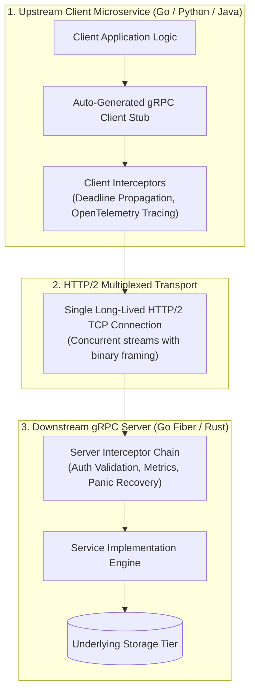

# gRPC & Protocol Buffers High-Performance IPC

For high-volume inter-service communication (East-West microservice traffic), traditional JSON over HTTP/1.1 introduces massive computational overhead: verbose string parsing, repeated TCP handshakes, head-of-line blocking, and lack of strict contract enforcement.

**gRPC** paired with **Protocol Buffers (Proto3)** eliminates these bottlenecks by serializing data into compact binary payloads, multiplexing hundreds of concurrent requests over a single long-lived **HTTP/2 TCP connection**, and providing first-class client and server streaming.

---

## 1. System Architecture



---

## 2. Protocol Buffers (Proto3) Service Definition

Save this interface specification under `proto/order/v1/order_service.proto`:

```protobuf
syntax = "proto3";

package order.v1;

option go_package = "github.com/enterprise/proto/order/v1;orderv1";

service OrderService {
  // Unary RPC: Single request -> Single response
  rpc CreateOrder (CreateOrderRequest) returns (CreateOrderResponse);

  // Server Streaming RPC: Single request -> Stream of status updates
  rpc TrackOrderStream (TrackOrderRequest) returns (stream OrderStatusUpdate);
}

enum OrderStatus {
  ORDER_STATUS_UNSPECIFIED = 0;
  ORDER_STATUS_PENDING = 1;
  ORDER_STATUS_PROCESSING = 2;
  ORDER_STATUS_SHIPPED = 3;
  ORDER_STATUS_DELIVERED = 4;
}

message OrderItem {
  string sku = 1;
  int32 quantity = 2;
  int64 price_cents = 3;
}

message CreateOrderRequest {
  string customer_id = 1;
  repeated OrderItem items = 2;
  string idempotency_key = 3;
}

message CreateOrderResponse {
  string order_id = 1;
  OrderStatus status = 2;
  int64 total_cents = 3;
  int64 created_at_unix = 4;
}

message TrackOrderRequest {
  string order_id = 1;
}

message OrderStatusUpdate {
  string order_id = 1;
  OrderStatus status = 2;
  string message = 3;
  int64 timestamp_unix = 4;
}
```

---

## 3. Production Go gRPC Server with Interceptors

```go
// cmd/server/main.go
package main

import (
	"context"
	"fmt"
	"log"
	"net"
	"time"

	orderv1 "github.com/enterprise/proto/order/v1"
	"google.golang.org/grpc"
	"google.golang.org/grpc/codes"
	"google.golang.org/grpc/keepalive"
	"google.golang.org/grpc/reflection"
	"google.golang.org/grpc/status"
)

type OrderServer struct {
	orderv1.UnimplementedOrderServiceServer
}

func (s *OrderServer) CreateOrder(ctx context.Context, req *orderv1.CreateOrderRequest) (*orderv1.CreateOrderResponse, error) {
	// Respect caller deadline / cancellation!
	if ctx.Err() == context.Canceled {
		return nil, status.Error(codes.Canceled, "client cancelled request")
	}

	if req.CustomerId == "" {
		return nil, status.Error(codes.InvalidArgument, "customer_id is required")
	}

	var totalCents int64
	for _, item := range req.Items {
		totalCents += int64(item.Quantity) * item.PriceCents
	}

	return &orderv1.CreateOrderResponse{
		OrderId:        fmt.Sprintf("ord_%d", time.Now().UnixNano()),
		Status:         orderv1.OrderStatus_ORDER_STATUS_PENDING,
		TotalCents:     totalCents,
		CreatedAtUnix: time.Now().Unix(),
	}, nil
}

// Unary Interceptor: Panic recovery & execution latency measurement
func UnaryServerInterceptor() grpc.UnaryServerInterceptor {
	return func(ctx context.Context, req any, info *grpc.UnaryServerInfo, handler grpc.UnaryHandler) (resp any, err error) {
		start := time.Now()

		defer func() {
			if r := recover(); r != nil {
				err = status.Errorf(codes.Internal, "panic recovered: %v", r)
			}
		}()

		resp, err = handler(ctx, req)
		log.Printf("[gRPC] Method=%s Duration=%v Error=%v", info.FullMethod, time.Since(start), err)
		return resp, err
	}
}

func main() {
	lis, err := net.Listen("tcp", ":50051")
	if err != nil {
		log.Fatalf("failed to listen: %v", err)
	}

	// High-scale keepalive settings to prevent load balancer timeouts
	serverOptions := []grpc.ServerOption{
		grpc.UnaryInterceptor(UnaryServerInterceptor()),
		grpc.KeepaliveParams(keepalive.ServerParameters{
			MaxConnectionIdle:     15 * time.Second,
			MaxConnectionAge:      30 * time.Second,
			Time:                  5 * time.Second,
			Timeout:               1 * time.Second,
		}),
	}

	grpcServer := grpc.NewServer(serverOptions...)
	orderv1.RegisterOrderServiceServer(grpcServer, &OrderServer{})
	reflection.Register(grpcServer) // Enable gRPC reflection for Evans/grpcurl debugging

	log.Println("gRPC Server listening on :50051...")
	if err := grpcServer.Serve(lis); err != nil {
		log.Fatalf("failed to serve: %v", err)
	}
}
```

---

## 4. Client with Deadline Propagation

In distributed call trees, never execute a gRPC request without an explicit deadline. If Service A has a 5-second timeout, all downstream calls to Service B and C must inherit the remaining budget:

```go
// pkg/client/order_client.go
package client

import (
	"context"
	"time"

	orderv1 "github.com/enterprise/proto/order/v1"
	"google.golang.org/grpc"
	"google.golang.org/grpc/credentials/insecure"
)

func CallCreateOrder(ctx context.Context, client orderv1.OrderServiceClient) (*orderv1.CreateOrderResponse, error) {
	// Propagate 3-second strict deadline
	callCtx, cancel := context.WithTimeout(ctx, 3*time.Second)
	defer cancel()

	req := &orderv1.CreateOrderRequest{
		CustomerId: "cust_9921",
		Items: []*orderv1.OrderItem{
			{Sku: "SKU-H100-80G", Quantity: 2, PriceCents: 3000000},
		},
	}

	return client.CreateOrder(callCtx, req)
}
```

---

## 5. Production Hardening Checklist

- [ ] **Configure Keepalive Pings**: Cloud load balancers (AWS ALB / NLB) terminate idle TCP connections after 60 to 350 seconds. Configure client keepalive pings (`keepalive.ClientParameters{Time: 10 * time.Second}`) to keep persistent channels alive.
- [ ] **Set Max Message Size**: gRPC defaults to a 4MB maximum inbound message limit (`MaxCallRecvMsgSize`). For large telemetry transfers, explicitly tune this limit on both client and server stubs.
- [ ] **Always Use Deadlines**: Never call `client.Method(context.Background(), ...)` without a deadline. Network partitions will cause client goroutines/threads to block forever, exhausting thread pools.
- [ ] **gRPC-Health-Checking-Protocol**: Implement standard gRPC health checks (`grpc.health.v1.Health`) so Kubernetes probes can intelligently route around initializing or saturated pods.
