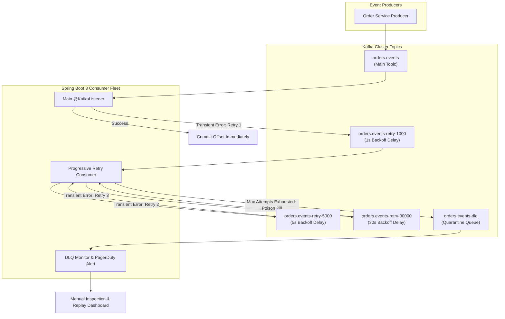

# Spring Boot & Kafka Resilient Consumer with Dead-Letter Queue (DLQ)

Naive Kafka consumers that retry processing errors in-place block the entire partition. Because Kafka partitions enforce strict sequential ordering, a single unprocessable **poison pill message** stalls all subsequent messages for that partition, causing consumer lag to skyrocket.

This blueprint implements a production-grade **Non-Blocking Retry & Dead-Letter Queue (DLQ)** pattern using Spring Boot 3 and Java 21 Virtual Threads. Failing messages are progressively forwarded to dedicated retry topics with exponential backoff delays, allowing the main consumer thread to continue processing healthy messages at line speed.

---

## 1. Non-Blocking Retry & DLQ Topic Topology



---

## 2. In-Place Blocking Retries vs Non-Blocking Retry Topics

| Dimension | In-Place Blocking Retry (`Thread.sleep()`) | Non-Blocking Progressive Retry Topics |
| :--- | :--- | :--- |
| **Partition Throughput** | **Zero:** Partition is blocked until error clears | **Line Speed:** Healthy events processed immediately |
| **Consumer Lag Impact** | Massive: Lag accumulates across thousands of upstream messages | Zero: Poisonous message forwarded off main topic path |
| **Rebalance Storms** | High: `max.poll.interval.ms` exceeded, kicking consumer from group | **Zero:** Consumer polls continuously without delay |
| **Backoff Precision** | Coarse; blocks worker thread | **Exact:** Handled via Kafka delayed message headers |
| **Observability** | Invisible; errors buried in application logs | **Transparent:** Lag and message count visible per retry topic in Prometheus |

---

## 3. Production Spring Boot 3 Implementation

Below is a complete Spring Boot 3 implementation using `@RetryableTopic`, configuring non-blocking retry topics, backoff multipliers, and dead-letter publishing:

```java
package dev.softwareblueprints.kafka;

import org.apache.kafka.clients.consumer.ConsumerRecord;
import org.slf4j.Logger;
import org.slf4j.LoggerFactory;
import org.springframework.boot.SpringApplication;
import org.springframework.boot.autoconfigure.SpringBootApplication;
import org.springframework.context.annotation.Bean;
import org.springframework.context.annotation.Configuration;
import org.springframework.dao.TransientDataAccessException;
import org.springframework.kafka.annotation.DltHandler;
import org.springframework.kafka.annotation.EnableKafka;
import org.springframework.kafka.annotation.KafkaListener;
import org.springframework.kafka.annotation.RetryableTopic;
import org.springframework.kafka.core.KafkaTemplate;
import org.springframework.kafka.listener.DeadLetterPublishingRecoverer;
import org.springframework.kafka.listener.DefaultErrorHandler;
import org.springframework.kafka.retrytopic.TopicSuffixingStrategy;
import org.springframework.kafka.support.Acknowledgment;
import org.springframework.kafka.support.KafkaHeaders;
import org.springframework.messaging.handler.annotation.Header;
import org.springframework.retry.annotation.Backoff;
import org.springframework.stereotype.Service;
import org.springframework.util.backoff.FixedBackOff;

import java.time.Instant;

@SpringBootApplication
@EnableKafka
public class KafkaDlqApplication {
    public static void main(String[] args) {
        SpringApplication.run(KafkaDlqApplication.class, args);
    }
}

record OrderEvent(String orderId, String customerId, double amount, String status, Instant timestamp) {}

@Service
class OrderEventListener {
    private static final Logger log = LoggerFactory.getLogger(OrderEventListener.class);

    @RetryableTopic(
        attempts = "4",
        backoff = @Backoff(delay = 1000, multiplier = 2.0, maxDelay = 10000),
        topicSuffixingStrategy = TopicSuffixingStrategy.SUFFIX_WITH_DELAY_VALUE,
        include = { TransientDataAccessException.class, RuntimeException.class },
        dltTopicSuffix = "-dlq"
    )
    @KafkaListener(
        topics = "orders.events",
        groupId = "order-fulfillment-group",
        containerFactory = "kafkaListenerContainerFactory"
    )
    public void handleOrderEvent(
        OrderEvent event,
        Acknowledgment ack,
        @Header(KafkaHeaders.RECEIVED_TOPIC) String topic,
        @Header(KafkaHeaders.RECEIVED_PARTITION) int partition,
        @Header(KafkaHeaders.OFFSET) long offset
    ) {
        log.info("Processing Order {} from topic {} [partition={}, offset={}]", 
            event.orderId(), topic, partition, offset);

        // Simulated Business Validation
        if ("INVALID_SKU".equals(event.status())) {
            throw new IllegalArgumentException("Fatal poison pill: Order " + event.orderId() + " has invalid SKU");
        }

        // Simulated Database Down / Transient Error
        if (event.amount() > 10000.0 && !topic.contains("retry")) {
            throw new TransientDataAccessException("Temporary database timeout verifying high-value order");
        }

        log.info("Successfully fulfilled Order {}", event.orderId());
        ack.acknowledge(); // Manual Immediate Offset Commit
    }

    @DltHandler
    public void handleDeadLetterQueue(
        OrderEvent event,
        @Header(KafkaHeaders.RECEIVED_TOPIC) String topic,
        @Header(KafkaHeaders.EXCEPTION_MESSAGE) String errorMsg
    ) {
        log.error("CRITICAL: Message quarantined in DLQ topic {} for Order {}. Root cause: {}", 
            topic, event.orderId(), errorMsg);
        
        // In production: Persist to database quarantine table and fire PagerDuty alert
    }
}

@Configuration
class KafkaConsumerConfig {
    @Bean
    public DefaultErrorHandler defaultErrorHandler(KafkaTemplate<String, Object> template) {
        DeadLetterPublishingRecoverer recoverer = new DeadLetterPublishingRecoverer(template);
        // Fallback policy: 1 fixed retry before sending to recovery
        return new DefaultErrorHandler(recoverer, new FixedBackOff(1000L, 1L));
    }
}
```

---

## 4. PostgreSQL Idempotency Deduplication Ledger

Because Kafka guarantees **at-least-once** delivery, network retries can deliver duplicates. A dedicated deduplication ledger guarantees idempotent processing:

```sql
-- Idempotent Consumer Offset & Event Ledger
CREATE TABLE kafka_processed_events (
    event_id VARCHAR(128) PRIMARY KEY,
    consumer_group VARCHAR(64) NOT NULL,
    topic VARCHAR(128) NOT NULL,
    partition_id INT NOT NULL,
    kafka_offset BIGINT NOT NULL,
    processed_at TIMESTAMPTZ NOT NULL DEFAULT NOW()
);

CREATE INDEX idx_kafka_group_topic ON kafka_processed_events(consumer_group, topic);
```

---

## 5. Production Hardening Checklist

| Operational Vector | Recommended Practice | Failure Mode If Ignored |
| :--- | :--- | :--- |
| **Max Delay Ceiling** | Set `@Backoff(maxDelay = 60000)` to cap progressive retry intervals | Unbounded exponential backoff delays poison recovery for hours |
| **Deduplication Check** | Perform `INSERT ... ON CONFLICT DO NOTHING` into the event ledger inside the same local DB transaction | Reprocessing duplicate payment events triggers multiple charges |
| **Exclude Fatal Exceptions** | Exclude validation errors (`MethodArgumentNotValidException`, `JsonParseException`) from retries; route directly to DLQ | Malformed JSON retries 4 times pointlessly, wasting CPU and broker I/O |
| **DLQ Retention Period** | Set `retention.ms = 1209600000` (14 days) on all `-dlq` topics | Poison messages expire and are deleted before engineers can inspect or replay |
| **Manual Ack Configuration** | Set `spring.kafka.listener.ack-mode = manual_immediate` | Batch auto-commit records offsets before business logic finishes |
