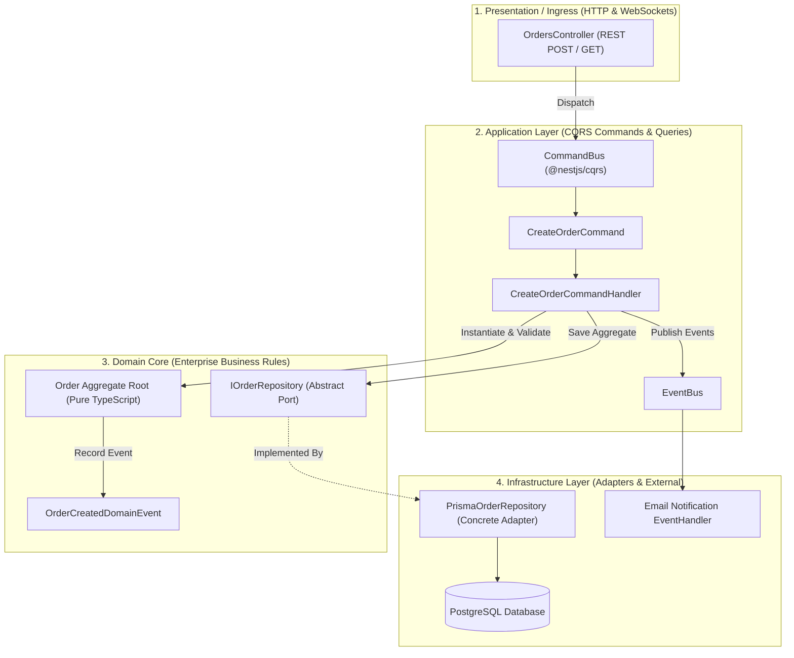

# NestJS Enterprise Clean Architecture & CQRS

As Node.js and TypeScript backends grow in scale, traditional "anemic" 3-tier architectures (Controller -> Service -> ORM) degrade into spaghetti code. Business rules leak into HTTP controllers, database schemas dictate domain models, and testing becomes nearly impossible without mocking massive database state.

This blueprint implements **Enterprise Clean Architecture with CQRS** in NestJS:
- **Dependency Inversion:** High-level domain logic has zero dependencies on NestJS decorators, HTTP frameworks, or Prisma ORM.
- **CQRS Segregation:** Write commands (which enforce domain invariants and state changes) are separated from read queries (which execute optimized projections).
- **Domain Event Bus:** Side effects (sending emails, audit logging, webhook dispatches) execute asynchronously via decoupled domain events.

---

## 1. Layered Clean Architecture & CQRS Flow



---

## 2. Anemic MVC vs Clean Architecture with CQRS

| Dimension | Anemic MVC (Controller -> Service -> DB) | Clean Architecture + CQRS |
| :--- | :--- | :--- |
| **Domain Logic Location** | Scattered across services, ORM hooks, and controllers | **Encapsulated:** Pure domain entity aggregate root methods |
| **Database Coupling** | Domain models are coupled to database tables | **Inverted:** Domain models define interface; DB adapts |
| **Unit Testability** | Requires mocking DB connections and NestJS DI container | **Instant:** Test pure TypeScript domain entities in < 1ms |
| **Read vs Write Optimization**| Heavy ORM models loaded even for simple display queries | Read queries bypass aggregates for raw SQL projections |
| **Event-Driven Side Effects** | Tightly coupled inside monolithic service methods | Cleanly decoupled via `@EventsHandler` subscribers |

---

## 3. Production NestJS Implementation

Below is a complete, production-grade NestJS CQRS module illustrating Domain Aggregate Roots, Command Handlers, and Repository Ports.

### Domain Layer (Pure TypeScript)

```typescript
// src/domain/order.entity.ts
export class OrderItem {
  constructor(
    public readonly sku: string,
    public readonly unitPrice: number,
    public readonly quantity: number,
  ) {
    if (quantity <= 0) throw new Error("Quantity must be greater than zero");
    if (unitPrice < 0) throw new Error("Price cannot be negative");
  }

  get subtotal(): number {
    return this.unitPrice * this.quantity;
  }
}

export class OrderAggregate {
  private _status: 'PENDING' | 'PAID' | 'CANCELLED' = 'PENDING';

  constructor(
    public readonly id: string,
    public readonly customerId: string,
    private readonly items: OrderItem[],
    public readonly createdAt: Date = new Date(),
  ) {
    if (items.length === 0) {
      throw new Error("Cannot create an order with zero items");
    }
  }

  get totalAmount(): number {
    return this.items.reduce((sum, item) => sum + item.subtotal, 0);
  }

  get status(): string {
    return this._status;
  }

  public markAsPaid(): void {
    if (this._status !== 'PENDING') {
      throw new Error(`Cannot pay for an order in status ${this._status}`);
    }
    this._status = 'PAID';
  }
}

// src/domain/order.repository.interface.ts
export const ORDER_REPOSITORY = Symbol('ORDER_REPOSITORY');

export interface IOrderRepository {
  save(order: OrderAggregate): Promise<void>;
  findById(id: string): Promise<OrderAggregate | null>;
}
```

### Application Layer (CQRS Command & Handler)

```typescript
// src/application/create-order.command.ts
import { ICommand } from '@nestjs/cqrs';

export class CreateOrderCommand implements ICommand {
  constructor(
    public readonly customerId: string,
    public readonly items: Array<{ sku: string; unitPrice: number; quantity: number }>,
  ) {}
}

// src/application/create-order.handler.ts
import { CommandHandler, ICommandHandler, EventBus } from '@nestjs/cqrs';
import { Inject } from '@nestjs/common';
import { CreateOrderCommand } from './create-order.command';
import { OrderAggregate, OrderItem, ORDER_REPOSITORY, IOrderRepository } from '../domain/order.entity';
import { OrderCreatedEvent } from './order-created.event';
import { randomUUID } from 'crypto';

@CommandHandler(CreateOrderCommand)
export class CreateOrderCommandHandler implements ICommandHandler<CreateOrderCommand> {
  constructor(
    @Inject(ORDER_REPOSITORY) private readonly orderRepo: IOrderRepository,
    private readonly eventBus: EventBus,
  ) {}

  async execute(command: CreateOrderCommand): Promise<string> {
    const domainItems = command.items.map(
      (i) => new OrderItem(i.sku, i.unitPrice, i.quantity)
    );

    const orderId = randomUUID();
    const order = new OrderAggregate(orderId, command.customerId, domainItems);

    // Persist via clean repository port
    await this.orderRepo.save(order);

    // Emit domain event for asynchronous side-effects
    this.eventBus.publish(new OrderCreatedEvent(order.id, order.totalAmount, order.customerId));

    return order.id;
  }
}
```

### Infrastructure Layer (Prisma ORM Adapter)

```typescript
// src/infrastructure/prisma-order.repository.ts
import { Injectable } from '@nestjs/common';
import { IOrderRepository, OrderAggregate } from '../domain/order.entity';

@Injectable()
export class PrismaOrderRepository implements IOrderRepository {
  // In production: inject PrismaClient
  private inMemoryDb = new Map<string, any>();

  async save(order: OrderAggregate): Promise<void> {
    this.inMemoryDb.set(order.id, {
      id: order.id,
      customerId: order.customerId,
      totalAmount: order.totalAmount,
      status: order.status,
      createdAt: order.createdAt,
    });
  }

  async findById(id: string): Promise<OrderAggregate | null> {
    const record = this.inMemoryDb.get(id);
    if (!record) return null;
    return new OrderAggregate(record.id, record.customerId, [], record.createdAt);
  }
}
```

### Presentation Layer (REST Controller)

```typescript
// src/presentation/orders.controller.ts
import { Controller, Post, Body } from '@nestjs/common';
import { CommandBus } from '@nestjs/cqrs';
import { CreateOrderCommand } from '../application/create-order.command';

@Controller('orders')
export class OrdersController {
  constructor(private readonly commandBus: CommandBus) {}

  @Post()
  async createOrder(@Body() dto: { customerId: string; items: any[] }) {
    const orderId = await this.commandBus.execute(
      new CreateOrderCommand(dto.customerId, dto.items)
    );
    return { orderId, status: 'ORDER_PLACED' };
  }
}
```

---

## 4. Production Hardening Checklist

| Architecture Vector | Recommended Practice | Failure Mode If Omitted |
| :--- | :--- | :--- |
| **Domain Purity** | Never import `@nestjs/*` or `@prisma/*` inside the `/domain` directory | Framework lock-in prevents migrating, upgrading, or testing without heavy mocks |
| **Transactional Outbox for Events** | When publishing events to Kafka/RabbitMQ from command handlers, write events to an outbox table in the same DB transaction | Dual-write anomalies: DB commits order but event publisher drops packet |
| **Query Segregation** | For complex read reports, bypass domain aggregates and execute direct SQL views or Knex/Prisma queries | Severe memory allocations inflating aggregates just to render a summary table |
| **Command Idempotency** | Include an `idempotencyKey` on every write command and verify it before execution | Double-submits trigger duplicate charges or duplicate inventory reservations |
