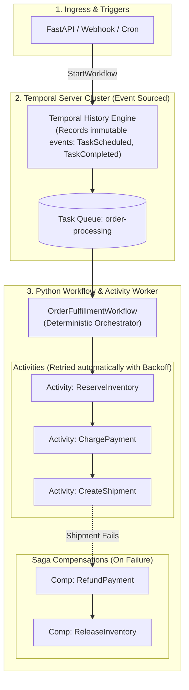

# Temporal.io Resilient Distributed Workflows (Python SDK)

<div style={{ display: 'flex', gap: '8px', flexWrap: 'wrap', margin: '1rem 0 2rem 0' }}>
  <span style={{ background: 'rgba(6, 182, 212, 0.15)', border: '1px solid rgba(6, 182, 212, 0.4)', borderRadius: '6px', padding: '3px 10px', fontSize: '12px', fontWeight: 700, color: '#00f0ff' }}>Python 3.10+</span>
  <span style={{ background: 'rgba(139, 92, 246, 0.15)', border: '1px solid rgba(139, 92, 246, 0.4)', borderRadius: '6px', padding: '3px 10px', fontSize: '12px', fontWeight: 700, color: '#c084fc' }}>Temporal Python SDK</span>
  <span style={{ background: 'rgba(16, 185, 129, 0.15)', border: '1px solid rgba(16, 185, 129, 0.4)', borderRadius: '6px', padding: '3px 10px', fontSize: '12px', fontWeight: 700, color: '#34d399' }}>Saga Pattern (Compensations)</span>
  <span style={{ background: 'rgba(255, 255, 255, 0.06)', border: '1px solid rgba(255, 255, 255, 0.15)', borderRadius: '6px', padding: '3px 10px', fontSize: '12px', fontFamily: 'monospace', color: '#cbd5e1' }}>npx software-blueprints add backend-python-temporal</span>
</div>

In complex multi-step backend operations (e.g., checkout flows, billing runs, customer onboarding), traditional task queues (like Celery or BullMQ) require writing complex manual state machines, error handlers, and timeout trackers in databases. When a worker server dies mid-task or network timeouts occur, transactions are left in half-finished corrupted states.

This blueprint implements **Durable Execution** using **Temporal.io**. Workflows write as standard imperative Python code, but are backed by **event-sourced history persistence**: if a server reboots or crashes at step 4, the Temporal worker replays past events from history and resumes execution exactly where it left off, complete with automated **Saga compensation rollbacks**.

---

## 1. System Architecture



---

## 2. Production Code Implementation

### 2.1 Activities & Compensations (`activities.py`)

Activities perform actual non-deterministic I/O (API calls, database mutations):

```python
from dataclasses import dataclass
from temporalio import activity

@dataclass
class OrderParams:
    order_id: str
    user_id: str
    amount_cents: int
    sku: str

@dataclass
class PaymentResult:
    transaction_id: str
    success: bool

@activity.defn
async def reserve_inventory(params: OrderParams) -> str:
    activity.logger.info(f"Reserving inventory for order {params.order_id}, SKU: {params.sku}")
    # Simulated DB call: locks inventory row
    reservation_id = f"res_{params.order_id}"
    return reservation_id

@activity.defn
async def release_inventory(reservation_id: str) -> None:
    activity.logger.warning(f"[COMPENSATION] Releasing inventory reservation {reservation_id}")
    # Simulated compensating rollback

@activity.defn
async def charge_payment(params: OrderParams) -> PaymentResult:
    activity.logger.info(f"Charging payment of ${params.amount_cents / 100} for user {params.user_id}")
    # Simulated Stripe API call
    return PaymentResult(transaction_id=f"tx_{params.order_id}", success=True)

@activity.defn
async def refund_payment(transaction_id: str) -> None:
    activity.logger.warning(f"[COMPENSATION] Refunding transaction {transaction_id}")
    # Simulated Stripe refund API call

@activity.defn
async def dispatch_shipment(params: OrderParams) -> str:
    activity.logger.info(f"Dispatching shipping carrier for order {params.order_id}")
    # Simulated failure condition: warehouse out of carrier capacity!
    if "fail_shipment" in params.sku:
        raise RuntimeError("Carrier shipping API timeout: warehouse fulfillment capacity exceeded!")
    return f"track_{params.order_id}"
```

---

### 2.2 Deterministic Workflow & Saga Pattern (`workflows.py`)

The workflow coordinates steps and automatically triggers compensating rollbacks on failure:

```python
from datetime import timedelta
from typing import List, Callable, Awaitable
from temporalio import workflow
from temporalio.common import RetryPolicy

with workflow.unsafe.imports_passed_through():
    from activities import (
        OrderParams,
        PaymentResult,
        reserve_inventory,
        release_inventory,
        charge_payment,
        refund_payment,
        dispatch_shipment,
    )

@workflow.defn
class OrderFulfillmentWorkflow:
    @workflow.run
    async def run(self, params: OrderParams) -> str:
        # Standard Exponential Backoff Retry Policy for external API blips
        standard_retry = RetryPolicy(
            initial_interval=timedelta(seconds=1),
            backoff_coefficient=2.0,
            maximum_interval=timedelta(seconds=30),
            maximum_attempts=3,
        )

        compensations: List[Callable[[], Awaitable[None]]] = []

        try:
            # Step 1: Reserve Inventory
            reservation_id = await workflow.execute_activity(
                reserve_inventory,
                params,
                start_to_close_timeout=timedelta(seconds=10),
                retry_policy=standard_retry,
            )
            compensations.append(lambda: workflow.execute_activity(
                release_inventory,
                reservation_id,
                start_to_close_timeout=timedelta(seconds=10),
            ))

            # Step 2: Charge Payment
            payment_res: PaymentResult = await workflow.execute_activity(
                charge_payment,
                params,
                start_to_close_timeout=timedelta(seconds=15),
                retry_policy=standard_retry,
            )
            compensations.append(lambda: workflow.execute_activity(
                refund_payment,
                payment_res.transaction_id,
                start_to_close_timeout=timedelta(seconds=15),
            ))

            # Step 3: Dispatch Shipment (May fail and trigger compensations)
            tracking_number = await workflow.execute_activity(
                dispatch_shipment,
                params,
                start_to_close_timeout=timedelta(seconds=10),
                retry_policy=standard_retry,
            )

            workflow.logger.info(f"Order {params.order_id} fulfilled successfully! Tracking: {tracking_number}")
            return tracking_number

        except Exception as err:
            workflow.logger.error(f"Workflow failed at step! Executing Saga compensations in reverse order: {err}")
            # Execute compensations in reverse order (LIFO)
            for comp in reversed(compensations):
                try:
                    await comp()
                except Exception as comp_err:
                    workflow.logger.critical(f"Critical: compensation failure: {comp_err}")
            raise err
```

---

### 2.3 Worker Bootstrap & Client Execution (`run_worker.py`)

Runs the Temporal worker polling the task queue:

```python
import asyncio
import os
from temporalio.client import Client
from temporalio.worker import Worker

from workflows import OrderFulfillmentWorkflow
from activities import (
    reserve_inventory,
    release_inventory,
    charge_payment,
    refund_payment,
    dispatch_shipment,
)

async def main():
    temporal_host = os.getenv("TEMPORAL_HOST", "localhost:7233")
    client = await Client.connect(temporal_host)

    worker = Worker(
        client,
        task_queue="order-processing",
        workflows=[OrderFulfillmentWorkflow],
        activities=[
            reserve_inventory,
            release_inventory,
            charge_payment,
            refund_payment,
            dispatch_shipment,
        ],
    )

    print("Temporal Python Worker running on queue 'order-processing'...")
    await worker.run()

if __name__ == "__main__":
    asyncio.run(main())
```

---

## 3. Production Hardening Checklist

| Verification Item | Target Standard | Failure Mode Prevented |
| :--- | :--- | :--- |
| **Workflow Determinism** | Zero calls to `datetime.now()`, `random.random()`, or network inside workflows | Prevents non-deterministic replay errors during state reconstruction |
| **Saga Compensation LIFO** | Compensating actions executed in reverse order (`reversed(compensations)`) | Ensures resources are rolled back in safe inverse dependency sequence |
| **Activity Retries with Jitter** | Configured `RetryPolicy` with exponential backoff on all network activities | Prevents thundering herds from overwhelming downstream payment APIs |
| **Idempotency Keys** | All activity mutations use `params.order_id` as the upstream idempotency token | Eliminates double-charges when activities retry across transient timeouts |
| **Crash Durability** | Server reboots or OS terminations replay from event history automatically | Zero orphaned transactions when Kubernetes pods restart |
