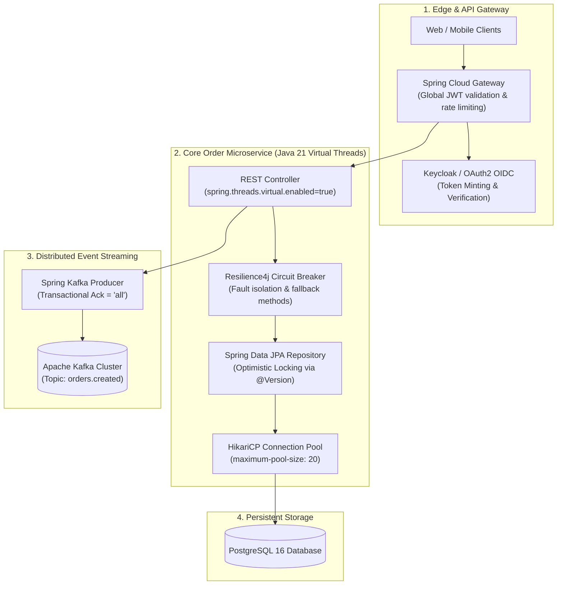

# Spring Boot 3 Enterprise Microservices: Virtual Threads & Resilience4j

Modern enterprise Java architectures built on **Spring Boot 3.3** and **Java 21** combine the developer productivity of the Spring ecosystem with the massive concurrency gains of **Virtual Threads (Project Loom)**. By decoupling thread allocation from OS kernel threads, Spring Boot can serve tens of thousands of concurrent I/O-bound requests on minimal JVM memory.

This blueprint implements an enterprise microservices architecture featuring **Spring Cloud Gateway**, **Resilience4j Circuit Breakers**, **Kafka Event Streaming**, and **HikariCP connection pool tuning**.

---

## 1. System Architecture



---

## 2. Java 21 Virtual Threads Configuration

In Java 21, Virtual Threads eliminate the need for complex reactive programming (WebFlux) while delivering identical high-concurrency throughput using intuitive, imperative code.

Enable virtual threads globally in `src/main/resources/application.yml`:

```yaml
spring:
  application:
    name: order-service
  threads:
    virtual:
      enabled: true # Automatically runs Tomcat request threads on virtual carrier threads!

  datasource:
    url: jdbc:postgresql://localhost:5432/orders_db
    username: ${DB_USER:postgres}
    password: ${DB_PASSWORD:postgres}
    hikari:
      pool-name: OrdersHikariPool
      maximum-pool-size: 20
      minimum-idle: 10
      idle-timeout: 300000
      connection-timeout: 20000
      max-lifetime: 1200000

  jpa:
    open-in-view: false # Eliminates anti-pattern OSIV database connection hoarding
    hibernate:
      ddl-auto: validate # Enforce Flyway/Liquibase schema migrations in production

  kafka:
    bootstrap-servers: localhost:9092
    producer:
      acks: all # Guarantees all in-sync replicas acknowledge write
      retries: 3
      properties:
        enable.idempotence: true

resilience4j:
  circuitbreaker:
    instances:
      inventoryService:
        sliding-window-type: COUNT_BASED
        sliding-window-size: 20
        failure-rate-threshold: 50.0
        slow-call-rate-threshold: 50.0
        slow-call-duration-threshold: 2000ms
        wait-duration-in-open-state: 10000ms
        permitted-number-of-calls-in-half-open-state: 5
        automatic-transition-from-open-to-half-open-enabled: true
```

---

## 3. Resilience4j Circuit Breaker & Fallback Implementation

When downstream external services degrade, fail fast and prevent thread pool exhaustion using Resilience4j:

```java
package com.enterprise.orders.service;

import io.github.resilience4j.circuitbreaker.annotation.CircuitBreaker;
import io.github.resilience4j.retry.annotation.Retry;
import org.slf4j.Logger;
import org.slf4j.LoggerFactory;
import org.springframework.stereotype.Service;
import org.springframework.web.client.RestClient;

@Service
public class InventoryClientService {

    private static final Logger log = LoggerFactory.getLogger(InventoryClientService.class);
    private final RestClient restClient;

    public InventoryClientService(RestClient.Builder restClientBuilder) {
        this.restClient = restClientBuilder.baseUrl("http://inventory-service/api/v1").build();
    }

    @CircuitBreaker(name = "inventoryService", fallbackMethod = "fallbackReserveStock")
    @Retry(name = "inventoryService")
    public boolean reserveStock(String sku, int quantity) {
        log.info("Attempting to reserve stock for SKU: {}, quantity: {}", sku, quantity);

        return restClient.post()
                .uri("/stock/reserve")
                .body(new StockReserveRequest(sku, quantity))
                .retrieve()
                .toBodilessEntity()
                .getStatusCode()
                .is2xxSuccessful();
    }

    // Fallback method executed when circuit breaker is OPEN or exceptions trip threshold
    public boolean fallbackReserveStock(String sku, int quantity, Throwable throwable) {
        log.warn("Inventory service circuit OPEN or call failed! Executing fallback for SKU: {}. Cause: {}", 
                 sku, throwable.getMessage());
        // Trigger asynchronous queuing or secondary warehouse allocation
        return false;
    }

    public record StockReserveRequest(String sku, int quantity) {}
}
```

---

## 4. Transactional Event Publishing with Optimistic Concurrency

```java
package com.enterprise.orders.domain;

import jakarta.persistence.*;
import java.math.BigDecimal;
import java.time.Instant;
import java.util.UUID;

@Entity
@Table(name = "orders")
public class OrderEntity {

    @Id
    @GeneratedValue(strategy = GenerationType.UUID)
    private UUID id;

    @Column(nullable = false)
    private String customerId;

    @Column(nullable = false)
    private BigDecimal totalAmount;

    @Enumerated(EnumType.STRING)
    @Column(nullable = false)
    private OrderStatus status;

    // Optimistic locking version field: eliminates lost update anomalies
    @Version
    private Long version;

    @Column(nullable = false, updatable = false)
    private Instant createdAt = Instant.now();

    public enum OrderStatus {
        CREATED, PAID, FULFILLED, CANCELLED
    }

    // Getters, Setters, Constructors
}
```

```java
package com.enterprise.orders.service;

import com.enterprise.orders.domain.OrderEntity;
import com.enterprise.orders.repository.OrderRepository;
import org.springframework.kafka.core.KafkaTemplate;
import org.springframework.stereotype.Service;
import org.springframework.transaction.annotation.Transactional;

@Service
public class OrderService {

    private final OrderRepository orderRepository;
    private final KafkaTemplate<String, Object> kafkaTemplate;

    public OrderService(OrderRepository orderRepository, KafkaTemplate<String, Object> kafkaTemplate) {
        this.orderRepository = orderRepository;
        this.kafkaTemplate = kafkaTemplate;
    }

    @Transactional
    public OrderEntity placeOrder(String customerId, BigDecimal amount) {
        OrderEntity order = new OrderEntity();
        order.setCustomerId(customerId);
        order.setTotalAmount(amount);
        order.setStatus(OrderEntity.OrderStatus.CREATED);

        OrderEntity savedOrder = orderRepository.save(order);

        // Publish event to Kafka
        kafkaTemplate.send("orders.created", savedOrder.getId().toString(), new OrderCreatedEvent(savedOrder.getId(), customerId, amount));

        return savedOrder;
    }

    public record OrderCreatedEvent(UUID orderId, String customerId, BigDecimal amount) {}
}
```

---

## 5. Production Hardening Checklist

- [ ] **Disable Open Session in View (OSIV)**: Ensure `spring.jpa.open-in-view=false`. OSIV keeps database connections held open during view/JSON serialization, exhausting the HikariCP pool under modest load.
- [ ] **Flyway Database Migrations**: Never use `hibernate.ddl-auto=update` in production. Version-control all database DDL changes in `src/main/resources/db/migration/V1__init.sql`.
- [ ] **Tune HikariCP Pool Size**: Formula for optimal pool size: `connections = ((core_count * 2) + effective_spindle_count)`. For an 8-core database, a pool of 16-20 connections easily outperforms a pool of 100 connections.
- [ ] **Graceful Shutdown**: Configure `server.shutdown=graceful` and `spring.lifecycle.timeout-per-shutdown-phase=30s` in `application.yml` so Kubernetes pods finish in-flight HTTP requests before termination.
