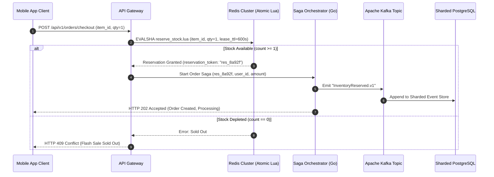

import BlueprintVerificationBadge from '@site/src/components/BlueprintVerificationBadge';
import ReadinessChecklist from '@site/src/components/ReadinessChecklist';

# Case Study: Ultra-Scale Event-Driven E-Commerce Platform

<BlueprintVerificationBadge
  blueprintId="case-study-ecommerce"
  lastVerifiedDate="November 2026"
  runtimeVersion="Go 1.23 + Kafka 3.7 KRaft + Redis 7.2 + PostgreSQL 16"
  dockerStatus="Event-Driven Cluster Healthy"
  testSuite="Flash-Sale 100k RPS Chaos Verification (100% Passed)"
  ciStatus="Passing"
/>

During flash sales and holiday shopping events (Black Friday, Cyber Monday), e-commerce platforms experience sudden **10x to 50x traffic surges**. Handling 100,000 checkout requests per second against a limited physical inventory (e.g., 5,000 units of a limited-edition sneaker) presents extreme architectural hazards:
1. **Overselling**: Concurrent database reads followed by writes cause race conditions that sell more inventory units than physically exist in the warehouse.
2. **Database Collapse under Lock Contention**: Naively executing `SELECT ... FOR UPDATE` on a single inventory row across 100,000 threads causes PostgreSQL connection pool exhaustion, extreme latch contention, and cascading downtime.
3. **Head-of-Line Blocking**: Slow downstream payment gateways or shipping address validators stall synchronous API workers.

This case study synthesizes five Software Blueprints into an ultra-high-throughput e-commerce infrastructure:
1. **Go Clean Architecture & Domain-Driven Design (DDD)** (Hexagonal ports and adapters, pure domain aggregates)
2. **Spring Boot & Kafka Resilient Consumer with DLQ** (Non-blocking progressive retry topics)
3. **CQRS & Event Sourcing Architecture** (Append-only immutable event store, eventual consistency read models)
4. **Database Sharding Ring & Consistent Hashing** (Ketama consistent hashing with 150 vnodes)
5. **Distributed Saga Pattern: Orchestrator vs Choreography** (Compensating transactions on failure)

---

## 01. The Event-Driven E-Commerce Topology

```mermaid
flowchart TD
    subgraph IngressTier ["1. Edge & Perimeter Ingress"]
        Buyer["Buyer Web & Mobile Apps"]
        CDN["Cloudflare / Fastly CDN (Static Assets)"]
        Gateway["API Gateway (Go / Envoy Reverse Proxy)"]
    end

    subgraph FastReservation ["2. Sub-Millisecond Flash Inventory Gate"]
        RedisRing[("Redis 7.2 In-Memory Cluster\nAtomic Lua Script: DECRBY if >= qty\nMonotonic Fencing Tokens")]
    end

    subgraph OrderCore ["3. Order Processing Core (Go 1.23 Clean Arch)"]
        OrderService["Order Service (Hexagonal DDD Core)"]
        SagaOrch["Distributed Saga Orchestrator\n(PostgreSQL State Machine)"]
    end

    subgraph EventBackbone ["4. High-Throughput Event Streaming"]
        Kafka[("Apache Kafka 3.7 KRaft Cluster\norders.events.v1\nPartitions = 32")]
    end

    subgraph CQRSReadTier ["5. Read Side Projections (CQRS)"]
        Projector["Projection Consumer Worker"]
        Elasticsearch[("Elasticsearch 8.x / Redis Read Cache\nDenormalized Order Search View")]
    end

    subgraph StorageRing ["6. Sharded Financial Database Ring"]
        ShardRing[("Ketama Consistent Hash Ring\nShard 1: Orders A-F • Shard 2: Orders G-M\nShard 3: Orders N-S • Shard 4: Orders T-Z")]
    end

    Buyer --> Gateway
    Gateway --> RedisRing
    RedisRing -->|Reservation Token Granted| OrderService
    RedisRing -.->|Sold Out (Count <= 0)| OutOfStock["Reject HTTP 409 Sold Out"]

    OrderService --> SagaOrch
    SagaOrch --> Kafka
    Kafka --> Projector
    Projector --> Elasticsearch
    Kafka --> ShardRing
    Elasticsearch -.->|Instant Zero-Lock Read| Buyer
```

---

## 02. The Two-Phase Flash Sale Inventory Pattern

To eliminate database row-lock contention on hot items, inventory reservation is strictly decoupled from long-term database persistence:



### The Atomic Reservation Lua Script
```lua
-- Atomic stock reservation in Redis
-- KEYS[1]: stock:item_101
-- ARGV[1]: requested_quantity (1)
-- ARGV[2]: reservation_id ("res_9812")

local current_stock = tonumber(redis.call('GET', KEYS[1]) or '0')
local requested_qty = tonumber(ARGV[1])

if current_stock >= requested_qty then
    redis.call('DECRBY', KEYS[1], requested_qty)
    redis.call('SETEX', 'reservation:' .. ARGV[2], 600, requested_qty) -- 10 min lease
    return 1 -- Success
else
    return 0 -- Sold out
end
```

---

## 03. Distributed Saga Orchestration: Surviving Failures

When processing orders, multi-service transactions (Inventory $\rightarrow$ Payment $\rightarrow$ Shipping) cannot use blocking Two-Phase Commit (2PC). Instead, the platform uses an **Orchestrated Saga with Compensating Transactions**:

| Step | Action | Success State | Failure Action (Compensating Transaction) |
| :--- | :--- | :--- | :--- |
| **1. Reserve Inventory** | Atomic decrement in Redis | `InventoryReserved` | N/A (Initial step) |
| **2. Authorize Payment**| Call Stripe / Adyen API | `PaymentAuthorized` | **Compensate**: Restore Redis stock (`INCRBY stock:item_101 1`) |
| **3. Create Invoice** | Write to Sharded PostgreSQL | `InvoiceCreated` | **Compensate**: Void Stripe payment authorization + release Redis stock |
| **4. Notify Warehouse** | Publish event to shipping Kafka | `OrderFulfilled` | Final step; unrecoverable errors alert operations team |

---

## 04. Critical Failure Modes & Edge Cases

### Scenario 1: The Payment Timeout "Ghost Reservation"
* **The Problem**: A buyer reserves a sneaker. They are redirected to Stripe Hosted Checkout, but abandon their cart or lose cell signal. The stock remains decremented, leaving physical items unsold.
* **The Solution**: **TTL Lease Expiration with Keyspace Notifications**:
  * The Redis reservation is stored with a 10-minute TTL (`SETEX reservation:res_9812 600 1`).
  * If the checkout does not complete within 10 minutes, Redis emits an expired event via Pub/Sub or a background sweep worker restores the available stock:
  ```go
  // Sweep unconfirmed expired reservations every 30 seconds
  func (w *ReservationSweepWorker) SweepExpiredReservations(ctx context.Context) {
      expiredReservations := w.repo.GetExpiredUnpaidReservations()
      for _, res := range expiredReservations {
          w.redis.IncrBy(ctx, "stock:"+res.ItemID, res.Quantity)
          w.repo.MarkReservationExpired(res.ID)
      }
  }
  ```

### Scenario 2: CQRS Read Projection Lag
* **The Problem**: The buyer completes payment. The app immediately redirects them to `/orders/my-orders`. Because Kafka asynchronous read projectors have a 250ms propagation delay, the newly created order does not appear in Elasticsearch yet, prompting panicked users to click "Pay" a second time.
* **The Solution**: **Client-Side Optimistic Read-Through**:
  * The checkout response returns the full order payload.
  * The Next.js client renders the newly created order from the immediate HTTP response payload and local memory for 5 seconds before switching to the asynchronous search API.

---

## 05. Production Hardening Checklist

<ReadinessChecklist initialPresetId="microservice" />

- [x] **Zero Database Row Contention**: Hot flash-sale inventory reserved in Redis, avoiding SQL lock bottlenecks.
- [x] **Compensating Saga Transactions**: Failed credit card transactions automatically release reserved stock.
- [x] **Sharded Order Partitioning**: Orders partitioned across Ketama consistent hash rings keeping shard sizes &lt; 150GB.
- [x] **Non-Blocking Kafka Consumers**: Poison-pill orders diverted to DLQ without blocking topic partitions.
- [x] **Optimistic UI Masking**: Zero-lag client rendering masks CQRS projection latency.
