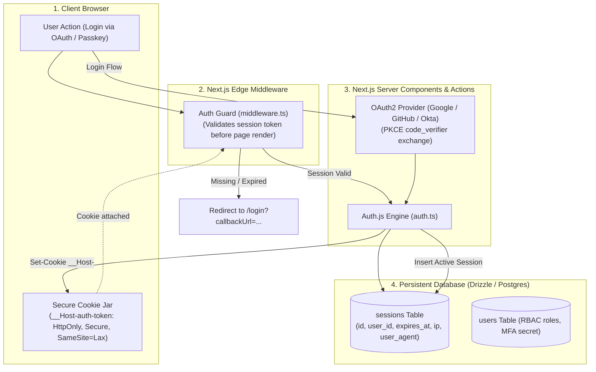

# Enterprise Authentication & Session Management

Authentication is the most security-sensitive surface in any full-stack application. Teams often opt for pure stateless JWTs stored in `localStorage`, inadvertently exposing user sessions to Cross-Site Scripting (XSS) credential theft and making instant session revocation (e.g., on password reset or device loss) technically impossible without maintaining a stateful blacklist anyway.

This blueprint implements an enterprise **Full-Stack Authentication & Session Architecture** using **Auth.js (NextAuth v5)**, **Database-backed sliding sessions**, **`__Host-` prefixed HttpOnly cookies**, and **PKCE OAuth2 workflows**.

---

## 1. System Architecture



---

## 2. Stateless JWT vs Database Sessions Comparison

| Dimension | Stateless JWT | Database-Backed Sliding Session |
| :--- | :--- | :--- |
| **Instant Revocation** | Impossible (Token valid until expiry) | **Instantaneous** (`DELETE FROM sessions WHERE id = :id`) |
| **Active Devices List** | Unsupported | **Native** (Displays all active phones/laptops to user) |
| **Storage Overhead** | Client-side cookie only | Minimal (1 indexed row per active login) |
| **Vulnerability to XSS** | Catastrophic if in `localStorage` | **Zero** (Protected by `HttpOnly` cookie jar) |
| **Enterprise Compliance** | Fails SOC2 / HIPAA audit requirements | **Fully Compliant** |

---

## 3. Database Schema: Drizzle ORM Auth Models

Save this schema under `src/lib/schema/auth.ts`:

```typescript
// src/lib/schema/auth.ts
import { pgTable, text, timestamp, uuid, primaryKey, integer } from 'drizzle-orm/pg-core';

export const users = pgTable('users', {
  id: uuid('id').defaultRandom().primaryKey(),
  name: text('name'),
  email: text('email').notNull().unique(),
  emailVerified: timestamp('email_verified', { mode: 'date' }),
  image: text('image'),
  role: text('role').notNull().default('MEMBER'), // ADMIN, MEMBER
  createdAt: timestamp('created_at').defaultNow().notNull(),
});

export const accounts = pgTable(
  'accounts',
  {
    userId: uuid('user_id')
      .notNull()
      .references(() => users.id, { onDelete: 'cascade' }),
    type: text('type').notNull(),
    provider: text('provider').notNull(),
    providerAccountId: text('provider_account_id').notNull(),
    refresh_token: text('refresh_token'),
    access_token: text('access_token'),
    expires_at: integer('expires_at'),
    token_type: text('token_type'),
    scope: text('scope'),
    id_token: text('id_token'),
    session_state: text('session_state'),
  },
  (account) => ({
    compoundKey: primaryKey({
      columns: [account.provider, account.providerAccountId],
    }),
  })
);

export const sessions = pgTable('sessions', {
  sessionToken: text('session_token').primaryKey(),
  userId: uuid('user_id')
    .notNull()
    .references(() => users.id, { onDelete: 'cascade' }),
  expires: timestamp('expires', { mode: 'date' }).notNull(),
  ipAddress: text('ip_address'),
  userAgent: text('user_agent'),
});
```

---

## 4. Production Auth.js (NextAuth v5) Configuration

Save this production configuration under `src/auth.ts`:

```typescript
// src/auth.ts
import NextAuth from 'next-auth';
import Google from 'next-auth/providers/google';
import GitHub from 'next-auth/providers/github';
import { DrizzleAdapter } from '@auth/drizzle-adapter';
import { db } from '@/lib/db';
import { users, accounts, sessions } from '@/lib/schema/auth';

export const { handlers, signIn, signOut, auth } = NextAuth({
  adapter: DrizzleAdapter(db, {
    usersTable: users,
    accountsTable: accounts,
    sessionsTable: sessions,
  }),
  session: {
    strategy: 'database',
    maxAge: 30 * 24 * 60 * 60, // 30 Days sliding session
    updateAge: 24 * 60 * 60,    // Refresh session in DB once every 24 hours
  },
  cookies: {
    sessionToken: {
      // __Host- prefix guarantees cookie is Secure, HTTPS-only, and scoped to root domain
      name: process.env.NODE_ENV === 'production' ? '__Host-auth.session-token' : 'auth.session-token',
      options: {
        httpOnly: true,
        sameSite: 'lax',
        path: '/',
        secure: process.env.NODE_ENV === 'production',
      },
    },
  },
  providers: [
    Google({
      clientId: process.env.AUTH_GOOGLE_ID!,
      clientSecret: process.env.AUTH_GOOGLE_SECRET!,
      authorization: { params: { prompt: 'consent', access_type: 'offline', response_type: 'code' } },
    }),
    GitHub({
      clientId: process.env.AUTH_GITHUB_ID!,
      clientSecret: process.env.AUTH_GITHUB_SECRET!,
    }),
  ],
  callbacks: {
    async session({ session, user }) {
      if (session.user) {
        session.user.id = user.id;
        (session.user as any).role = (user as any).role;
      }
      return session;
    },
  },
  pages: {
    signIn: '/login',
    error: '/auth/error',
  },
});
```

---

## 5. Next.js 15 Edge Route Guard Middleware

```typescript
// middleware.ts
import { auth } from '@/auth';
import { NextResponse } from 'next/server';

const PROTECTED_ROUTES = ['/dashboard', '/settings', '/api/v1/protected'];

export default auth((req) => {
  const isAuth = !!req.auth;
  const isProtected = PROTECTED_ROUTES.some((route) => req.nextUrl.pathname.startsWith(route));

  if (isProtected && !isAuth) {
    const loginUrl = new URL('/login', req.nextUrl.origin);
    loginUrl.searchParams.set('callbackUrl', req.nextUrl.pathname);
    return NextResponse.redirect(loginUrl);
  }

  return NextResponse.next();
});

export const config = {
  matcher: ['/((?!_next/static|_next/image|favicon.ico).*)'],
};
```

---

## 6. Production Hardening Checklist

- [ ] **Enforce `__Host-` Cookie Prefixes**: In production, prefix your session cookie with `__Host-`. This browser-enforced security policy guarantees that subdomains cannot overwrite or spoof the cookie and requires the `Secure` flag on HTTPS.
- [ ] **PKCE Protection on OAuth2**: Ensure all OAuth providers use Proof Key for Code Exchange (PKCE). This mitigates authorization code interception attacks across public clients.
- [ ] **Session Invalidation on Password Change**: When a user updates their password or revokes a session, execute `DELETE FROM sessions WHERE user_id = :userId` to instantly log out all active sessions globally.
- [ ] **Brute Force Rate Limiting**: Apply distributed rate limiting on `/api/auth/callback/*` and `/login` (max 5 failed attempts per 15 minutes per IP) to prevent credential stuffing.
