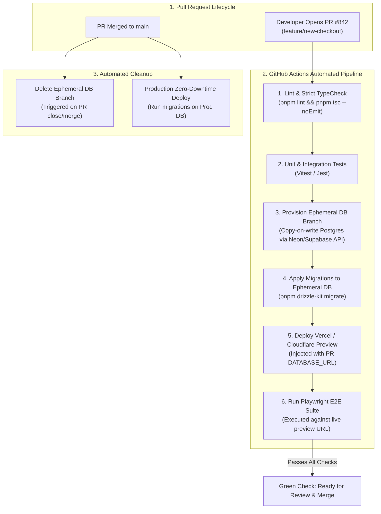

# Full-Stack CI/CD & Ephemeral Preview Environments

Modern continuous deployment requires verifying every Pull Request in a production-identical staging environment before merging to `main`. Traditional preview workflows fail because **preview deployments share a single monolithic staging database**: a PR containing an experimental migration breaks the staging database for the entire engineering team, while test suites pollute shared records.

This blueprint implements an enterprise **Full-Stack CI/CD Pipeline** featuring **Copy-on-Write Ephemeral Database Branching**, **Automated Playwright E2E testing**, and **Zero-Downtime Blue-Green deployments**.

---

## 1. System Architecture



---

## 2. GitHub Actions Production Workflow Specification

Save this workflow under `.github/workflows/pr-preview.yml`:

```yaml
name: Pull Request Preview & E2E Validation

on:
  pull_request:
    types: [opened, synchronize, reopened, closed]

env:
  NODE_VERSION: '20'
  PNPM_VERSION: '9'

jobs:
  # Cleanup ephemeral resources when PR is closed
  cleanup-preview:
    if: github.event.action == 'closed'
    runs-on: ubuntu-latest
    steps:
      - name: Delete Ephemeral Database Branch
        env:
          NEON_API_KEY: ${{ secrets.NEON_API_KEY }}
          NEON_PROJECT_ID: ${{ secrets.NEON_PROJECT_ID }}
        run: |
          BRANCH_NAME="pr-${{ github.event.pull_request.number }}"
          echo "Deleting database branch: $BRANCH_NAME"
          curl -s -X DELETE \
            -H "Authorization: Bearer $NEON_API_KEY" \
            "https://console.neon.tech/api/v2/projects/$NEON_PROJECT_ID/branches/$BRANCH_NAME"

  # Validate and test active PRs
  validate-and-preview:
    if: github.event.action != 'closed'
    runs-on: ubuntu-latest
    steps:
      - uses: actions/checkout@v4

      - uses: pnpm/action-setup@v3
        with:
          version: ${{ env.PNPM_VERSION }}

      - uses: actions/setup-node@v4
        with:
          node-version: ${{ env.NODE_VERSION }}
          cache: 'pnpm'

      - name: Install Dependencies
        run: pnpm install --frozen-lockfile

      - name: Static Analysis & Type Checking
        run: |
          pnpm lint
          pnpm tsc --noEmit

      - name: Provision Ephemeral Database Branch
        id: db-branch
        env:
          NEON_API_KEY: ${{ secrets.NEON_API_KEY }}
          NEON_PROJECT_ID: ${{ secrets.NEON_PROJECT_ID }}
        run: |
          BRANCH_NAME="pr-${{ github.event.pull_request.number }}"
          echo "Creating isolated DB branch for $BRANCH_NAME..."
          RESPONSE=$(curl -s -X POST \
            -H "Authorization: Bearer $NEON_API_KEY" \
            -H "Content-Type: application/json" \
            -d '{"branch": {"name": "'"$BRANCH_NAME"'"}}' \
            "https://console.neon.tech/api/v2/projects/$NEON_PROJECT_ID/branches")
          
          # Extract ephemeral connection string
          DB_URL=$(echo $RESPONSE | jq -r '.connection_uris[0].connection_uri')
          echo "DATABASE_URL=$DB_URL" >> $GITHUB_ENV

      - name: Apply Database Migrations
        run: pnpm drizzle-kit migrate

      - name: Install Playwright Browsers
        run: pnpm exec playwright install --with-deps chromium

      - name: Run End-to-End Test Suite
        env:
          DATABASE_URL: ${{ env.DATABASE_URL }}
        run: pnpm test:e2e
```

---

## 3. End-to-End Integration Testing with Playwright

Save this critical-path test under `tests/e2e/checkout.spec.ts`:

```typescript
// tests/e2e/checkout.spec.ts
import { test, expect } from '@playwright/test';

test.describe('Critical Path: User Authentication and Subscription Upgrade', () => {
  test('New user can log in, select enterprise plan, and reach checkout', async ({ page }) => {
    // 1. Visit landing page
    await page.goto('/');
    await expect(page).toHaveTitle(/Software Blueprints/);

    // 2. Click sign-in trigger
    await page.click('button:has-text("Sign In")');
    await expect(page).toHaveURL(/.*login/);

    // 3. Fill mock credentials in isolated preview DB
    await page.fill('input[name="email"]', 'test-user@preview.internal');
    await page.fill('input[name="password"]', 'SuperSecretPass123!');
    await page.click('button[type="submit"]');

    // 4. Verify dashboard loads with correct tenant context
    await expect(page.locator('h1')).toContainText('Dashboard');

    // 5. Trigger upgrade modal
    await page.click('button:has-text("Upgrade to Pro")');
    await expect(page.locator('[role="dialog"]')).toBeVisible();

    // 6. Verify Stripe checkout redirect button is functional
    const checkoutButton = page.locator('button:has-text("Proceed to Stripe")');
    await expect(checkoutButton).toBeEnabled();
  });
});
```

---

## 4. Production Hardening Checklist

- [ ] **Copy-on-Write Database Branching**: Use instant database branching (Neon, PlanetScale, or Supabase) for PR previews. Provisioning physical database copies takes minutes; copy-on-write branching takes under 800 milliseconds and costs nothing for idle compute.
- [ ] **Automated Ephemeral Teardown**: Always attach a `github.event.action == 'closed'` trigger to destroy preview database branches. Forgotten branches accumulate storage costs.
- [ ] **Strict Backward-Compatible Migrations (Expand/Contract)**: Never rename or delete a database column in a single migration step. Follow the **Expand-and-Contract** pattern:
  1. Add new column (Expand).
  2. Deploy application code reading both, writing to new.
  3. Backfill old data to new column.
  4. Deploy code reading only from new column.
  5. Drop old column in next release (Contract).
- [ ] **Deterministic Lockfiles**: Always run `pnpm install --frozen-lockfile` (or `npm ci`) in CI to guarantee that untrusted dependency version updates cannot sneak into builds.
