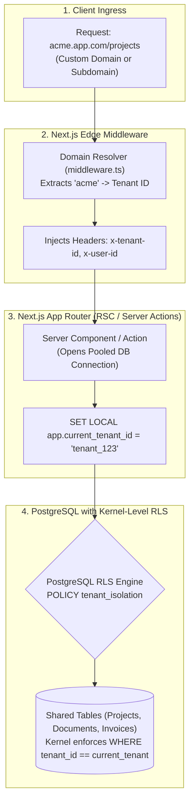

# Multi-Tenant B2B SaaS Architecture: PostgreSQL RLS & Subdomains

Building B2B SaaS software requires enforcing strict data isolation between corporate customers. Relying solely on application-level filtering (`WHERE tenant_id = :id`) is an inevitable disaster: a single developer omitting the `WHERE` clause in an ORM query exposes private customer records across tenant boundaries.

This blueprint implements an enterprise **Multi-Tenant SaaS Architecture** using **PostgreSQL Row-Level Security (RLS)** (enforced at the database engine level), **Next.js wildcard subdomain routing**, and **role-based organization switching**.

---

## 1. System Architecture



---

## 2. Multi-Tenancy Isolation Tradeoff Matrix

| Isolation Model | Blast Radius | Infra Cost | Max Tenants | Migration Complexity |
| :--- | :--- | :--- | :--- | :--- |
| **Database-per-Tenant** | Zero (Completely isolated) | Very High (Idle DB instances) | Low (~100s) | Nightmare (Run 500 migrations per release) |
| **Schema-per-Tenant** | Low | Moderate | Medium (~2,000) | Moderate (Postgres table catalog lock contention) |
| **Row-Level Security (RLS)** | **Negligible (Kernel Enforced)** | **Low (Single Shared Pool)** | **Infinite (Millions)** | **Effortless (Single standard migration)** |

---

## 3. PostgreSQL Row-Level Security (RLS) Schema

Save this SQL migration to set up the multi-tenant schema with kernel-level isolation policies:

```sql
-- 1. Enable Row-Level Security on Multi-Tenant Tables
CREATE TABLE IF NOT EXISTS organizations (
    id UUID PRIMARY KEY DEFAULT gen_random_uuid(),
    slug VARCHAR(64) UNIQUE NOT NULL,      -- Subdomain: 'acme' for acme.app.com
    name VARCHAR(255) NOT NULL,
    created_at TIMESTAMPTZ DEFAULT NOW()
);

CREATE TABLE IF NOT EXISTS organization_members (
    id UUID PRIMARY KEY DEFAULT gen_random_uuid(),
    organization_id UUID NOT NULL REFERENCES organizations(id) ON DELETE CASCADE,
    user_id UUID NOT NULL,
    role VARCHAR(32) NOT NULL DEFAULT 'MEMBER', -- OWNER, ADMIN, MEMBER
    created_at TIMESTAMPTZ DEFAULT NOW(),
    UNIQUE (organization_id, user_id)
);

CREATE TABLE IF NOT EXISTS projects (
    id UUID PRIMARY KEY DEFAULT gen_random_uuid(),
    organization_id UUID NOT NULL REFERENCES organizations(id) ON DELETE CASCADE,
    name VARCHAR(255) NOT NULL,
    description TEXT,
    created_at TIMESTAMPTZ DEFAULT NOW()
);

-- 2. Activate RLS on Projects
ALTER TABLE projects ENABLE ROW LEVEL SECURITY;

-- 3. Define Kernel-Level Tenant Policy
-- Reads app.current_tenant_id session variable set by the application connection
CREATE POLICY tenant_isolation_policy ON projects
    FOR ALL
    USING (organization_id = NULLIF(current_setting('app.current_tenant_id', true), '')::uuid)
    WITH CHECK (organization_id = NULLIF(current_setting('app.current_tenant_id', true), '')::uuid);
```

---

## 4. Next.js 15 Edge Middleware: Subdomain & Domain Resolution

```typescript
// middleware.ts
import { NextRequest, NextResponse } from 'next/server';

export const config = {
  matcher: ['/((?!api/|_next/|_static/|_vercel|[\\w-]+\\.\\w+).*)'],
};

export default async function middleware(req: NextRequest) {
  const url = req.nextUrl;
  const hostname = req.headers.get('host') || '';

  // Extract root domain from environment (e.g. app.com)
  const rootDomain = process.env.NEXT_PUBLIC_ROOT_DOMAIN || 'localhost:3000';

  let currentHost = hostname.replace(`.${rootDomain}`, '');
  const isCustomDomain = !hostname.includes(rootDomain);

  // If visiting main landing domain, rewrite to home page
  if (currentHost === rootDomain || currentHost === 'www') {
    return NextResponse.rewrite(new URL('/home', req.url));
  }

  // Rewrite /path to /app/[tenantSlug]/path
  // e.g. acme.app.com/dashboard -> /app/acme/dashboard
  const tenantSlug = currentHost;
  const newPathname = `/app/${tenantSlug}${url.pathname}`;

  const response = NextResponse.rewrite(new URL(newPathname, req.url));
  response.headers.set('x-tenant-slug', tenantSlug);
  return response;
}
```

---

## 5. Type-Safe Database Context with Drizzle ORM

When executing queries in Server Components or Server Actions, wrap database calls in a transaction that sets `app.current_tenant_id`:

```typescript
// src/lib/tenant-db.ts
import { sql } from 'drizzle-orm';
import { db } from './db';
import { projects } from './schema';

export async function withTenantContext<T>(
  tenantId: string,
  callback: (tx: typeof db) => Promise<T>
): Promise<T> {
  // Execute within a transaction so SET LOCAL only applies to the current pooled connection
  return await db.transaction(async (tx) => {
    // Inject the active tenant ID into the Postgres session variable
    await tx.execute(sql`SELECT set_config('app.current_tenant_id', ${tenantId}, true)`);

    // Run application queries - RLS guarantees zero leakages!
    return await callback(tx as any);
  });
}

// Example Server Action Usage:
export async function getTenantProjects(tenantId: string) {
  return await withTenantContext(tenantId, async (tx) => {
    // Even if you write a query without a WHERE clause,
    // PostgreSQL RLS automatically filters only rows belonging to tenantId!
    return await tx.select().from(projects);
  });
}
```

---

## 6. Production Hardening Checklist

- [ ] **Beware of Superuser Bypass**: Never connect your application backend using the PostgreSQL `postgres` superuser. PostgreSQL superusers automatically bypass all RLS policies! Connect using a dedicated app role (`CREATE ROLE saas_app LOGIN ...`).
- [ ] **Transaction-Scoped Session Config**: Always use `set_config('app.current_tenant_id', tenant_id, true)`. The `true` parameter ensures the variable is scoped strictly to the current transaction (`SET LOCAL`), preventing connection pool leakage to subsequent queries.
- [ ] **Strict Organization Membership Validation**: Before invoking `withTenantContext`, verify in your authentication middleware that `auth.userId` has an active record in `organization_members` for the requested tenant.
- [ ] **Index Tenant ID Foreign Keys**: Ensure every table with RLS has a B-tree index on `organization_id`. Without an index, Postgres must perform full table scans across all tenants to evaluate the RLS policy.
