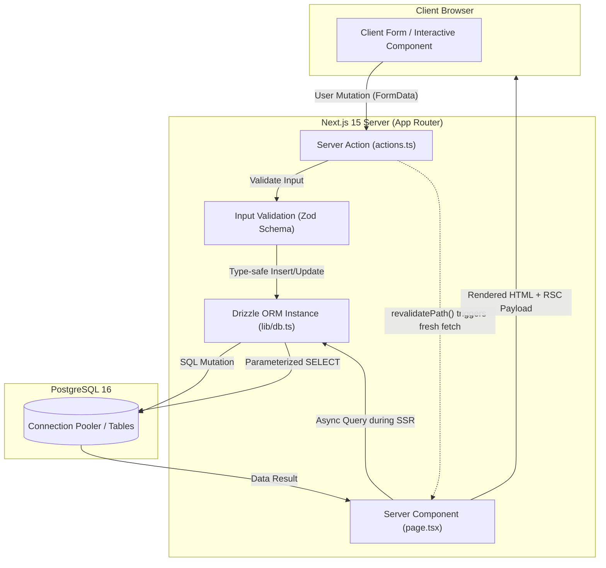

# ⚡ Modern Full-Stack Blueprint: Next.js 15, Drizzle ORM & PostgreSQL

An enterprise architectural blueprint for building scalable, type-safe web applications using **Next.js 15 (App Router)**, **React Server Components (RSCs)**, **Server Actions**, **Drizzle ORM**, and **PostgreSQL**.

---

## 1. Architectural Highlights

- **Zero API Layer Bloat:** Eliminates redundant REST/GraphQL endpoints (`/api/*`). Direct async database queries live directly inside React Server Components.
- **End-to-End Type Safety:** TypeScript types are automatically inferred from your Drizzle schema, ensuring compile-time checking from PostgreSQL tables up to UI props.
- **Atomic Server Mutations:** Uses Next.js Server Actions validated with **Zod** schema parsing, with instant UI updates via `revalidatePath()`.
- **Lightweight Connection Pooling:** Uses `postgres-js` for sub-millisecond connection handling suitable for both persistent servers and serverless deployments.

---

## 2. High-Level Architecture Diagram



---

## 3. Directory Layout (Feature-Aligned)

```text
├── app/
│   ├── layout.tsx              # Root Layout & Theme Providers
│   └── dashboard/
│       ├── page.tsx            # Server Component (Async DB Query)
│       ├── actions.ts          # Server Actions (Mutations & Validation)
│       └── UserForm.tsx        # Client Component (Interactive Form)
├── db/
│   ├── schema.ts               # Drizzle PostgreSQL Table Schemas
│   └── migrations/             # Generated SQL Migration Files
├── lib/
│   └── db.ts                   # Drizzle Client Singleton
├── drizzle.config.ts           # Drizzle Kit Migration Config
└── .env
```

---

## 4. Database Setup & Drizzle Schema

### Database Client Singleton (`lib/db.ts`)

```typescript
import { drizzle } from 'drizzle-orm/postgres-js';
import postgres from 'postgres';
import * as schema from '@/db/schema';

const connectionString = process.env.DATABASE_URL!;

// Cache connection in development to avoid hitting connection limits upon HMR
const globalForDb = globalThis as unknown as {
  conn: postgres.Sql | undefined;
};

const client = globalForDb.conn ?? postgres(connectionString, { max: 10 });
if (process.env.NODE_ENV !== 'production') globalForDb.conn = client;

export const db = drizzle(client, { schema });
```

### Table Definitions (`db/schema.ts`)

```typescript
import { pgTable, integer, text, timestamp, varchar, boolean } from 'drizzle-orm/pg-core';
import { InferSelectModel, InferInsertModel } from 'drizzle-orm';

export const organizations = pgTable('organizations', {
  id: integer('id').primaryKey().generatedAlwaysAsIdentity(),
  name: varchar('name', { length: 128 }).notNull(),
  slug: varchar('slug', { length: 64 }).notNull().unique(),
  createdAt: timestamp('created_at', { withTimezone: true }).defaultNow().notNull(),
});

export const members = pgTable('members', {
  id: integer('id').primaryKey().generatedAlwaysAsIdentity(),
  orgId: integer('org_id').references(() => organizations.id, { onDelete: 'cascade' }).notNull(),
  name: text('name').notNull(),
  email: varchar('email', { length: 320 }).notNull().unique(),
  role: varchar('role', { length: 32 }).default('member').notNull(),
  isActive: boolean('is_active').default(true).notNull(),
  createdAt: timestamp('created_at', { withTimezone: true }).defaultNow().notNull(),
  updatedAt: timestamp('updated_at', { withTimezone: true }).defaultNow().notNull().$onUpdate(() => new Date()),
});

// Infer TypeScript types directly from Schema
export type Member = InferSelectModel<typeof members>;
export type NewMember = InferInsertModel<typeof members>;
```

---

## 5. Server Component Data Fetching (`app/dashboard/page.tsx`)

Direct database execution inside React Server Components without HTTP network overhead:

```tsx
import { db } from '@/lib/db';
import { members } from '@/db/schema';
import { desc, eq } from 'drizzle-orm';
import UserForm from './UserForm';

export default async function DashboardPage() {
  // Query executes on the server at request time
  const memberList = await db
    .select()
    .from(members)
    .where(eq(members.isActive, true))
    .orderBy(desc(members.createdAt))
    .limit(25);

  return (
    <div style={{ padding: '24px', maxWidth: '800px', margin: '0 auto', fontFamily: 'sans-serif' }}>
      <h1>Team Members ({memberList.length})</h1>
      
      <UserForm />

      <table style={{ width: '100%', borderCollapse: 'collapse', marginTop: '24px' }}>
        <thead>
          <tr style={{ borderBottom: '2px solid #ccc', textAlign: 'left' }}>
            <th style={{ padding: '8px' }}>Name</th>
            <th style={{ padding: '8px' }}>Email</th>
            <th style={{ padding: '8px' }}>Role</th>
            <th style={{ padding: '8px' }}>Created</th>
          </tr>
        </thead>
        <tbody>
          {memberList.map((m) => (
            <tr key={m.id} style={{ borderBottom: '1px solid #eee' }}>
              <td style={{ padding: '8px' }}>{m.name}</td>
              <td style={{ padding: '8px' }}>{m.email}</td>
              <td style={{ padding: '8px' }}>{m.role}</td>
              <td style={{ padding: '8px' }}>{new Date(m.createdAt).toLocaleDateString()}</td>
            </tr>
          ))}
        </tbody>
      </table>
    </div>
  );
}
```

---

## 6. Type-Safe Server Actions (`app/dashboard/actions.ts`)

```typescript
'use server';

import { db } from '@/lib/db';
import { members } from '@/db/schema';
import { revalidatePath } from 'next/cache';
import { z } from 'zod';

const createMemberSchema = z.object({
  name: z.string().min(2, 'Name must be at least 2 characters'),
  email: z.string().email('Please enter a valid email address'),
  role: z.enum(['admin', 'member', 'viewer']).default('member'),
  orgId: z.coerce.number().int().positive(),
});

export type ActionState = {
  success: boolean;
  errors?: Record<string, string[]>;
  message?: string;
};

export async function createMemberAction(prevState: ActionState, formData: FormData): Promise<ActionState> {
  // 1. Strict Server-Side Validation
  const validated = createMemberSchema.safeParse({
    name: formData.get('name'),
    email: formData.get('email'),
    role: formData.get('role') || 'member',
    orgId: formData.get('orgId') || 1,
  });

  if (!validated.success) {
    return {
      success: false,
      errors: validated.error.flatten().fieldErrors,
    };
  }

  try {
    // 2. Type-Safe Database Insertion via Drizzle
    await db.insert(members).values(validated.data);

    // 3. Invalidate cached data for the route to trigger instant refresh
    revalidatePath('/dashboard');

    return {
      success: true,
      message: 'Member added successfully!',
    };
  } catch (error: any) {
    return {
      success: false,
      message: error?.code === '23505' ? 'Email already registered.' : 'Failed to save member.',
    };
  }
}
```

---

## 7. Interactive Client Form (`app/dashboard/UserForm.tsx`)

```tsx
'use client';

import React, { useActionState } from 'react';
import { createMemberAction, ActionState } from './actions';

const initialState: ActionState = { success: false };

export default function UserForm() {
  const [state, formAction, isPending] = useActionState(createMemberAction, initialState);

  return (
    <form action={formAction} style={{ display: 'flex', gap: '8px', flexWrap: 'wrap', marginTop: '16px' }}>
      <input
        name="name"
        placeholder="Full Name"
        required
        style={{ padding: '8px', borderRadius: '4px', border: '1px solid #ccc' }}
      />
      <input
        name="email"
        type="email"
        placeholder="Email Address"
        required
        style={{ padding: '8px', borderRadius: '4px', border: '1px solid #ccc' }}
      />
      <select name="role" style={{ padding: '8px', borderRadius: '4px', border: '1px solid #ccc' }}>
        <option value="member">Member</option>
        <option value="admin">Admin</option>
        <option value="viewer">Viewer</option>
      </select>
      <input type="hidden" name="orgId" value="1" />

      <button
        type="submit"
        disabled={isPending}
        style={{
          padding: '8px 16px',
          background: isPending ? '#888' : '#0066cc',
          color: '#fff',
          border: 'none',
          borderRadius: '4px',
          cursor: isPending ? 'not-allowed' : 'pointer'
        }}
      >
        {isPending ? 'Adding...' : 'Add Member'}
      </button>

      {state.message && (
        <p style={{ width: '100%', color: state.success ? 'green' : 'red', margin: '4px 0' }}>
          {state.message}
        </p>
      )}
    </form>
  );
}
```

---

## 8. Migration & Deployment Strategy

1. **Drizzle Kit Setup (`drizzle.config.ts`):**
   ```typescript
   import { defineConfig } from 'drizzle-kit';

   export default defineConfig({
     schema: './db/schema.ts',
     out: './db/migrations',
     dialect: 'postgresql',
     dbCredentials: {
       url: process.env.DATABASE_URL!,
     },
   });
   ```
2. **Apply Migrations in CI/CD:**
   Run `npx drizzle-kit migrate` in your GitHub Actions deployment pipeline prior to container or serverless restarts.
3. **Database Performance Best Practices:**
   - Pair with **Neon**, **Supabase**, or **AWS Aurora Serverless**.
   - Use pooled connection strings (`?pgbouncer=true` or port `6543`) to prevent pooling exhaustion during traffic spikes.
