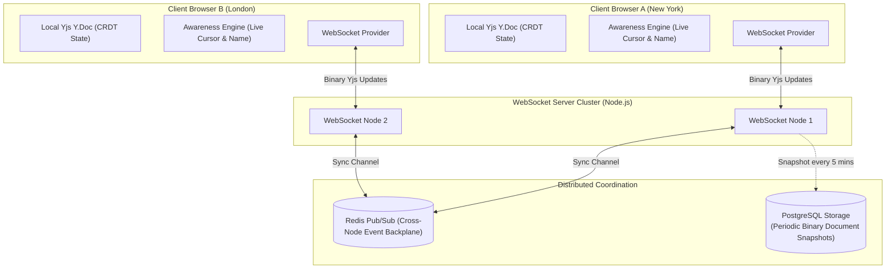

# Real-Time Collaboration & CRDT Architecture

Building collaborative, multiplayer applications (such as Figma-like canvas editors or Notion-like document editors) cannot be accomplished with standard REST polling or database locks. Traditional Operational Transformation (OT) requires a single centralized coordinator, making offline editing and multi-region scaling fragile.

**Conflict-Free Replicated Data Types (CRDTs)** mathematically guarantee **Strong Eventual Consistency**: concurrent edits from distributed clients converge to the exact same state regardless of network latency, packet arrival order, or offline editing duration.

This blueprint implements a production multiplayer architecture using **Yjs CRDTs**, **WebSockets**, **Redis pub/sub backplanes**, and **live cursor presence awareness**.

---

## 1. System Architecture



---

## 2. OT vs CRDT Decision Matrix

| Metric | Operational Transformation (OT) | Conflict-Free Replicated Data Types (CRDT) |
| :--- | :--- | :--- |
| **Central Coordinator** | Mandatory (Server transforms operations) | **None required (Peer-to-peer or decentralized)** |
| **Offline-First Support** | Highly complex, error-prone | **Native (Offline edits auto-merge cleanly)** |
| **Network Reordering** | Fails if operations arrive out of order | **Commutative & Associative (Order agnostic)** |
| **Memory Footprint** | Low (Stores only active operations) | Moderate (Maintains delete tombstones) |
| **Used By** | Google Docs (Legacy) | **Figma, Apple Notes, Linear, Notion** |

---

## 3. WebSocket Sync Server with Redis Backplane

Save this production WebSocket synchronization server under `server/sync_server.ts`:

```typescript
// server/sync_server.ts
import http from 'http';
import WebSocket from 'ws';
import * as Y from 'yjs';
import IORedis from 'ioredis';

const server = http.createServer();
const wss = new WebSocket.Server({ server });

const pub = new IORedis(process.env.REDIS_URL || 'redis://localhost:6379');
const sub = new IORedis(process.env.REDIS_URL || 'redis://localhost:6379');

// Active in-memory document store: Map<documentId, Y.Doc>
const activeDocs = new Map<string, Y.Doc>();

function getOrCreateDoc(docName: string): Y.Doc {
  let doc = activeDocs.get(docName);
  if (!doc) {
    doc = new Y.Doc();
    activeDocs.set(docName, doc);

    // Listen to local document updates and publish to Redis cross-node backplane
    doc.on('update', (update: Uint8Array, origin: any) => {
      if (origin !== 'redis') {
        pub.publishBuffer(`doc:${docName}`, Buffer.from(update));
      }
    });

    // Subscribe to updates from other WebSocket cluster nodes
    sub.subscribe(`doc:${docName}`);
  }
  return doc;
}

// Receive updates from peer nodes via Redis
sub.on('messageBuffer', (channel: Buffer, message: Buffer) => {
  const docName = channel.toString().replace('doc:', '');
  const doc = activeDocs.get(docName);
  if (doc) {
    // Apply update with 'redis' origin tag to avoid infinite loop bounce-back
    Y.applyUpdate(doc, new Uint8Array(message), 'redis');
  }
});

wss.on('connection', (ws: WebSocket, req) => {
  const docName = req.url?.replace('/', '') || 'default-room';
  const doc = getOrCreateDoc(docName);

  // 1. Send current complete document state vector to newly connected client
  const state = Y.encodeStateAsUpdate(doc);
  ws.send(state);

  // 2. Broadcast subsequent document changes to connected websocket clients
  const updateHandler = (update: Uint8Array) => {
    if (ws.readyState === WebSocket.OPEN) {
      ws.send(update);
    }
  };
  doc.on('update', updateHandler);

  // 3. Receive binary incremental updates from client
  ws.on('message', (message: ArrayBuffer) => {
    Y.applyUpdate(doc, new Uint8Array(message), ws);
  });

  ws.on('close', () => {
    doc.off('update', updateHandler);
  });
});

server.listen(1234, () => {
  console.log('Real-Time Yjs WebSocket server listening on port 1234...');
});
```

---

## 4. Client-Side React Hook: Collaborative Editor with Presence

Save this custom hook under `src/hooks/useCollaborativeDoc.ts`:

```typescript
// src/hooks/useCollaborativeDoc.ts
import { useEffect, useState, useRef } from 'react';
import * as Y from 'yjs';

export interface UserPresence {
  id: string;
  name: string;
  color: string;
  cursor: { x: number; y: number } | null;
}

export function useCollaborativeDoc(roomName: string, currentUser: { id: string; name: string; color: string }) {
  const [text, setText] = useState<string>('');
  const [peers, setPeers] = useState<UserPresence[]>([]);
  const ydocRef = useRef<Y.Doc | null>(null);
  const wsRef = useRef<WebSocket | null>(null);

  useEffect(() => {
    const ydoc = new Y.Doc();
    ydocRef.current = ydoc;

    const ytext = ydoc.getText('shared-content');
    const ws = new WebSocket(`ws://localhost:1234/${roomName}`);
    ws.binaryType = 'arraybuffer';
    wsRef.current = ws;

    // Observe local text changes
    ytext.observe(() => {
      setText(ytext.toString());
    });

    // Receive server updates
    ws.onmessage = (event) => {
      const update = new Uint8Array(event.data);
      Y.applyUpdate(ydoc, update);
    };

    // Send local document changes over wire
    ydoc.on('update', (update: Uint8Array, origin: any) => {
      if (origin !== ws && ws.readyState === WebSocket.OPEN) {
        ws.send(update);
      }
    });

    return () => {
      ws.close();
      ydoc.destroy();
    };
  }, [roomName]);

  const updateText = (newContent: string) => {
    if (!ydocRef.current) return;
    const ytext = ydocRef.current.getText('shared-content');
    ydocRef.current.transact(() => {
      ytext.delete(0, ytext.length);
      ytext.insert(0, newContent);
    });
  };

  return { text, updateText, peers };
}
```

---

## 5. Production Hardening Checklist

- [ ] **Binary Framing (No JSON Bloat)**: Always transmit updates as raw binary buffers (`Uint8Array`). Serializing CRDT state vectors into JSON increases message size by 400% and taxes the garbage collector.
- [ ] **Periodic Document Compaction**: Over months of edits, deleted text items accumulate internal CRDT metadata ("tombstones"). Periodically compact documents offline using `Y.encodeStateAsUpdate(doc)` to eliminate deleted history overhead.
- [ ] **Persistence Snapshots**: Store document state vectors periodically in PostgreSQL using `BYTEA` columns (`INSERT INTO documents (doc_id, yjs_state) VALUES ($1, $2)`). On server restart, preload documents from Postgres before accepting WebSocket connections.
- [ ] **Heartbeat Ping/Pong**: Configure 30-second ping/pong cycles on the WebSocket layer. Firewalls and proxies terminate silent TCP connections without firing close events.
