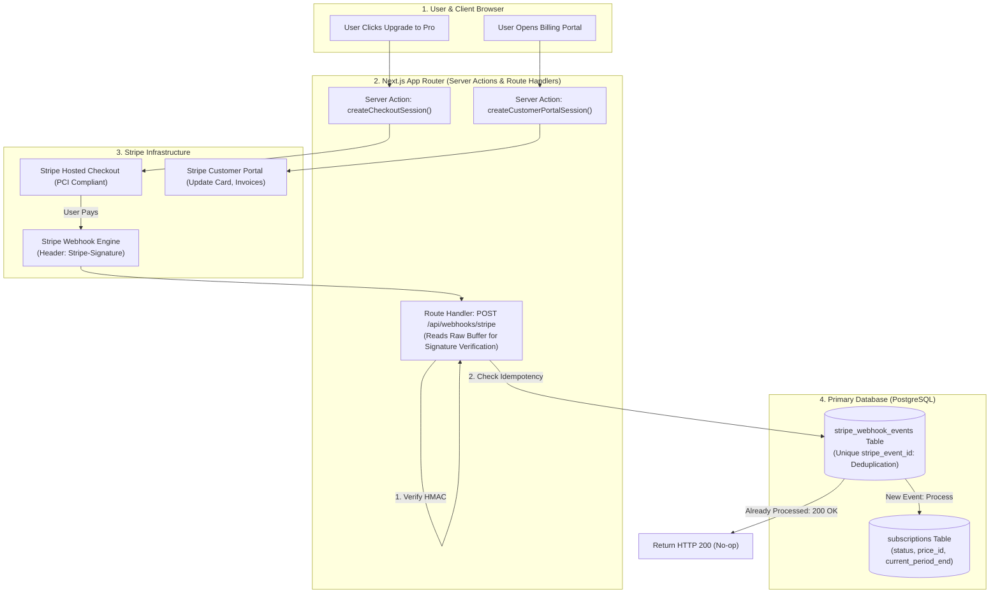

# Stripe Subscription Billing & Idempotent Webhook Ledger

Integrating recurring subscription billing requires more than simply creating a Stripe Checkout Session. The critical challenge lies in **handling asynchronous webhook events**: Stripe redelivers webhooks upon transient network timeouts, and events frequently arrive out of chronological order (e.g. `invoice.paid` arriving before `customer.subscription.created`).

This blueprint implements an enterprise **Stripe Billing Architecture** with **cryptographic HMAC signature verification**, an **idempotent webhook ledger**, and **safe subscription lifecycle state machines**.

---

## 1. System Architecture



---

## 2. Database Schema: Subscriptions & Webhook Ledger

Save this schema definition in your database migration:

```sql
-- Production Stripe Subscription & Webhook Ledger Schema

CREATE TYPE subscription_status_enum AS ENUM (
    'incomplete', 'incomplete_expired', 'trialing', 
    'active', 'past_due', 'canceled', 'unpaid'
);

CREATE TABLE IF NOT EXISTS subscriptions (
    id UUID PRIMARY KEY DEFAULT gen_random_uuid(),
    user_id UUID NOT NULL,
    organization_id UUID,
    stripe_customer_id VARCHAR(128) UNIQUE NOT NULL,
    stripe_subscription_id VARCHAR(128) UNIQUE NOT NULL,
    stripe_price_id VARCHAR(128) NOT NULL,
    status subscription_status_enum NOT NULL,
    current_period_start TIMESTAMPTZ NOT NULL,
    current_period_end TIMESTAMPTZ NOT NULL,
    cancel_at_period_end BOOLEAN NOT NULL DEFAULT FALSE,
    created_at TIMESTAMPTZ DEFAULT NOW(),
    updated_at TIMESTAMPTZ DEFAULT NOW()
);

-- Idempotency Ledger: Guarantees zero duplicate webhook executions
CREATE TABLE IF NOT EXISTS stripe_webhook_events (
    id UUID PRIMARY KEY DEFAULT gen_random_uuid(),
    stripe_event_id VARCHAR(128) UNIQUE NOT NULL,
    event_type VARCHAR(128) NOT NULL,
    processed_at TIMESTAMPTZ DEFAULT NOW(),
    payload JSONB NOT NULL
);

CREATE INDEX idx_subscriptions_user ON subscriptions(user_id);
```

---

## 3. Production Webhook Route Handler (Next.js 15)

Next.js automatically parses request bodies into JSON by default, which corrupts raw bytes needed for HMAC signature verification. Use `req.text()` to preserve the raw payload:

```typescript
// app/api/webhooks/stripe/route.ts
import { NextRequest, NextResponse } from 'next/server';
import Stripe from 'stripe';
import { db } from '@/lib/db';
import { sql } from 'drizzle-orm';
import { subscriptions, stripeWebhookEvents } from '@/lib/schema';

const stripe = new Stripe(process.env.STRIPE_SECRET_KEY!, {
  apiVersion: '2024-06-20',
});

const webhookSecret = process.env.STRIPE_WEBHOOK_SECRET!;

export async function POST(req: NextRequest) {
  const rawBody = await req.text();
  const signature = req.headers.get('stripe-signature');

  if (!signature) {
    return NextResponse.json({ error: 'Missing stripe-signature header' }, { status: 400 });
  }

  let event: Stripe.Event;

  // 1. Verify Cryptographic HMAC Signature
  try {
    event = stripe.webhooks.constructEvent(rawBody, signature, webhookSecret);
  } catch (err: any) {
    console.error(`[Stripe Webhook] Invalid signature: ${err.message}`);
    return NextResponse.json({ error: `Webhook signature verification failed` }, { status: 400 });
  }

  // 2. Idempotency Check: Deduplicate based on event.id
  try {
    const existing = await db
      .select()
      .from(stripeWebhookEvents)
      .where(sql`stripe_event_id = ${event.id}`)
      .limit(1);

    if (existing.length > 0) {
      console.log(`[Stripe Webhook] Event ${event.id} already processed. Acknowledging with 200.`);
      return NextResponse.json({ received: true });
    }

    // 3. Process Subscription Lifecycle Events
    switch (event.type) {
      case 'checkout.session.completed': {
        const session = event.data.object as Stripe.Checkout.Session;
        if (session.mode === 'subscription' && session.subscription) {
          const sub = await stripe.subscriptions.retrieve(session.subscription as string);
          await upsertSubscriptionRecord(sub, session.metadata?.userId);
        }
        break;
      }

      case 'customer.subscription.updated':
      case 'customer.subscription.deleted': {
        const subscription = event.data.object as Stripe.Subscription;
        await upsertSubscriptionRecord(subscription);
        break;
      }

      case 'invoice.payment_failed': {
        const invoice = event.data.object as Stripe.Invoice;
        console.warn(`[Stripe Billing] Payment failed for customer ${invoice.customer}. Dunning triggered.`);
        break;
      }
    }

    // 4. Mark Event as Processed in Ledger
    await db.insert(stripeWebhookEvents).values({
      stripeEventId: event.id,
      eventType: event.type,
      payload: event.data.object,
    });

    return NextResponse.json({ received: true });
  } catch (err: any) {
    console.error(`[Stripe Webhook Error]:`, err);
    // Return 500 so Stripe re-delivers later
    return NextResponse.json({ error: 'Internal server error processing webhook' }, { status: 500 });
  }
}

async function upsertSubscriptionRecord(sub: Stripe.Subscription, fallbackUserId?: string) {
  const customerId = typeof sub.customer === 'string' ? sub.customer : sub.customer.id;
  const priceId = sub.items.data[0].price.id;

  await db.execute(sql`
    INSERT INTO subscriptions (
      user_id, stripe_customer_id, stripe_subscription_id, 
      stripe_price_id, status, current_period_start, 
      current_period_end, cancel_at_period_end
    )
    VALUES (
      COALESCE((SELECT user_id FROM subscriptions WHERE stripe_customer_id = ${customerId} LIMIT 1), ${fallbackUserId}::uuid),
      ${customerId},
      ${sub.id},
      ${priceId},
      ${sub.status}::subscription_status_enum,
      to_timestamp(${sub.current_period_start}),
      to_timestamp(${sub.current_period_end}),
      ${sub.cancel_at_period_end}
    )
    ON CONFLICT (stripe_subscription_id) DO UPDATE SET
      stripe_price_id = EXCLUDED.stripe_price_id,
      status = EXCLUDED.status,
      current_period_start = EXCLUDED.current_period_start,
      current_period_end = EXCLUDED.current_period_end,
      cancel_at_period_end = EXCLUDED.cancel_at_period_end,
      updated_at = NOW();
  `);
}
```

---

## 4. Production Hardening Checklist

- [ ] **Always Use Raw Text Parsing**: Never apply `bodyParser: json` middleware to the webhook route. Modifying even a single whitespace character invalidates the cryptographic HMAC signature.
- [ ] **Enforce Event Idempotency**: Stripe retries failed deliveries with exponential backoff up to 72 hours. An un-deduplicated webhook handler will process duplicate provisioning calls or double-charge meter usages.
- [ ] **Use Customer Portal for Payment Updates**: Never build custom credit card update forms. Redirect users to Stripe's hosted Customer Portal (`stripe.billingPortal.sessions.create`) to maintain zero PCI-DSS compliance scope.
- [ ] **Grace Period for Dunning**: When `invoice.payment_failed` arrives, do not immediately revoke user access. Configure Stripe Smart Retries to retry the card 4 times over 2 weeks while displaying an in-app payment banner.
