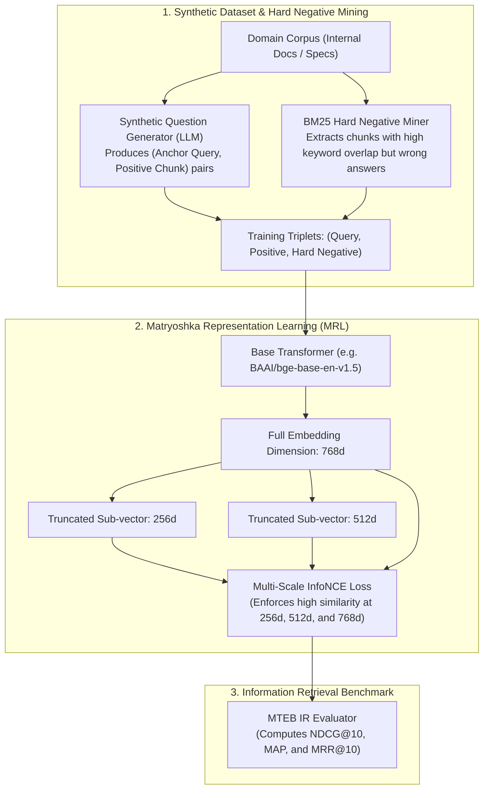

# Embedding & Cross-Encoder Fine-Tuning Architecture

Off-the-shelf embedding models (such as generic `text-embedding-3-small` or `bge-base`) degrade significantly when applied to proprietary corporate domains containing specialized terminology, internal codebases, medical nomenclature, or complex SKUs.

This blueprint implements a production fine-tuning pipeline for **Bi-Encoder embeddings** and **Cross-Encoder rerankers** featuring **Hard Negative Mining**, **Multiple Negatives Ranking Loss (InfoNCE)**, and **Matryoshka Representation Learning (MRL)** for dynamic vector truncation.

---

## 1. Domain Adaptation Architecture



---

## 2. Matryoshka Representation Learning (MRL) Benefits

Standard embeddings require storing the entire dense vector (e.g., 768 or 1536 floats) in vector memory. **Matryoshka embeddings** are trained so that the first `d` dimensions retain 97%+ of the full vector's retrieval precision.

| Truncated Dimension | Memory Reduction vs 768d | Vector Search Speedup | NDCG@10 Retention |
| :--- | :--- | :--- | :--- |
| **768-dim (Full)** | 1.0x (Baseline) | 1.0x | 100.0% |
| **512-dim** | **1.5x smaller** | **1.4x faster** | **99.6%** |
| **256-dim** | **3.0x smaller** | **2.8x faster** | **98.2%** |
| **128-dim** | **6.0x smaller** | **5.4x faster** | **94.8%** |

---

## 3. Production Training Pipeline

Save this complete training script under `training/train_embedding_mrl.py`.

```python
"""
Matryoshka Embedding Fine-Tuning Pipeline with Hard Negatives
Framework: SentenceTransformers v3 + PyTorch
"""

from __future__ import annotations

import json
from typing import List
import torch
from datasets import Dataset
from sentence_transformers import (
    SentenceTransformer,
    SentenceTransformerTrainer,
    SentenceTransformerTrainingArguments,
)
from sentence_transformers.losses import (
    MatryoshkaLoss,
    MultipleNegativesRankingLoss,
)
from sentence_transformers.evaluation import InformationRetrievalEvaluator


def train_domain_embeddings():
    # -----------------------------------------------------------------------
    # 1. Base Model Selection
    # -----------------------------------------------------------------------
    base_model_id = "BAAI/bge-base-en-v1.5"
    model = SentenceTransformer(base_model_id)

    # -----------------------------------------------------------------------
    # 2. Training Loss Setup (MRL + MultipleNegativesRankingLoss)
    # -----------------------------------------------------------------------
    # Inner loss: InfoNCE across in-batch negatives + explicit hard negatives
    inner_loss = MultipleNegativesRankingLoss(model)

    # Outer loss: Enforces representation quality at multiple sub-dimensions
    matryoshka_dimensions = [768, 512, 256, 128]
    train_loss = MatryoshkaLoss(
        model=model,
        loss=inner_loss,
        matryoshka_dims=matryoshka_dimensions
    )

    # -----------------------------------------------------------------------
    # 3. Training Dataset Schema (Anchor, Positive, Negative)
    # -----------------------------------------------------------------------
    # In real production, load from mined JSONL file
    synthetic_triplets = {
        "anchor": [
            "How do I reset the master database password?",
            "What is the maximum latency threshold for the payment webhook?"
        ],
        "positive": [
            "To reset the master database credentials, execute vault kv put secret/db password=NEW_VAL.",
            "Payment webhooks must acknowledge with HTTP 200 within 2500ms to avoid retry queues."
        ],
        "negative": [
            "The read replica credentials can be viewed in the settings dashboard.",
            "Standard API endpoints timeout after 30 seconds."
        ]
    }
    train_dataset = Dataset.from_dict(synthetic_triplets)

    # -----------------------------------------------------------------------
    # 4. Training Arguments
    # -----------------------------------------------------------------------
    training_args = SentenceTransformerTrainingArguments(
        output_dir="./checkpoints/bge-custom-mrl-domain",
        num_train_epochs=4,
        per_device_train_batch_size=16,       # High batch size = more in-batch negatives!
        learning_rate=2e-5,
        warmup_ratio=0.1,
        fp16=True,
        evaluation_strategy="no",
        save_strategy="epoch",
        logging_steps=10,
        report_to="none"
    )

    # -----------------------------------------------------------------------
    # 5. Execute Training Loop
    # -----------------------------------------------------------------------
    trainer = SentenceTransformerTrainer(
        model=model,
        args=training_args,
        train_dataset=train_dataset,
        loss=train_loss
    )

    print("Training domain embedding model with Matryoshka representation...")
    trainer.train()

    # Save final model checkpoint
    model.save_pretrained("./checkpoints/bge-custom-mrl-domain/final")
    print("Model saved. Compatible with standard SentenceTransformers loaders!")


if __name__ == "__main__":
    train_domain_embeddings()
```

---

## 4. Hard Negative Mining Pipeline

To prevent embedding models from learning trivial shortcuts, mine hard negatives using BM25:

```python
"""
BM25 Hard Negative Miner
File: scripts/mine_hard_negatives.py
"""

from typing import Dict, List
from rank_bm25 import BM25Okapi

def mine_hard_negatives_bm25(
    corpus_chunks: List[str],
    queries: List[str],
    positives: List[str],
    top_n: int = 5
) -> List[Dict[str, str]]:
    tokenized_corpus = [doc.lower().split() for doc in corpus_chunks]
    bm25 = BM25Okapi(tokenized_corpus)

    training_pairs = []

    for query, positive in zip(queries, positives):
        tokenized_query = query.lower().split()
        top_indices = bm25.get_top_n(tokenized_query, corpus_chunks, n=top_n)

        # A hard negative has high BM25 keyword score, but is NOT the true positive
        hard_negative = next((doc for doc in top_indices if doc != positive), None)
        
        if hard_negative:
            training_pairs.append({
                "anchor": query,
                "positive": positive,
                "negative": hard_negative
            })

    return training_pairs
```

---

## 5. Production Hardening Checklist

- [ ] **Large Batch Sizes**: `MultipleNegativesRankingLoss` relies on in-batch negatives. With `batch_size = 64`, every anchor query is contrasted against 1 positive and 127 negatives. Use gradient checkpointing to maximize batch sizes.
- [ ] **Dimension Slicing**: When using Matryoshka embeddings in pgvector, create your table using `vector(256)` and slice the embedding array `vector[:256]` before insertion for 3x vector storage savings.
- [ ] **Data Leakage Quarantine**: Strictly segregate the evaluation corpus from the training corpus. Never allow documents appearing in the validation set to be mined for training triplets.
- [ ] **Cross-Encoder Fine-Tuning**: For maximum reranking gain, take the trained hard negatives and fine-tune a Cross-Encoder (`bge-reranker-base`) with binary cross-entropy loss over `(query, document, label)` pairs.
