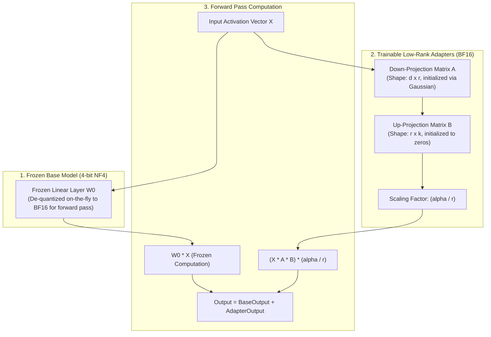

# LoRA & QLoRA Fine-Tuning Pipeline

Full parameter fine-tuning of a 70B parameter model requires over 800GB of GPU VRAM across multiple 8x A100/H100 nodes. **Low-Rank Adaptation (LoRA)** and **Quantized LoRA (QLoRA)** reduce this barrier by freezing the base model weights in 4-bit precision and training lightweight low-rank adapter matrices, enabling fine-tuning of 7B-70B models on commodity GPU hardware.

This blueprint implements an enterprise-grade QLoRA supervised fine-tuning (SFT) pipeline, from dataset tokenization with loss masking to adapter weight merging.

---

## 1. QLoRA Architecture



---

## 2. VRAM Hardware Requirements Matrix

| Model Size | Full Fine-Tuning VRAM | 16-bit LoRA (r=16) | 4-bit QLoRA (r=16, BS=2, Seq=4k) | Minimum Hardware |
| :--- | :--- | :--- | :--- | :--- |
| **8B (Llama 3.1)** | 160 GB VRAM | 32 GB VRAM | **14 GB VRAM** | 1x RTX 4090 (24GB) |
| **14B (Qwen 2.5)** | 280 GB VRAM | 56 GB VRAM | **22 GB VRAM** | 1x A10G / L40S (24-48GB) |
| **70B (Llama 3.1)** | 1,400 GB VRAM | 240 GB VRAM | **48 GB VRAM** | 2x A100 (80GB) or 1x H100 |

---

## 3. Production Fine-Tuning Pipeline

Save this complete training script under `training/train_qlora.py`.

```python
"""
Enterprise QLoRA Fine-Tuning Pipeline
Framework: PyTorch + Hugging Face Transformers + PEFT + TRL + BitsAndBytes
"""

from __future__ import annotations

import os
from dataclasses import dataclass
from typing import Dict, List
import torch
from datasets import load_dataset
from transformers import (
    AutoModelForCausalLM,
    AutoTokenizer,
    BitsAndBytesConfig,
    TrainingArguments,
)
from peft import (
    LoraConfig,
    get_peft_model,
    prepare_model_for_kbit_training,
    PeftModel,
)
from trl import SFTTrainer


# ---------------------------------------------------------------------------
# 1. Hyperparameter Configuration
# ---------------------------------------------------------------------------

@dataclass
class QLoRAConfig:
    model_id: str = "meta-llama/Llama-3.1-8B-Instruct"
    output_dir: str = "./checkpoints/llama-3.1-8b-custom-qlora"
    max_seq_length: int = 4096
    
    # LoRA Hyperparameters
    lora_r: int = 16               # Rank dimension (8 to 64)
    lora_alpha: int = 32          # Typically 2x rank
    lora_dropout: float = 0.05
    target_modules: List[str] = (
        "q_proj", "k_proj", "v_proj", "o_proj",
        "gate_proj", "up_proj", "down_proj"
    )

    # Optimization Hyperparameters
    batch_size: int = 2
    gradient_accumulation_steps: int = 8
    learning_rate: float = 2e-4
    warmup_ratio: float = 0.03
    num_train_epochs: int = 3
    weight_decay: float = 0.01


def build_pipeline(cfg: QLoRAConfig):
    # -----------------------------------------------------------------------
    # 2. 4-Bit NormalFloat4 (NF4) Quantization Config
    # -----------------------------------------------------------------------
    bnb_config = BitsAndBytesConfig(
        load_in_4bit=True,
        bnb_4bit_quant_type="nf4",
        bnb_4bit_use_double_quant=True,       # Compresses quantization constants
        bnb_4bit_compute_dtype=torch.bfloat16 # Fast computation in bfloat16
    )

    # -----------------------------------------------------------------------
    # 3. Load Base Model and Tokenizer
    # -----------------------------------------------------------------------
    tokenizer = AutoTokenizer.from_pretrained(cfg.model_id, trust_remote_code=True)
    if tokenizer.pad_token is None:
        tokenizer.pad_token = tokenizer.eos_token
    tokenizer.padding_side = "right"

    base_model = AutoModelForCausalLM.from_pretrained(
        cfg.model_id,
        quantization_config=bnb_config,
        device_map="auto",
        torch_dtype=torch.bfloat16,
        trust_remote_code=True
    )

    # Prepare for k-bit training and gradient checkpointing
    base_model = prepare_model_for_kbit_training(base_model, use_gradient_checkpointing=True)

    # -----------------------------------------------------------------------
    # 4. Attach LoRA Adapter
    # -----------------------------------------------------------------------
    peft_config = LoraConfig(
        r=cfg.lora_r,
        lora_alpha=cfg.lora_alpha,
        target_modules=list(cfg.target_modules),
        lora_dropout=cfg.lora_dropout,
        bias="none",
        task_type="CAUSAL_LM"
    )

    model = get_peft_model(base_model, peft_config)
    model.print_trainable_parameters()
    # Output: trainable params: ~42M || all params: ~8B || trainable%: 0.52%

    # -----------------------------------------------------------------------
    # 5. Training Arguments
    # -----------------------------------------------------------------------
    training_args = TrainingArguments(
        output_dir=cfg.output_dir,
        per_device_train_batch_size=cfg.batch_size,
        gradient_accumulation_steps=cfg.gradient_accumulation_steps,
        learning_rate=cfg.learning_rate,
        lr_scheduler_type="cosine",
        warmup_ratio=cfg.warmup_ratio,
        num_train_epochs=cfg.num_train_epochs,
        weight_decay=cfg.weight_decay,
        fp16=False,
        bf16=True,                             # Native BF16 for Ampere/Hopper
        logging_steps=10,
        save_strategy="epoch",
        evaluation_strategy="no",
        optim="paged_adamw_8bit",             # Paged optimizer eliminates OOM spikes
        gradient_checkpointing=True,
        report_to="none"
    )

    return model, tokenizer, training_args
```

---

## 4. Adapter Merging for Zero-Overhead Inference

During training, keeping the base model in 4-bit saves memory. For production serving on vLLM or Triton, **merge the LoRA adapter back into the full 16-bit model weights** to eliminate dynamic low-rank matrix multiplications at runtime.

Save this merge script under `training/merge_adapter.py`.

```python
"""
LoRA Adapter Merge & Export Script
File: training/merge_adapter.py
"""

import torch
from transformers import AutoModelForCausalLM, AutoTokenizer
from peft import PeftModel

BASE_MODEL = "meta-llama/Llama-3.1-8B-Instruct"
ADAPTER_PATH = "./checkpoints/llama-3.1-8b-custom-qlora"
EXPORT_PATH = "./models/llama-3.1-8b-merged-production"

def merge_and_export():
    print(f"Loading base model in FP16 from {BASE_MODEL}...")
    base_model = AutoModelForCausalLM.from_pretrained(
        BASE_MODEL,
        return_dict=True,
        torch_dtype=torch.float16,
        device_map="auto"
    )

    print(f"Loading LoRA adapter weights from {ADAPTER_PATH}...")
    model = PeftModel.from_pretrained(base_model, ADAPTER_PATH)

    print("Merging adapter weights into base model layers (W = W0 + B*A)...")
    merged_model = model.merge_and_unload()

    tokenizer = AutoTokenizer.from_pretrained(BASE_MODEL)
    print(f"Saving merged 16-bit model to {EXPORT_PATH}...")
    merged_model.save_pretrained(EXPORT_PATH, safe_serialization=True)
    tokenizer.save_pretrained(EXPORT_PATH)
    print("Export complete. Model ready for vLLM deployment!")

if __name__ == "__main__":
    merge_and_export()
```

---

## 5. Production Hardening Checklist

- [ ] **Target All Linear Modules**: Always fine-tune both attention projections (`q_proj`, `k_proj`, `v_proj`, `o_proj`) and MLP feed-forward layers (`gate_proj`, `up_proj`, `down_proj`). Tuning only attention modules halves sample efficiency.
- [ ] **Loss Masking on Prompts**: In instruction datasets, set `labels = -100` on the user prompt tokens. The loss gradient must compute strictly on the assistant's generation tokens to prevent the model from memorizing customer prompts.
- [ ] **Paged Optimizers**: Always use `paged_adamw_8bit` or `paged_adamw_32bit`. When gradient memory spikes near batch boundaries, paged optimizers seamlessly evict optimizer states to CPU RAM rather than crashing with CUDA OOM.
- [ ] **Never Serve Unmerged LoRA in High-Throughput Scenarios**: Serving raw adapter layers incurs additional kernel launches on every forward pass. Merge adapters using `merge_and_unload()` before pushing to vLLM.
