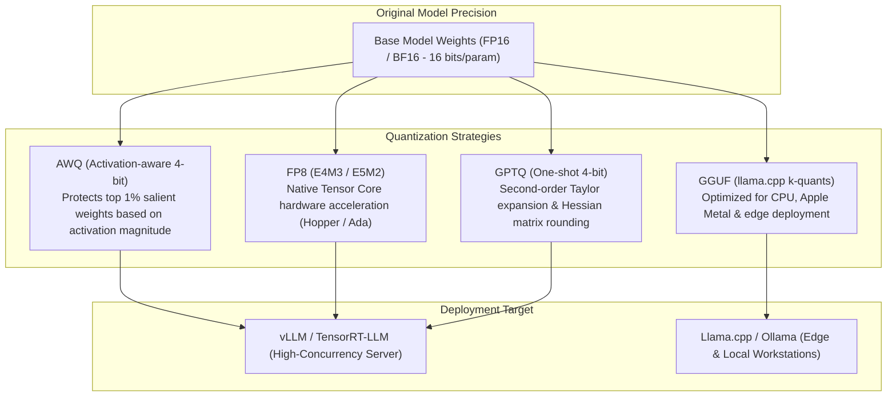

# Model Quantization & Compression Architecture

Deploying large models (e.g., Llama 70B, Mixtral 8x7B) in standard 16-bit precision requires expensive multi-GPU infrastructure. Post-Training Quantization (PTQ) compresses floating-point weights down to 8-bit or 4-bit representations, **slashing GPU VRAM requirements by 50% to 75%** while keeping task accuracy degradation within 1-2%.

This blueprint provides production architectures for the primary quantization paradigms: **AWQ**, **Native FP8**, **GPTQ**, and **GGUF**.

---

## 1. Quantization Taxonomy



---

## 2. Benchmark & Hardware Compatibility Matrix

| Quantization Format | Target Precision | GPU VRAM (70B Model) | Relative Perplexity Impact | Minimum GPU Architecture |
| :--- | :--- | :--- | :--- | :--- |
| **FP16 / BF16 (Baseline)** | 16-bit | 140 GB | 1.00x (Baseline) | Any CUDA GPU |
| **FP8 (E4M3)** | 8-bit | **72 GB** | **1.01x (Negligible)** | NVIDIA Ada (RTX 4090, L40S) or Hopper (H100) |
| **AWQ (INT4-GEMM)** | 4-bit | **38 GB** | 1.03x (Minimal) | Ampere (A100, RTX 3090) or newer |
| **GPTQ (INT4)** | 4-bit | **39 GB** | 1.05x (Low) | Turing (T4, RTX 2080) or newer |
| **GGUF (Q4_K_M)** | 4.5-bit | **42 GB** | 1.04x (Low) | CPU (AVX2/AVX-512) or Apple Silicon (Metal) |

---

## 3. Production Implementation: AWQ Quantization Pipeline

Activation-aware Weight Quantization (AWQ) outperforms simple uniform quantization because it observes that **not all weights are equally important**. By inspecting intermediate activation magnitudes on a small calibration dataset, AWQ scales up the top 1% salient weights before INT4 rounding to protect reasoning capabilities.

Save this script under `quantization/quantize_awq.py`.

```python
"""
AWQ 4-Bit Quantization Pipeline
Framework: AutoAWQ + PyTorch
"""

from __future__ import annotations

import torch
from awq import AutoAWQForCausalLM
from transformers import AutoTokenizer

MODEL_PATH = "meta-llama/Llama-3.1-8B-Instruct"
QUANT_OUTPUT_PATH = "./models/llama-3.1-8b-instruct-awq-int4"

QUANT_CONFIG = {
    "zero_point": True,
    "q_group_size": 128,          # Group size for scaling factor
    "w_bit": 4,                   # Target weight bit width
    "version": "GEMM"             # GEMM kernel for high-throughput vLLM serving
}

def run_awq_quantization():
    print(f"Loading tokenizer for {MODEL_PATH}...")
    tokenizer = AutoTokenizer.from_pretrained(MODEL_PATH, trust_remote_code=True)

    print(f"Loading full-precision model from {MODEL_PATH}...")
    model = AutoAWQForCausalLM.from_pretrained(
        MODEL_PATH,
        device_map="auto",
        torch_dtype=torch.float16,
        safetensors=True
    )

    print("Executing activation-aware quantization with calibration dataset...")
    # Uses built-in pile-val or custom text samples to measure activation magnitudes
    model.quantize(
        tokenizer,
        quant_config=QUANT_CONFIG,
        calib_data="pileval",
        split="train",
        max_calib_samples=128,
        max_calib_seq_len=2048
    )

    print(f"Saving quantized weights and metadata to {QUANT_OUTPUT_PATH}...")
    model.save_quantized(QUANT_OUTPUT_PATH)
    tokenizer.save_pretrained(QUANT_OUTPUT_PATH)
    print("AWQ quantization complete. Deployable directly with: vllm serve --quantization awq")

if __name__ == "__main__":
    run_awq_quantization()
```

---

## 4. GGUF Quantization for Local & Edge Inference

For edge deployment and CPU execution via llama.cpp or Ollama, quantize Hugging Face checkpoints to GGUF format with medium k-quants (`Q4_K_M`):

```bash
# 1. Clone and compile llama.cpp
git clone https://github.com/ggerganov/llama.cpp
cd llama.cpp && cmake -B build && cmake --build build --config Release -j

# 2. Convert Hugging Face Safetensors to FP16 GGUF
python3 convert_hf_to_gguf.py \
  --outtype f16 \
  --outfile ./models/llama-8b-f16.gguf \
  /path/to/huggingface/model

# 3. Quantize FP16 GGUF to optimal Q4_K_M (4-bit medium k-quant)
./build/bin/llama-quantize \
  ./models/llama-8b-f16.gguf \
  ./models/llama-8b-Q4_K_M.gguf \
  Q4_K_M
```

---

## 5. Production Hardening Checklist

- [ ] **Calibration Dataset Alignment**: Never calibrate AWQ or GPTQ using code datasets if the model will serve medical or financial text. Ensure calibration distribution matches production ingress traffic.
- [ ] **FP8 Native on Ada/Hopper**: If deploying on NVIDIA H100 or L40S GPUs, prefer native FP8 serving in vLLM (`--kv-cache-dtype fp8`) over INT4 AWQ. FP8 provides near-zero loss in reasoning ability with 2x memory reduction out of the box.
- [ ] **Perplexity Validation Gate**: Always run perplexity benchmarks over the `wikitext-2` test split before and after quantization:
  `delta_perplexity = (quantized_ppl - base_ppl) / base_ppl`
  Reject any INT4 model where `delta_perplexity > 0.08` (8% degradation).
- [ ] **Group Size Setting**: Always use `q_group_size = 128`. Group size 64 increases VRAM footprint; group size 256 causes measurable degradation in coding and reasoning tasks.
