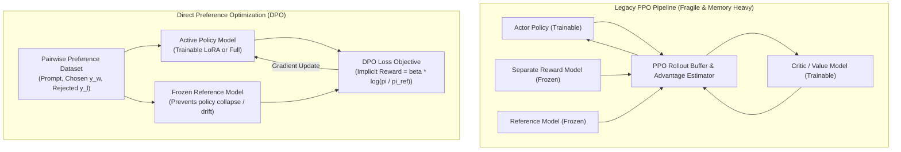

# Preference Alignment & Direct Preference Optimization (DPO)

Traditional Reinforcement Learning from Human Feedback (RLHF) via Proximal Policy Optimization (PPO) is notoriously unstable and resource-intensive, requiring four simultaneous models in GPU memory: an **Actor**, a **Critic (Value Model)**, a **Reward Model**, and a **Frozen Reference Model**.

**Direct Preference Optimization (DPO)** mathematically proves that the reward model can be directly reparameterized by the policy network itself. This eliminates the reward model and reinforcement learning loop entirely, transforming preference alignment into a straightforward binary cross-entropy loss over pairwise `(chosen, rejected)` completions.

---

## 1. PPO vs DPO Architectural Comparison



---

## 2. The DPO Mathematical Objective

The DPO loss function directly optimizes the probability ratio of the preferred response over the dispreferred response relative to the reference model:

`Loss = - E [ log sigma ( beta * log( pi_theta(y_w | x) / pi_ref(y_w | x) ) - beta * log( pi_theta(y_l | x) / pi_ref(y_l | x) ) ) ]`

Where:
- `y_w` is the **winning/chosen** completion.
- `y_l` is the **losing/rejected** completion.
- `pi_theta` is the model being trained.
- `pi_ref` is the frozen reference model (typically the base SFT model).
- `beta` controls deviation penalty from the reference model (typically 0.1 to 0.5).

---

## 3. Production Pairwise Dataset Schema

Save your training pairs in a standardized JSONL format (`data/preferences.jsonl`):

```json
{
  "prompt": "Write a bash function to check if port 5432 is open.",
  "chosen": "```bash\ncheck_pg_port() {\n  nc -z -v -w3 localhost 5432\n}\n```\nThis function uses `nc` with a 3-second timeout to check TCP reachability safely.",
  "rejected": "Just type `telnet localhost 5432` into your console and see if it fails."
}
```

---

## 4. Production DPO Training Pipeline

Save this alignment pipeline under `training/train_dpo.py`.

```python
"""
Direct Preference Optimization (DPO) Training Pipeline
Framework: PyTorch + Hugging Face Transformers + TRL + PEFT
"""

from __future__ import annotations

import torch
from datasets import load_dataset
from transformers import AutoModelForCausalLM, AutoTokenizer, TrainingArguments
from peft import LoraConfig, get_peft_model
from trl import DPOTrainer, DPOConfig


def run_dpo_alignment():
    # -----------------------------------------------------------------------
    # 1. Base Model & Tokenizer Selection
    # -----------------------------------------------------------------------
    model_name = "meta-llama/Llama-3.1-8B-Instruct"
    
    tokenizer = AutoTokenizer.from_pretrained(model_name)
    if tokenizer.pad_token is None:
        tokenizer.pad_token = tokenizer.eos_token

    # -----------------------------------------------------------------------
    # 2. Model Initialization (BF16 with LoRA for Memory Efficiency)
    # -----------------------------------------------------------------------
    model = AutoModelForCausalLM.from_pretrained(
        model_name,
        torch_dtype=torch.bfloat16,
        device_map="auto"
    )

    # Attach LoRA to trainable policy
    peft_config = LoraConfig(
        r=16,
        lora_alpha=32,
        lora_dropout=0.05,
        target_modules=["q_proj", "v_proj", "k_proj", "o_proj"],
        bias="none",
        task_type="CAUSAL_LM"
    )

    # Note: When using LoRA with DPOTrainer, ref_model can be left as None.
    # TRL automatically uses the frozen base model (with adapters disabled) as pi_ref!
    
    # -----------------------------------------------------------------------
    # 3. DPO Hyperparameters
    # -----------------------------------------------------------------------
    training_args = DPOConfig(
        output_dir="./checkpoints/dpo-aligned-llama-8b",
        beta=0.1,                              # Critical: controls conservative regularization
        loss_type="sigmoid",                   # Standard DPO loss
        per_device_train_batch_size=2,
        gradient_accumulation_steps=8,
        learning_rate=5e-7,                   # DPO requires small learning rates (5e-7 to 1e-6)
        lr_scheduler_type="cosine",
        warmup_ratio=0.1,
        num_train_epochs=2,
        bf16=True,
        logging_steps=10,
        save_strategy="epoch",
        max_prompt_length=1024,
        max_length=2048,
        remove_unused_columns=False,
        report_to="none"
    )

    # -----------------------------------------------------------------------
    # 4. Dataset Loading & Training
    # -----------------------------------------------------------------------
    dataset = load_dataset("json", data_files="data/preferences.jsonl")

    dpo_trainer = DPOTrainer(
        model=model,
        ref_model=None,                        # Handled automatically via LoRA disabling
        args=training_args,
        train_dataset=dataset["train"],
        tokenizer=tokenizer,
        peft_config=peft_config
    )

    print("Executing Direct Preference Optimization loop...")
    dpo_trainer.train()
    
    print("Saving aligned adapter weights...")
    dpo_trainer.save_model("./checkpoints/dpo-aligned-llama-8b/final")


if __name__ == "__main__":
    run_dpo_alignment()
```

---

## 5. Odds Ratio Preference Optimization (ORPO) Alternative

When compute is severely constrained, **ORPO (Odds Ratio Preference Optimization)** merges supervised fine-tuning (SFT) and preference alignment into a single training run, eliminating the need for a separate reference model altogether.

| Parameter | DPO | ORPO |
| :--- | :--- | :--- |
| **Prerequisite** | Requires a high-quality pre-existing SFT checkpoint | Trains from raw instruct model in a single stage |
| **Reference Model** | Mandatory (either frozen base weights or explicit model) | None (Uses odds ratio penalty against SFT cross-entropy loss) |
| **Learning Rate** | Small (`5e-7` to `1e-6`) | Moderate (`5e-6` to `2e-5`) |
| **Memory Footprint** | Moderate (dual forward passes: policy and reference) | Minimal (single model forward pass) |

---

## 6. Production Hardening Checklist

- [ ] **Conservative Learning Rate**: Keep DPO learning rates between `5e-7` and `2e-6`. Learning rates higher than `5e-5` cause rapid policy divergence, catastrophic forgetting, and output gibberish.
- [ ] **Beta Tuning**: Default `beta=0.1`. If the model begins ignoring tone instructions, increase `beta` to `0.2 - 0.3` to anchor outputs more tightly to the reference distribution.
- [ ] **Data Quality Over Volume**: 2,000 carefully curated, unambiguous pairwise examples deliver higher alignment gains than 100,000 noisy, crowdsourced preference pairs.
- [ ] **Length-Bias Sanitization**: Models easily exploit response length as a proxy for quality. Ensure your `chosen` and `rejected` completions have balanced average token lengths.
