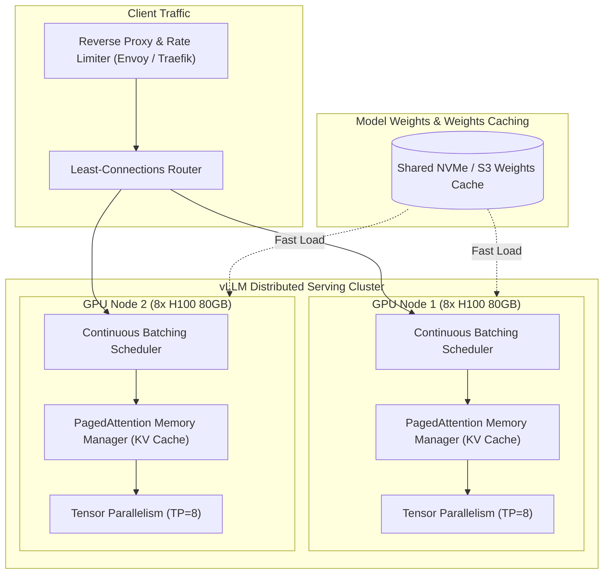

# ⚡ High-Throughput LLM Serving Architecture: vLLM & Triton

An enterprise architecture blueprint for self-hosted, cost-effective LLM serving clusters delivering maximum tokens per second (TPS) using **vLLM**, **PagedAttention**, **Continuous Batching**, and **NVIDIA Triton Inference Server**.

---

## 1. System Architecture



---

## 2. Core Optimization Principles

1. **PagedAttention (KV Cache Virtualization):** Traditional serving allocates contiguous memory for max sequence lengths (e.g. 8k tokens), wasting 60–80% of VRAM due to fragmentation. PagedAttention divides key-value caches into virtual blocks (pages), increasing batch concurrency by 2x to 4x.
2. **Continuous Batching (Iteration-Level Scheduling):** Instead of waiting for the longest request in a batch to finish generating, new requests are dynamically inserted into the batch iteration by iteration, eliminating idle GPU compute.
3. **Quantization Strategies (FP8 & AWQ):**
   - **FP8 (Ada Lovelace / Hopper):** Native tensor core throughput without perceptual degradation.
   - **AWQ (Activation-aware Weight Quantization):** 4-bit weight compression with high accuracy for 70B+ parameter models on budget GPUs.

---

## 3. Production Deployment Specification (`docker-compose.yml`)

```yaml
version: '3.8'

services:
  vllm-engine:
    image: vllm/vllm-openai:latest
    container_name: vllm-prod-server
    runtime: nvidia
    environment:
      - HUGGING_FACE_HUB_TOKEN=${HF_TOKEN}
    ports:
      - "8000:8000"
    volumes:
      - ~/.cache/huggingface:/root/.cache/huggingface
      - /data/models:/models
    command: >
      --model meta-llama/Llama-3.1-70B-Instruct
      --tensor-parallel-size 4
      --pipeline-parallel-size 1
      --max-model-len 8192
      --gpu-memory-utilization 0.92
      --kv-cache-dtype auto
      --enable-chunked-prefill
      --trust-remote-code
    deploy:
      resources:
        reservations:
          devices:
            - driver: nvidia
              count: 4
              capabilities: [gpu]
    restart: always
```

---

## 4. Performance Benchmarks & Sizing Matrix

| Model Size | Precision | GPUs Required | Target Concurrency | Throughput (tok/sec) |
| :--- | :--- | :--- | :--- | :--- |
| **8B Params** | FP16 / BF16 | 1x RTX 4090 / A10G | 32 streams | ~1,200 tok/s |
| **70B Params** | FP8 / AWQ | 4x A100 (80GB) | 64 streams | ~2,400 tok/s |
| **70B Params** | FP16 | 8x H100 (80GB) | 128 streams | ~5,800 tok/s |
