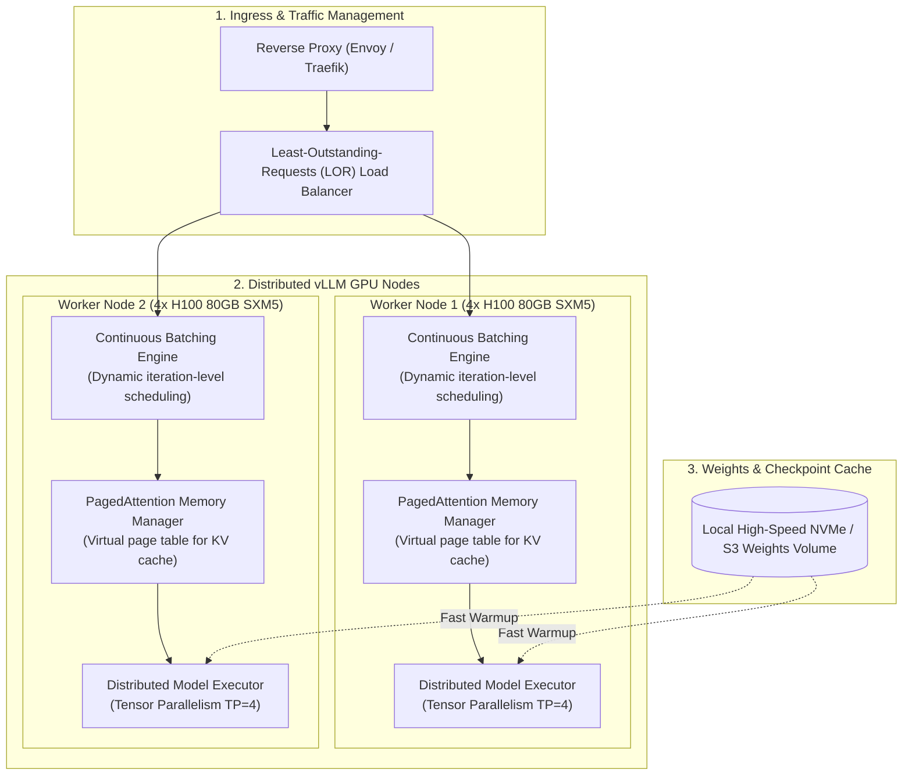

# High-Throughput LLM Serving Architecture: vLLM & Triton

Serving frontier Large Language Models at scale requires maximizing GPU memory utilization while maintaining low Time-To-First-Token (TTFT) and high Tokens-Per-Second (TPS). Traditional serving systems waste up to 60-80% of GPU VRAM due to Key-Value (KV) cache memory fragmentation and static request batching.

**vLLM** eliminates this memory waste via **PagedAttention** (managing KV cache like operating system virtual memory pages) and **Continuous Batching** (inserting new requests into ongoing GPU matrix multiplications at token boundaries).

---

## 1. Serving Cluster Architecture



---

## 2. Serving Latency & Performance Profile

| Metric | Target SLA | Bottleneck Component | Primary Mitigation |
| :--- | :--- | :--- | :--- |
| **TTFT (Time-To-First-Token)** | under 350ms (Prompt: 1k tokens) | Prefill Phase (Compute-bound GEMM) | Chunked Prefill (`--enable-chunked-prefill`) |
| **ITL (Inter-Token Latency)** | under 25ms / token | Decode Phase (Memory bandwidth-bound) | FP8 / AWQ quantization, PagedAttention |
| **Total Cluster TPS** | >= 2,500 tokens / sec | GPU VRAM capacity & KV cache spills | Increase `--gpu-memory-utilization 0.95` |
| **KV Cache Waste** | under 4% | Memory fragmentation | PagedAttention 16-token memory page size |

---

## 3. Production Deployment Specification

Save this production Docker Compose configuration under `deploy/vllm/docker-compose.yml`.

```yaml
version: '3.8'

services:
  vllm-primary:
    image: vllm/vllm-openai:v0.6.3
    container_name: vllm-worker-01
    runtime: nvidia
    restart: always
    environment:
      - HUGGING_FACE_HUB_TOKEN=${HF_TOKEN}
      - NCCL_DEBUG=INFO
      - VLLM_LOGGING_LEVEL=INFO
    ports:
      - "8000:8000"
    volumes:
      - /mnt/nvme/models:/root/.cache/huggingface
      - /dev/shm:/dev/shm
    ipc: host
    deploy:
      resources:
        reservations:
          devices:
            - driver: nvidia
              count: 4
              capabilities: [gpu]
    command: >
      --model meta-llama/Llama-3.1-70B-Instruct
      --tensor-parallel-size 4
      --gpu-memory-utilization 0.94
      --max-model-len 8192
      --max-num-seqs 256
      --enable-chunked-prefill
      --kv-cache-dtype auto
      --port 8000
      --trust-remote-code
      --disable-log-requests
```

---

## 4. Latency & Throughput Benchmark Harness

Save this benchmarking script under `scripts/benchmark_serving.py` to validate TTFT, ITL, and aggregate tokens per second across concurrent client streams.

```python
"""
vLLM Production Inference Benchmarking Tool
Framework: Pure Python 3.11 + Asyncio + HTTPX
"""

from __future__ import annotations

import asyncio
import time
from dataclasses import dataclass
from typing import List
import httpx


@dataclass
class RequestBenchmarkResult:
    status_code: int
    ttft_seconds: float
    total_latency_seconds: float
    generated_tokens: int
    itl_seconds: float  # Inter-token latency


async def send_streaming_request(
    client: httpx.AsyncClient,
    url: str,
    prompt: str,
    max_tokens: int = 128
) -> RequestBenchmarkResult:
    start_time = time.perf_counter()
    ttft = 0.0
    first_token_received = False
    tokens_count = 0

    payload = {
        "model": "meta-llama/Llama-3.1-70B-Instruct",
        "messages": [{"role": "user", "content": prompt}],
        "max_tokens": max_tokens,
        "temperature": 0.0,
        "stream": True
    }

    try:
        async with client.stream("POST", f"{url}/v1/chat/completions", json=payload, timeout=60.0) as response:
            async for line in response.aiter_lines():
                if not line or not line.startswith("data: "):
                    continue
                if line.strip() == "data: [DONE]":
                    break

                if not first_token_received:
                    ttft = time.perf_counter() - start_time
                    first_token_received = True

                tokens_count += 1

        total_time = time.perf_counter() - start_time
        decode_time = total_time - ttft
        itl = (decode_time / max(1, tokens_count - 1)) if tokens_count > 1 else 0.0

        return RequestBenchmarkResult(
            status_code=response.status_code,
            ttft_seconds=ttft,
            total_latency_seconds=total_time,
            generated_tokens=tokens_count,
            itl_seconds=itl
        )
    except Exception:
        return RequestBenchmarkResult(status_code=500, ttft_seconds=0, total_latency_seconds=0, generated_tokens=0, itl_seconds=0)


async def run_concurrent_load_test(url: str, concurrency: int = 32):
    prompts = [
        "Explain the mechanism of PagedAttention and how it mitigates internal fragmentation in KV cache memory."
    ] * concurrency

    async with httpx.AsyncClient(timeout=120.0) as client:
        start_cluster_time = time.perf_counter()
        tasks = [send_streaming_request(client, url, p, max_tokens=150) for p in prompts]
        results: List[RequestBenchmarkResult] = await asyncio.gather(*tasks)
        total_cluster_time = time.perf_counter() - start_cluster_time

    successful = [r for r in results if r.status_code == 200]
    total_tokens = sum(r.generated_tokens for r in successful)
    avg_ttft = sum(r.ttft_seconds for r in successful) / len(successful)
    avg_itl = sum(r.itl_seconds for r in successful) / len(successful)
    cluster_tps = total_tokens / total_cluster_time

    print(f"--- Benchmark Results (Concurrency: {concurrency}) ---")
    print(f"Successful Requests: {len(successful)} / {concurrency}")
    print(f"Average TTFT: {avg_ttft * 1000:.2f} ms")
    print(f"Average ITL: {avg_itl * 1000:.2f} ms / token")
    print(f"Aggregate Cluster Throughput: {cluster_tps:.2f} tokens/second")


if __name__ == "__main__":
    asyncio.run(run_concurrent_load_test("http://localhost:8000", concurrency=16))
```

---

## 5. Production Hardening Checklist

- [ ] **Shared Memory Allocation**: Always run container with `ipc: host` or `--shm-size=16g`. Multi-GPU Tensor Parallelism communicates through `/dev/shm`; default container sizes crash PyTorch NCCL collectives.
- [ ] **Chunked Prefill**: Enable `--enable-chunked-prefill` to interleave compute-heavy prompt prefilling with lightweight token generation, preventing long user prompts from causing latency spikes for concurrent streams.
- [ ] **Graceful Preemption**: Configure the load balancer health check probe against `/health`. vLLM returns HTTP 503 if GPU VRAM is exhausted and requests cannot be queued.
- [ ] **Quantization Selection**: Use FP8 (`--kv-cache-dtype fp8`) on NVIDIA Ada/Hopper architectures (L40S, H100) to cut KV cache VRAM footprint by 50% with zero observable quality degradation.
