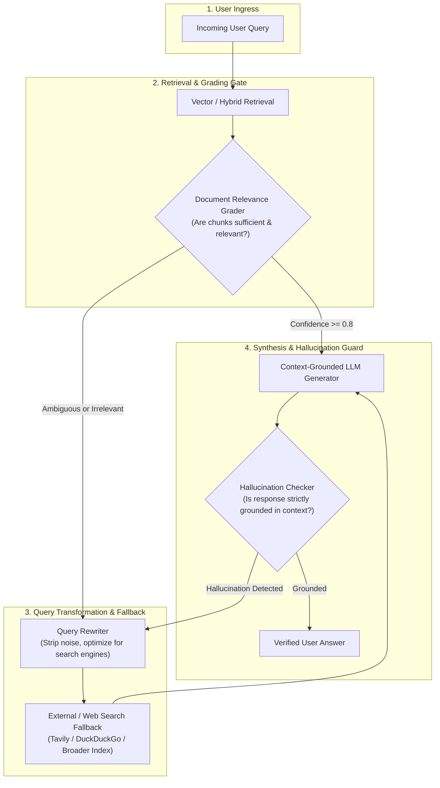

# Corrective RAG & Self-Reflection

Standard RAG operates on a naive assumption: whatever chunks the vector index returns are automatically relevant, accurate, and sufficient to answer the prompt. When retrieval returns irrelevant or conflicting documents, naive RAG either hallucinates or confidently serves wrong answers.

**Corrective RAG (CRAG)** and **Self-RAG** introduce dynamic evaluation gates inside the retrieval loop. They actively grade document relevance, rewrite poor user queries, trigger fallback web retrieval when internal docs are inadequate, and grade final outputs against hallucinations.

---

## 1. Corrective RAG Architecture



---

## 2. Evaluation Gates & Decision Matrix

| Evaluation Gate | Evaluator Model | Condition | Automated Remediation |
| :--- | :--- | :--- | :--- |
| **Document Relevance** | Fast Classifier (GPT-4o-mini / Mistral) | Chunks do not contain factual answers to user question | Drop irrelevant chunks; trigger Query Rewriter + Fallback |
| **Query Clarity** | Heuristic / LLM Rewriter | Ambiguous phrasing, missing entity names, typo-dense | Transform prompt into optimized keyword search terms |
| **Hallucination Gate** | NLI / LLM Faithfulness Grader | Generated claim is absent from retrieved document context | Reject response; regenerate with strict temperature=0.0 |
| **Answer Completeness** | Semantic Rubric | Answer addresses only part of a multi-part prompt | Trigger query decomposition and second-round retrieval |

---

## 3. Production Implementation: State Machine Pipeline

Save this state machine under `src/rag/corrective_rag.py`.

```python
"""
Corrective RAG (CRAG) Production State Machine
Framework: Pure Python 3.11 + Pydantic v2 + Async
"""

from __future__ import annotations

from typing import Any, Dict, List, Literal, Optional
from pydantic import BaseModel, Field


# ---------------------------------------------------------------------------
# 1. State Models
# ---------------------------------------------------------------------------

class DocumentChunk(BaseModel):
    id: str
    content: str
    is_relevant: Optional[bool] = None


class CRAGState(BaseModel):
    original_query: str
    transformed_query: Optional[str] = None
    documents: List[DocumentChunk] = Field(default_factory=list)
    generation: Optional[str] = None
    requires_fallback_search: bool = False
    retry_count: int = 0
    max_retries: int = 2


# ---------------------------------------------------------------------------
# 2. Pipeline Nodes
# ---------------------------------------------------------------------------

class CorrectiveRAGPipeline:
    def __init__(self, vector_search_fn, fallback_search_fn, llm_generate_fn):
        self.vector_search = vector_search_fn
        self.fallback_search = fallback_search_fn
        self.llm_generate = llm_generate_fn

    async def node_retrieve(self, state: CRAGState) -> CRAGState:
        """Executes vector retrieval using current best query."""
        search_query = state.transformed_query or state.original_query
        raw_docs = await self.vector_search(search_query)
        state.documents = [DocumentChunk(id=d["id"], content=d["content"]) for d in raw_docs]
        return state

    async def node_grade_documents(self, state: CRAGState) -> CRAGState:
        """
        Grades each document chunk for relevance to the original query.
        Filters out low-utility noise and flags fallback if content is insufficient.
        """
        relevant_docs: List[DocumentChunk] = []

        for doc in state.documents:
            # Deterministic/LLM grading logic
            # Simulating fast binary grading check:
            # Prompt: "Does this document contain information to answer {state.original_query}?"
            has_keywords = any(w.lower() in doc.content.lower() for w in state.original_query.split())
            if has_keywords:
                doc.is_relevant = True
                relevant_docs.append(doc)
            else:
                doc.is_relevant = False

        state.documents = relevant_docs

        # If zero documents passed relevance check, activate fallback
        if len(state.documents) == 0:
            state.requires_fallback_search = True

        return state

    async def node_transform_query(self, state: CRAGState) -> CRAGState:
        """
        Rewrites the user prompt to maximize retrieval recall on search engines.
        """
        # Formulate query rewrite prompt
        rewrite_prompt = (
            f"Analyze the user question and produce an optimized keyword search query.\n"
            f"Original Question: {state.original_query}\n"
            f"Search Query:"
        )
        new_query = await self.llm_generate(rewrite_prompt, max_tokens=30)
        state.transformed_query = new_query.strip()
        return state

    async def node_fallback_search(self, state: CRAGState) -> CRAGState:
        """Runs external search engine when local knowledge base is empty."""
        query = state.transformed_query or state.original_query
        web_results = await self.fallback_search(query)
        for res in web_results:
            state.documents.append(DocumentChunk(id=res["url"], content=res["snippet"], is_relevant=True))
        return state

    async def node_generate(self, state: CRAGState) -> CRAGState:
        """Generates grounded answer strictly conditioned on relevant documents."""
        context_text = "\n\n".join([f"[Doc {d.id}]: {d.content}" for d in state.documents])
        synthesis_prompt = (
            f"Answer the question strictly based on the retrieved context below. "
            f"If the context does not contain the answer, say 'Insufficient documentation available.'\n\n"
            f"Context:\n{context_text}\n\n"
            f"Question: {state.original_query}\n"
            f"Answer:"
        )
        answer = await self.llm_generate(synthesis_prompt, max_tokens=300)
        state.generation = answer.strip()
        return state

    async def node_verify_groundedness(self, state: CRAGState) -> bool:
        """
        Validates that the generated answer does not contain hallucinated assertions
        outside of provided context.
        """
        if not state.generation or "Insufficient documentation" in state.generation:
            return True

        # In production, call an NLI cross-encoder or structured verification prompt
        # Return True if claims are supported, False if hallucination detected
        return True

    # ---------------------------------------------------------------------------
    # Main Workflow Loop
    # ---------------------------------------------------------------------------
    async def execute(self, user_query: str) -> str:
        state = CRAGState(original_query=user_query)

        # 1. First-pass retrieval
        state = await self.node_retrieve(state)

        # 2. Grade retrieved documents
        state = await self.node_grade_documents(state)

        # 3. Fallback recovery if documents failed grading
        if state.requires_fallback_search and state.retry_count < state.max_retries:
            state.retry_count += 1
            state = await self.node_transform_query(state)
            state = await self.node_fallback_search(state)

        # 4. Generate grounded response
        state = await self.node_generate(state)

        # 5. Hallucination checkpoint
        is_grounded = await self.node_verify_groundedness(state)
        if not is_grounded:
            return "Unable to answer: Generated answer failed factual grounding verification."

        return state.generation or "No response generated."
```

---

## 4. Production Hardening Checklist

- [ ] **Fast Grader Model**: Use small, ultra-low-latency models (e.g. `gpt-4o-mini`, `claude-3-haiku`, or local 7B models) for the document relevance gate to keep added latency under 150ms.
- [ ] **Loop Termination Guard**: Enforce a strict `max_retries <= 2` limit. A query rewriter must never enter an infinite loop trying to retrieve missing information.
- [ ] **Document Provenance Tracking**: Include metadata citations (`[Source: Contract_v2.pdf, Page 12]`) alongside retrieved facts so users can verify references directly.
- [ ] **Fallback Rate Limiting**: Put circuit breakers on external search API calls (e.g., Tavily, Serper) to protect against unexpected token spikes when local queries return zero results.
