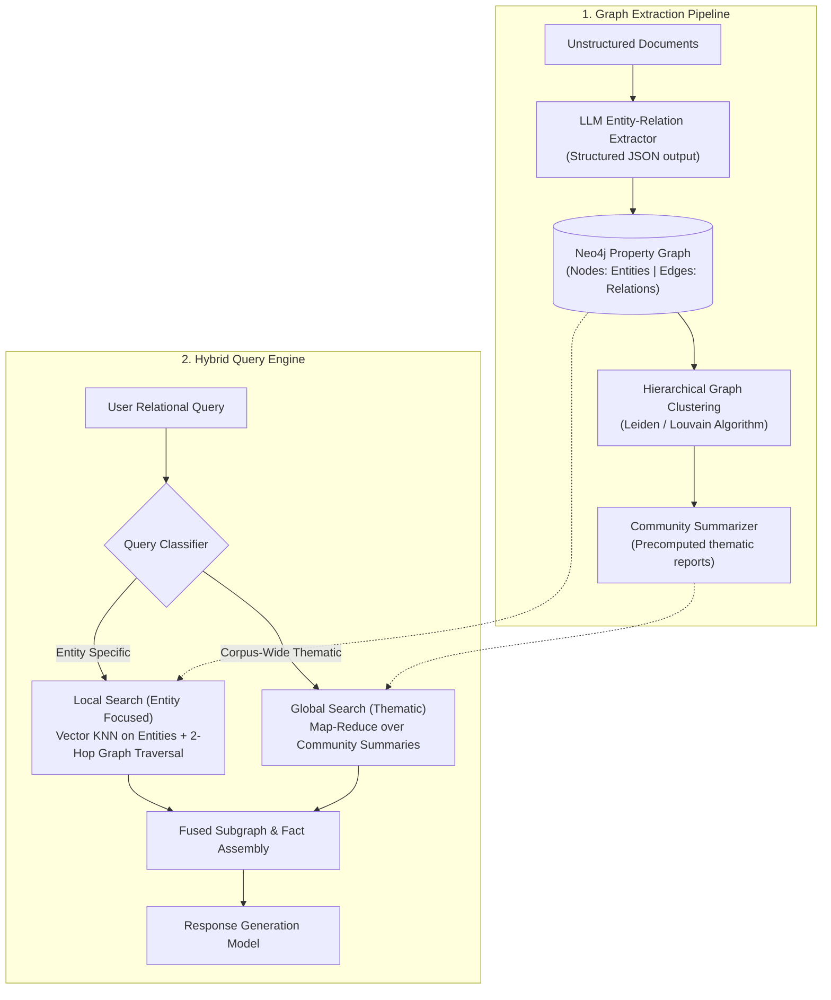

# GraphRAG & Knowledge Graphs

Standard vector RAG excels at retrieving localized text snippets (`"What is the battery capacity of Model X?"`), but fails on **global thematic queries** (`"What are the overarching supply chain risks across all our European vendors?"`) and **multi-hop relational reasoning** (`"How is Company A connected to Subsidiary C through Board Members?"`).

**GraphRAG** bridges this gap by extracting structured knowledge graphs (Entities, Relationships, Claims) from unstructured text, clustering them into hierarchical communities, and combining vector similarity with graph traversals.

---

## 1. GraphRAG Architecture



---

## 2. Graph Schema & Node Specifications

```cypher
// Neo4j Node and Relationship Constraints
CREATE CONSTRAINT entity_name_unique IF NOT EXISTS 
FOR (e:Entity) REQUIRE e.name IS UNIQUE;

CREATE INDEX entity_embedding_idx IF NOT EXISTS
FOR (e:Entity) ON (e.embedding);

// Example Node Schema
// (:Entity {
//    name: "Acme Corp",
//    type: "ORGANIZATION",
//    description: "Cloud infrastructure supplier",
//    embedding: [...]
// })

// Example Relationship Schema
// (e1)-[:OPERATES_IN { description: "Main manufacturing hub", weight: 0.95 }]->(e2)
```

---

## 3. Production Extraction & Neo4j Ingestion

Save this pipeline under `src/graphrag/graph_engine.py`.

```python
"""
GraphRAG Extraction and Query Engine
Framework: Neo4j Driver + Pydantic v2 + OpenAI Async
"""

from __future__ import annotations

import json
from typing import Any, Dict, List, Optional
from pydantic import BaseModel, Field
from neo4j import AsyncGraphDatabase


# ---------------------------------------------------------------------------
# 1. Pydantic Extraction Schemas
# ---------------------------------------------------------------------------

class ExtractedEntity(BaseModel):
    name: str = Field(..., description="Canonical entity name in Title Case")
    category: str = Field(..., description="E.g., ORGANIZATION, PERSON, LOCATION, TECHNOLOGY, EVENT")
    description: str = Field(..., description="Comprehensive factual summary of the entity")


class ExtractedRelationship(BaseModel):
    source_entity: str = Field(..., description="Source entity name")
    target_entity: str = Field(..., description="Target entity name")
    relationship_type: str = Field(..., description="UPPER_SNAKE_CASE relationship name (e.g. SUPPLIES, OWNS, ACQUIRED)")
    description: str = Field(..., description="Contextual explanation of how they are related")
    strength: float = Field(default=1.0, ge=0.1, le=1.0)


class GraphExtractionBundle(BaseModel):
    entities: List[ExtractedEntity] = Field(default_factory=list)
    relationships: List[ExtractedRelationship] = Field(default_factory=list)


# ---------------------------------------------------------------------------
# 2. Neo4j Graph Manager
# ---------------------------------------------------------------------------

class Neo4jGraphManager:
    def __init__(self, uri: str, user: str, password: str):
        self.driver = AsyncGraphDatabase.driver(uri, auth=(user, password))

    async def close(self):
        await self.driver.close()

    async def batch_upsert_graph(self, bundle: GraphExtractionBundle):
        """
        Idempotently merges extracted entities and directed relationships into Neo4j.
        """
        async with self.driver.session() as session:
            # 1. Upsert Entities (Nodes)
            for entity in bundle.entities:
                await session.run(
                    """
                    MERGE (e:Entity { name: $name })
                    ON CREATE SET 
                        e.category = $category,
                        e.description = $description,
                        e.created_at = datetime()
                    ON MATCH SET 
                        e.description = e.description + ' ' + $description
                    """,
                    name=entity.name.strip(),
                    category=entity.category.strip().upper(),
                    description=entity.description.strip()
                )

            # 2. Upsert Relationships (Edges)
            for rel in bundle.relationships:
                # Dynamic cypher creation for parameterized relationship types
                cypher = f"""
                MATCH (source:Entity {{ name: $source_name }})
                MATCH (target:Entity {{ name: $target_name }})
                MERGE (source)-[r:{rel.relationship_type.strip().upper()}]->(target)
                ON CREATE SET 
                    r.description = $desc,
                    r.strength = $strength,
                    r.created_at = datetime()
                ON MATCH SET
                    r.description = r.description + ' ' + $desc,
                    r.strength = ($strength + r.strength) / 2.0
                """
                await session.run(
                    cypher,
                    source_name=rel.source_entity.strip(),
                    target_name=rel.target_entity.strip(),
                    desc=rel.description.strip(),
                    strength=rel.strength
                )

    async def local_subgraph_traversal(self, entity_names: List[str], max_hops: int = 2) -> List[Dict[str, Any]]:
        """
        Discovers the 1-to-2 hop connected neighborhood around candidate entities.
        Returns paths and relationship context.
        """
        cypher = f"""
        MATCH (start:Entity)
        WHERE start.name IN $entity_names
        MATCH path = (start)-[r*1..{max_hops}]-(neighbor:Entity)
        RETURN 
            start.name AS root_entity,
            [node in nodes(path) | node.name] AS entity_chain,
            [rel in relationships(path) | type(rel) + ': ' + rel.description] AS relation_chain
        LIMIT 30
        """
        async with self.driver.session() as session:
            result = await session.run(cypher, entity_names=entity_names)
            records = await result.data()
            return records
```

---

## 4. Extraction Prompt Specification

```python
EXTRACTION_SYSTEM_PROMPT = """You are an expert knowledge graph extraction engine.
Given the source text, extract all salient named entities (Organizations, Technologies, People, Locations)
and the explicit causal or operational relationships between them.

Do not invent facts. Every relationship must be supported by the input text.
Return strictly valid JSON adhering to the GraphExtractionBundle schema.
"""
```

---

## 5. Local Multi-Hop Query Execution

When a user asks: *"How does our European data center setup depend on AWS Frankfurt?"*, the engine performs local neighborhood traversal:

```python
async def answer_graph_query(query: str, target_entities: List[str], graph_mgr: Neo4jGraphManager) -> str:
    # 1. Fetch 2-hop connected graph context
    subgraph_paths = await graph_mgr.local_subgraph_traversal(target_entities, max_hops=2)

    # 2. Serialize knowledge graph into structural prompt context
    graph_context_lines = []
    for path in subgraph_paths:
        chain = " -> ".join(path["entity_chain"])
        facts = " | ".join(path["relation_chain"])
        graph_context_lines.append(f"PATH: {chain}\nRELATIONS: {facts}")

    formatted_context = "\n---\n".join(graph_context_lines)

    # 3. Supply synthesized graph context directly to LLM reasoner
    return formatted_context
```

---

## 6. Production Hardening Checklist

- [ ] **Entity Canonicalization**: Run fuzzy string matching (Levenshtein distance) or LLM resolution (e.g. mapping `"Apple"`, `"Apple Inc."`, and `"Apple Computer"` to the same node) before running `MERGE` to prevent graph fragmentation.
- [ ] **Relationship Allowlist**: Enforce a strict enum of permitted relationship types (e.g., `DEPENDS_ON`, `SUBSIDIARY_OF`, `PARTNERED_WITH`) to avoid unbounded predicate cardinality.
- [ ] **Hop Limiting**: Hard-cap graph traversals at `max_hops=2`. Three-hop traversals in dense enterprise graphs lead to combinatorial node explosion and timeout penalties.
- [ ] **Periodic Community Detection**: Run the Leiden graph community algorithm offline in an automated cron job every 24 hours to refresh high-level thematic summaries.
