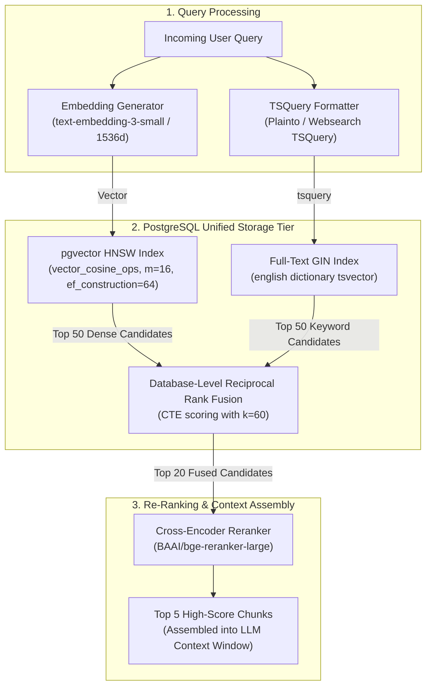

# Hybrid Search & Reranking Architecture

Pure vector search frequently misses exact keyword tokens, alphanumeric product codes, acronyms, and SKU numbers. Pure keyword search (BM25) fails on semantic meaning, contextual synonyms, and multilingual queries.

This blueprint implements an enterprise **Hybrid Retrieval and Reranking Architecture** powered by PostgreSQL (`pgvector` HNSW + `tsvector` GIN), unified via **Reciprocal Rank Fusion (RRF)** at the database layer, and refined with a **Cross-Encoder reranking model** operating under 80ms total latency.

---

## 1. System Architecture



---

## 2. PostgreSQL Storage Schema & Hybrid SQL Function

Save this migration script into your PostgreSQL database. It builds both dense and sparse indices and implements an in-database Reciprocal Rank Fusion calculation via Common Table Expressions (CTEs).

```sql
-- Enable pgvector extension
CREATE EXTENSION IF NOT EXISTS vector;

-- Multi-tenant document chunk table
CREATE TABLE IF NOT EXISTS document_chunks (
    id UUID PRIMARY KEY DEFAULT gen_random_uuid(),
    tenant_id VARCHAR(64) NOT NULL,
    document_id VARCHAR(128) NOT NULL,
    chunk_index INT NOT NULL,
    content TEXT NOT NULL,
    parent_content TEXT, -- Stored for contextual LLM injection
    metadata JSONB DEFAULT '{}'::jsonb,
    
    -- Dense embedding column (OpenAI 1536-dim)
    embedding vector(1536) NOT NULL,
    
    -- Sparse full-text search column
    tsv_content tsvector GENERATED ALWAYS AS (to_tsvector('english', content)) STORED,
    
    created_at TIMESTAMPTZ DEFAULT NOW()
);

-- Indices for performance
CREATE INDEX IF NOT EXISTS idx_chunks_tenant ON document_chunks(tenant_id);
CREATE INDEX IF NOT EXISTS idx_chunks_tsv ON document_chunks USING GIN(tsv_content);

-- HNSW Vector Index (Cosine Distance)
CREATE INDEX IF NOT EXISTS idx_chunks_hnsw 
ON document_chunks 
USING hnsw (embedding vector_cosine_ops)
WITH (m = 16, ef_construction = 64);

-- ---------------------------------------------------------------------------
-- In-Database Hybrid Retrieval Function (Reciprocal Rank Fusion)
-- ---------------------------------------------------------------------------
CREATE OR REPLACE FUNCTION hybrid_rrf_search(
    p_tenant_id VARCHAR(64),
    p_query_vector vector(1536),
    p_query_text TEXT,
    p_limit INT DEFAULT 20,
    p_k INT DEFAULT 60
)
RETURNS TABLE (
    id UUID,
    document_id VARCHAR(128),
    content TEXT,
    parent_content TEXT,
    dense_rank INT,
    sparse_rank INT,
    rrf_score DOUBLE PRECISION
)
LANGUAGE sql
STABLE
AS $$
WITH dense_matches AS (
    SELECT 
        id,
        ROW_NUMBER() OVER (ORDER BY embedding <=> p_query_vector) AS rank
    FROM document_chunks
    WHERE tenant_id = p_tenant_id
    ORDER BY embedding <=> p_query_vector
    LIMIT 50
),
sparse_matches AS (
    SELECT 
        id,
        ROW_NUMBER() OVER (ORDER BY ts_rank(tsv_content, websearch_to_tsquery('english', p_query_text)) DESC) AS rank
    FROM document_chunks
    WHERE tenant_id = p_tenant_id
      AND tsv_content @@ websearch_to_tsquery('english', p_query_text)
    ORDER BY rank
    LIMIT 50
),
fused AS (
    SELECT 
        COALESCE(d.id, s.id) AS id,
        d.rank AS dense_rank,
        s.rank AS sparse_rank,
        (COALESCE(1.0 / (p_k + d.rank), 0.0) + COALESCE(1.0 / (p_k + s.rank), 0.0)) AS score
    FROM dense_matches d
    FULL OUTER JOIN sparse_matches s ON d.id = s.id
)
SELECT 
    c.id,
    c.document_id,
    c.content,
    c.parent_content,
    f.dense_rank::INT,
    f.sparse_rank::INT,
    f.score AS rrf_score
FROM fused f
JOIN document_chunks c ON c.id = f.id
ORDER BY f.score DESC
LIMIT p_limit;
$$;
```

---

## 3. Python Service with Cross-Encoder Reranking

Bi-encoder dense models compute representations independently, which is fast for initial candidate retrieval. However, a **Cross-Encoder model** accepts `(query, document_chunk)` pairs simultaneously into full cross-attention layers, computing genuine semantic relevance with high accuracy.

```python
"""
Hybrid Retrieval and Cross-Encoder Reranking Service
File: backend/retrieval_service.py
"""

from __future__ import annotations

import asyncio
from typing import Any, Dict, List, Optional
from pydantic import BaseModel, Field
import psycopg_pool
from sentence_transformers import CrossEncoder
from openai import AsyncOpenAI


class RetrievedChunk(BaseModel):
    id: str
    document_id: str
    content: str
    parent_content: Optional[str] = None
    rrf_score: float
    rerank_score: Optional[float] = None


class HybridRetrievalService:
    def __init__(self, db_pool: psycopg_pool.AsyncConnectionPool, openai_client: AsyncOpenAI):
        self.pool = db_pool
        self.openai = openai_client
        # Lightweight local Cross-Encoder (runs on CPU or GPU)
        self.reranker = CrossEncoder("BAAI/bge-reranker-base", max_length=512)

    async def get_embedding(self, text: str) -> List[float]:
        response = await self.openai.embeddings.create(
            model="text-embedding-3-small",
            input=text
        )
        return response.data[0].embedding

    async def search(
        self,
        tenant_id: str,
        query: str,
        final_top_k: int = 5,
        candidate_pool_size: int = 20
    ) -> List[RetrievedChunk]:
        """
        Executes hybrid retrieval:
        1. Embeds query text.
        2. Calls Postgres hybrid_rrf_search stored function (Dense + BM25).
        3. Scores top candidates with Cross-Encoder.
        4. Sorts and returns top_k most relevant chunks.
        """
        # Step 1: Create dense vector
        query_vector = await self.get_embedding(query)

        # Step 2: Query PostgreSQL
        async with self.pool.connection() as conn:
            async with conn.cursor() as cur:
                await cur.execute(
                    """
                    SELECT id, document_id, content, parent_content, rrf_score
                    FROM hybrid_rrf_search(%s, %s::vector, %s, %s);
                    """,
                    (tenant_id, query_vector, query, candidate_pool_size)
                )
                rows = await cur.fetchall()

        if not rows:
            return []

        candidates = [
            RetrievedChunk(
                id=str(r[0]),
                document_id=r[1],
                content=r[2],
                parent_content=r[3],
                rrf_score=float(r[4])
            )
            for r in rows
        ]

        # Step 3: Run Cross-Encoder Reranking
        # Prepare pairs: [[query, doc_text_1], [query, doc_text_2], ...]
        pairs = [[query, c.content] for c in candidates]
        
        # Offload synchronous ML model inference to thread pool
        rerank_scores = await asyncio.to_thread(self.reranker.predict, pairs)

        for idx, score in enumerate(rerank_scores):
            candidates[idx].rerank_score = float(score)

        # Step 4: Sort by Cross-Encoder score descending
        ranked_chunks = sorted(candidates, key=lambda x: x.rerank_score or 0.0, reverse=True)
        return ranked_chunks[:final_top_k]
```

---

## 4. Performance & Latency Profile

| Stage | Mechanism | Typical Latency | Primary Optimization |
| :--- | :--- | :--- | :--- |
| **Query Embedding** | `text-embedding-3-small` API | 25ms - 40ms | Asynchronous HTTP connection reuse (`httpx.AsyncClient`) |
| **Postgres Dense KNN** | `HNSW (m=16, ef_search=40)` | 4ms - 8ms | Keep index in RAM (`shared_buffers` tuning) |
| **Postgres Sparse BM25** | `tsvector @@ tsquery` | 2ms - 5ms | Precomputed generated column with GIN index |
| **In-Database RRF** | SQL CTE fusion | 1ms | Executed in a single round-trip database query |
| **Cross-Encoder Reranking** | `bge-reranker-base` (20 items) | 20ms - 35ms | ONNX Runtime / TensorRT acceleration |
| **Total End-to-End** | **Hybrid Pipeline** | **under 85ms** | Sub-100ms budget preserved before LLM generation |

---

## 5. Production Hardening Checklist

- [ ] **Tune `ef_search` dynamically**: Set `SET hnsw.ef_search = 40;` before running retrieval queries to balance recall (approx 98%) against query throughput.
- [ ] **Tenant Isolation**: Always enforce `tenant_id` filtering in both dense and sparse CTEs before applying limits to prevent cross-customer data leakage.
- [ ] **Query Cleaning for `tsquery`**: Sanitize punctuation and unescaped operators (`!`, `&`, `|`, `:`) using `websearch_to_tsquery` instead of `to_tsquery` to prevent SQL syntax exceptions on freeform user input.
- [ ] **Parent-Child Injection**: When passing retrieved chunks to the LLM generation prompt, inject `parent_content` if available to eliminate fragmented context or truncated sentences.
