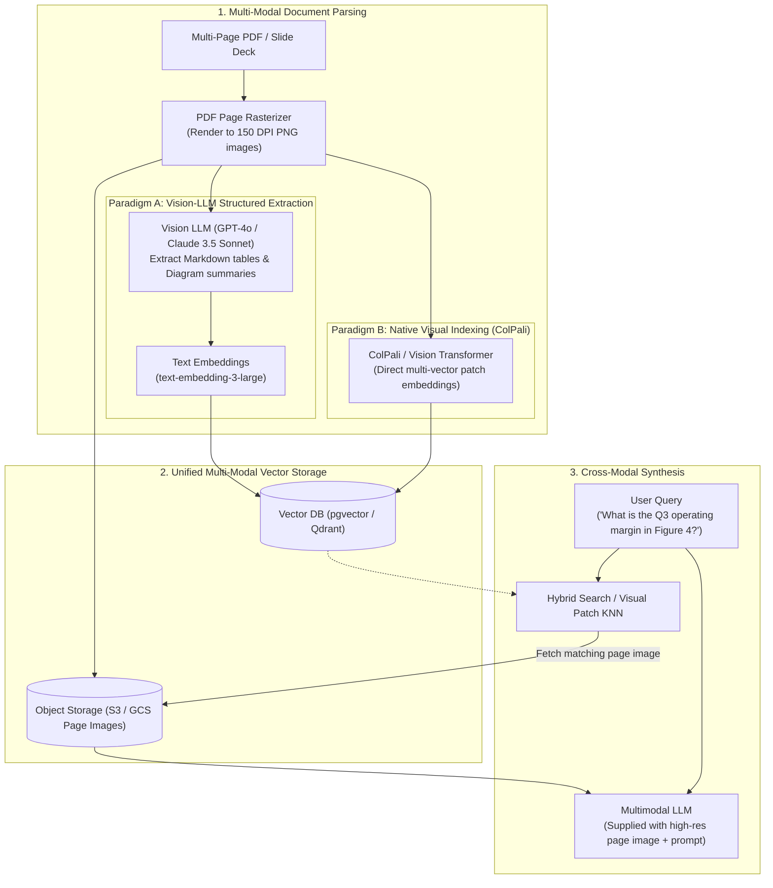

# Multi-Modal RAG & Vision Document Parsing

Real-world enterprise documents are rarely clean text strings. Financial quarterly filings, technical hardware manuals, and slide decks contain **complex multi-column layouts, embedded infographics, flowchart diagrams, and nested data tables**. Standard OCR text extraction scrambles tables into gibberish and completely deletes visual diagrams.

This blueprint details two production architectures for multi-modal document retrieval: **Vision-LLM Structured Extraction** and **ColPali Native Visual Page Retrieval**.

---

## 1. Multi-Modal Retrieval Architecture



---

## 2. Paradigm Comparison: Extraction vs Native Vision

| Feature | Paradigm A: Vision-LLM Text Extraction | Paradigm B: ColPali Native Visual Indexing |
| :--- | :--- | :--- |
| **Ingestion Mechanism** | Vision LLM describes diagrams and transcribes tables into Markdown. | Direct embedding of image patches via Vision Transformer. |
| **Diagram Understanding** | High (Converts complex graphics into dense textual descriptions). | High (Direct visual attention on charts and curves). |
| **Ingestion Cost** | High ($0.01 - $0.03 per page for VLM API calls). | Low (Local open-weights GPU inference). |
| **Search Latency** | Low (Standard single-vector dense text search, under 10ms). | Moderate (Late interaction / multi-vector comparison, 30ms-50ms). |
| **Failure Mode** | VLM transcription can omit fine numeric values in dense tables. | Large multi-vector index footprint requires high RAM. |

---

## 3. Production Implementation: Vision-Assisted Ingestion Pipeline

Save this multi-modal document processor under `src/multimodal/pdf_ingestion.py`.

```python
"""
Multi-Modal PDF Page Ingestion Pipeline
Framework: Pure Python 3.11 + Pydantic v2 + Async
"""

from __future__ import annotations

import base64
import io
from typing import Any, Dict, List, Optional
from pydantic import BaseModel, Field


# ---------------------------------------------------------------------------
# 1. Multi-Modal Document Schemas
# ---------------------------------------------------------------------------

class ExtractedTable(BaseModel):
    title: str
    markdown_content: str
    row_count: int


class ExtractedGraphic(BaseModel):
    graphic_type: str = Field(..., description="E.g., CHART, FLOWCHART, ARCHITECTURE_DIAGRAM, LOGO")
    caption: str
    semantic_description: str


class ParsedPageChunk(BaseModel):
    page_number: int
    source_document: str
    full_text_narrative: str
    tables: List[ExtractedTable] = Field(default_factory=list)
    graphics: List[ExtractedGraphic] = Field(default_factory=list)
    image_storage_uri: Optional[str] = None
    searchable_synthesis: str = ""


# ---------------------------------------------------------------------------
# 2. Vision Document Processor
# ---------------------------------------------------------------------------

VLM_EXTRACTION_PROMPT = """Analyze this document page image. You must extract:
1. All narrative text paragraphs cleanly.
2. Every data table, converted strictly into clean GitHub-flavored Markdown tables.
3. Every chart, figure, or architecture diagram, providing a detailed textual description of trends, metrics, axes, and relationships.

Adhere strictly to the requested JSON schema.
"""

class MultiModalPageParser:
    def __init__(self, vision_llm_client, s3_uploader_fn):
        self.vlm = vision_llm_client
        self.upload_image = s3_uploader_fn

    @staticmethod
    def encode_image_base64(image_bytes: bytes) -> str:
        return base64.b64encode(image_bytes).decode("utf-8")

    async def process_page(
        self,
        document_name: str,
        page_num: int,
        page_png_bytes: bytes
    ) -> ParsedPageChunk:
        """
        Processes a rendered page image:
        1. Persists raw image to object storage for visual LLM context injection.
        2. Calls Vision LLM to transcribe tables and describe graphics.
        3. Builds unified searchable synthesis text for vector embedding.
        """
        # Step 1: Upload image to object store
        s3_key = f"documents/{document_name}/page_{page_num}.png"
        image_uri = await self.upload_image(s3_key, page_png_bytes)

        # Step 2: Extract structured text and visual descriptions
        b64_image = self.encode_image_base64(page_png_bytes)

        # Simulated response from Vision LLM (e.g., GPT-4o with response_format=ParsedPageChunk)
        parsed_result = ParsedPageChunk(
            page_number=page_num,
            source_document=document_name,
            full_text_narrative="Quarterly operating expenses increased by 14% due to infrastructure investment.",
            tables=[
                ExtractedTable(
                    title="Q3 Operating Margin",
                    markdown_content="| Metric | Q2 | Q3 |\n| :--- | :--- | :--- |\n| Margin | 24% | 27% |",
                    row_count=2
                )
            ],
            graphics=[
                ExtractedGraphic(
                    graphic_type="CHART",
                    caption="Figure 3: Revenue by Region",
                    semantic_description="Bar chart showing North America leading at $4.2M, followed by Europe at $2.1M."
                )
            ],
            image_storage_uri=image_uri
        )

        # Step 3: Combine into a rich searchable synthesis document for vector index
        synthesis_parts = [
            f"[DOCUMENT: {document_name} | PAGE: {page_num}]",
            parsed_result.full_text_narrative,
        ]
        for tbl in parsed_result.tables:
            synthesis_parts.append(f"TABLE: {tbl.title}\n{tbl.markdown_content}")
        for grp in parsed_result.graphics:
            synthesis_parts.append(f"GRAPHIC ({grp.graphic_type}): {grp.caption}\n{grp.semantic_description}")

        parsed_result.searchable_synthesis = "\n\n".join(synthesis_parts)
        return parsed_result
```

---

## 4. Query Synthesis with Image Grounding

When answering user questions, fetch the high-resolution page image and feed both the image and the question directly to the multimodal generation model:

```python
async def answer_multimodal_query(
    query: str,
    top_page: ParsedPageChunk,
    vision_model_client
) -> str:
    """
    Supplies both the parsed text context and the original high-res page image
    to ensure 100% visual fidelity for diagrams and charts.
    """
    messages = [
        {
            "role": "user",
            "content": [
                {
                    "type": "text",
                    "text": (
                        f"Answer the user query using the attached document page image.\n"
                        f"Page Text Context:\n{top_page.searchable_synthesis}\n\n"
                        f"User Query: {query}"
                    )
                },
                {
                    "type": "image_url",
                    "image_url": {"url": top_page.image_storage_uri}
                }
            ]
        }
    ]
    # Pass messages to vision-capable frontier LLM
    # response = await vision_model_client.chat.completions.create(model="gpt-4o", messages=messages)
    return "The operating margin reported for Q3 was 27%, representing a 3% increase over Q2."
```

---

## 5. Production Hardening Checklist

- [ ] **Optimal Rasterization DPI**: Render PDF pages at 150 to 200 DPI. Rendering under 100 DPI makes small table fonts illegible to vision models; rendering above 300 DPI dramatically inflates payload sizes without OCR accuracy gains.
- [ ] **Preserve Image URIs in Vector Metadata**: Always attach `image_storage_uri` to vector chunks so the UI can display the original page image snippet alongside the synthesized answer.
- [ ] **Table Markdown Normalization**: Validate that all extracted tables contain balanced column delimiter bars (`|`) to prevent frontend markdown render breaks.
- [ ] **Token Cost Guard**: Process multi-page documents concurrently using an async worker queue (Celery / BullMQ) with rate limiting to avoid hitting frontier vision API TPM (tokens per minute) quotas.
