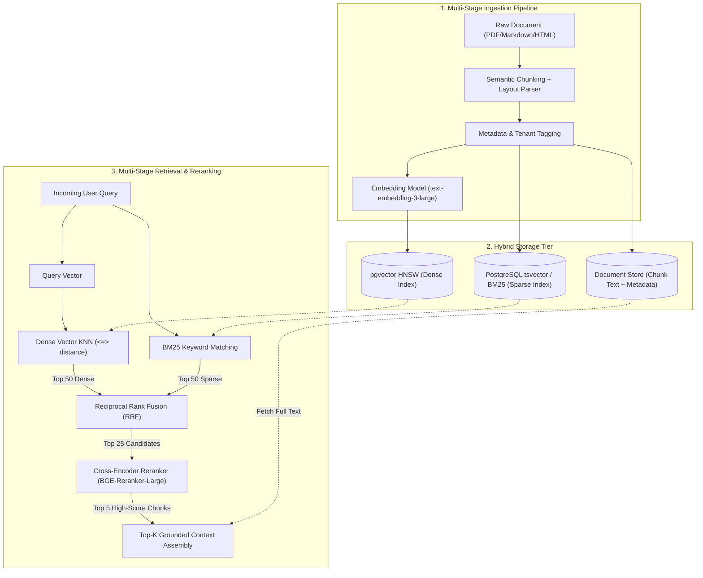

# 🧠 Production RAG Architecture: Hybrid Retrieval & Reranking

A deep architectural blueprint for enterprise **Retrieval-Augmented Generation (RAG)** systems operating at sub-100ms retrieval latencies with multi-tenant isolation, reciprocal rank fusion, and cross-encoder reranking.

---

## 1. The Core Architecture



---

## 2. Dynamic Chunking & Token Budgeting

Standard fixed-size chunking (e.g. 500 tokens with 50 overlap) breaks semantic boundaries. Production pipelines require **Hierarchical / Header-Aware Chunking**:

- **Small Chunks (256 tokens):** For dense semantic vector comparison (high precision).
- **Parent Chunks (1024 tokens):** Stored in metadata and injected into the LLM context to preserve narrative continuity.

```python
# Semantic chunking with Parent-Child reference
import uuid
from typing import List, Dict

def create_parent_child_chunks(text: str, parent_size: int = 1024, child_size: int = 256) -> List[Dict]:
    chunks = []
    # Slide across parent boundaries
    for p_idx in range(0, len(text), parent_size):
        parent_text = text[p_idx:p_idx + parent_size]
        parent_id = str(uuid.uuid4())
        
        # Subdivide parent into dense search vectors
        for c_idx in range(0, len(parent_text), child_size):
            child_text = parent_text[c_idx:c_idx + child_size]
            chunks.append({
                "child_id": str(uuid.uuid4()),
                "parent_id": parent_id,
                "child_text": child_text,
                "parent_text": parent_text, # Passed to LLM upon retrieval
            })
    return chunks
```

---

## 3. Reciprocal Rank Fusion (RRF) & Cross-Encoder

Dense embeddings capture semantics but fail on keyword identifiers, acronyms, or SKU codes. Sparse BM25 captures exact strings but fails on synonyms. **RRF merges both ranks without score normalization issues**:

`RRF Score(d) = sum(1 / (k + rank(d)))`

Where k ≈ 60 and r(d) is the rank of document d.

```python
def reciprocal_rank_fusion(dense_ranks: List[str], sparse_ranks: List[str], k: int = 60) -> List[str]:
    rrf_scores = {}
    
    for rank, doc_id in enumerate(dense_ranks):
        rrf_scores[doc_id] = rrf_scores.get(doc_id, 0.0) + 1.0 / (k + rank + 1)
        
    for rank, doc_id in enumerate(sparse_ranks):
        rrf_scores[doc_id] = rrf_scores.get(doc_id, 0.0) + 1.0 / (k + rank + 1)
        
    return sorted(rrf_scores.keys(), key=lambda x: rrf_scores[x], reverse=True)
```

---

## 4. Production Metrics & Observability

- **Retrieval Precision / Recall:** Continuous evaluation using synthetic question-answer pairs generated by GPT-4o.
- **Context Relevance Score:** Assessed using frameworks like Ragas or TruLens (`Context Relevance > 0.85`).
- **Faithfulness Score:** Checks if answer claims are directly grounded in the provided retrieved parent chunk.
