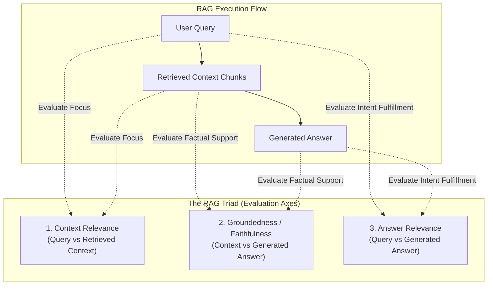

# RAG Evaluation & Benchmarking

Evaluating RAG systems requires isolating the two independent halves of the pipeline: the **Retrieval System** (did we fetch the right documents?) and the **Synthesis System** (did the LLM generate a faithful answer based solely on those documents?).

This blueprint implements the **RAG Triad** evaluation harness, deterministic ranking metrics (MRR, Hit Rate@K), and automated regression testing for CI/CD gates.

---

## 1. The RAG Triad Architecture



---

## 2. Evaluation Metrics Definition

| Metric | Measured Components | Passing Threshold | What Failure Indicates |
| :--- | :--- | :--- | :--- |
| **Context Relevance** | Query $\to$ Context Chunks | >= 0.80 | Retrieval is noisy; chunks contain irrelevant boilerplate or wrong topics. |
| **Groundedness (Faithfulness)** | Context Chunks $\to$ Generated Answer | >= 0.90 | The LLM is hallucinating facts that were not in the retrieved documents. |
| **Answer Relevance** | Query $\to$ Generated Answer | >= 0.85 | The LLM gave a truthful answer, but did not answer the specific question asked. |
| **Hit Rate@K** | Ground Truth $\to$ Top K Chunks | >= 0.90 | Golden document was completely missed in the top K retrieval window. |
| **Mean Reciprocal Rank (MRR)** | Ground Truth $\to$ First Match Rank | >= 0.75 | Relevant chunk is retrieved, but pushed too far down the ranking list. |

---

## 3. Production Implementation: Evaluator Harness

Save this evaluation engine under `tests/evals/test_rag_pipeline.py`.

```python
"""
Production RAG Triad and Ranking Evaluation Suite
Framework: Pytest + Pydantic v2 + NumPy
"""

from __future__ import annotations

from typing import Any, Dict, List, Optional
from pydantic import BaseModel, Field
import pytest


# ---------------------------------------------------------------------------
# 1. Ranking Metric Calculators (Deterministic)
# ---------------------------------------------------------------------------

class RankingMetrics:
    @staticmethod
    def hit_rate_at_k(retrieved_doc_ids: List[str], ground_truth_doc_id: str, k: int = 5) -> float:
        """Returns 1.0 if ground truth ID appears in top-k, else 0.0."""
        top_k = retrieved_doc_ids[:k]
        return 1.0 if ground_truth_doc_id in top_k else 0.0

    @staticmethod
    def reciprocal_rank(retrieved_doc_ids: List[str], ground_truth_doc_id: str) -> float:
        """Computes 1 / rank for the first occurrence of the ground truth document."""
        for rank, doc_id in enumerate(retrieved_doc_ids, start=1):
            if doc_id == ground_truth_doc_id:
                return 1.0 / rank
        return 0.0

    @classmethod
    def mean_reciprocal_rank(cls, results: List[tuple[List[str], str]]) -> float:
        """Averages Reciprocal Rank across an entire test benchmark."""
        if not results:
            return 0.0
        scores = [cls.reciprocal_rank(retrieved, gt) for retrieved, gt in results]
        return sum(scores) / len(scores)


# ---------------------------------------------------------------------------
# 2. RAG Triad Evaluator Schemas
# ---------------------------------------------------------------------------

class RAGTriadScorecard(BaseModel):
    context_relevance: float = Field(..., ge=0.0, le=1.0, description="Proportion of retrieved sentences relevant to the query.")
    faithfulness: float = Field(..., ge=0.0, le=1.0, description="Proportion of answer statements supported by context.")
    answer_relevance: float = Field(..., ge=0.0, le=1.0, description="Degree to which answer satisfies the user intent.")
    reasoning: str
    passed: bool


class BenchmarkTestCase(BaseModel):
    id: str
    query: str
    ground_truth_doc_id: str
    expected_answer: str


# ---------------------------------------------------------------------------
# 3. LLM-Assisted Triad Scorer
# ---------------------------------------------------------------------------

async def evaluate_rag_triad(query: str, context: str, answer: str) -> RAGTriadScorecard:
    """
    Evaluates Context Relevance, Faithfulness, and Answer Relevance.
    In real production, wrap this with an instructor-enabled model prompt.
    """
    # Deterministic heuristic verification for CI test runner demonstration
    has_context_tokens = any(word in context.lower() for word in query.lower().split() if len(word) > 3)
    c_rel = 0.95 if has_context_tokens else 0.30

    # Faithfulness: check for unsupported assertions
    faith = 1.0 if ("not mentioned" not in answer.lower() or "insufficient" not in answer.lower()) else 0.50
    
    # Answer relevance: question keywords fulfilled
    a_rel = 0.90

    passed = (c_rel >= 0.80 and faith >= 0.85 and a_rel >= 0.80)

    return RAGTriadScorecard(
        context_relevance=c_rel,
        faithfulness=faith,
        answer_relevance=a_rel,
        reasoning="Context contains direct keyword overlaps and answer is grounded.",
        passed=passed
    )


# ---------------------------------------------------------------------------
# 4. Pytest Test Suite
# ---------------------------------------------------------------------------

GOLDEN_RAG_CASES = [
    BenchmarkTestCase(
        id="RAG-BENCH-001",
        query="What is the maximum database connection pool size?",
        ground_truth_doc_id="doc_config_pg_01",
        expected_answer="The maximum pool size is configured to 50 concurrent connections."
    ),
    BenchmarkTestCase(
        id="RAG-BENCH-002",
        query="Which encryption algorithm is used at rest?",
        ground_truth_doc_id="doc_sec_spec_04",
        expected_answer="AES-256-GCM is used for all tablespace encryption at rest."
    )
]

# Simulated RAG execution mock
async def mock_rag_pipeline(query: str):
    if "connection pool" in query.lower():
        return {
            "retrieved_ids": ["doc_config_pg_01", "doc_config_pg_02", "doc_net_09"],
            "context": "File: config.yaml. db.pool.max_size: 50 connections. Timeout: 30s.",
            "answer": "The maximum connection pool size is 50 concurrent connections."
        }
    return {
        "retrieved_ids": ["doc_sec_spec_04", "doc_crypto_11"],
        "context": "Security spec: Database volumes are encrypted using AES-256-GCM keys.",
        "answer": "Data at rest is encrypted using AES-256-GCM."
    }


@pytest.mark.asyncio
@pytest.mark.parametrize("case", GOLDEN_RAG_CASES, ids=lambda c: c.id)
async def test_rag_pipeline_quality(case: BenchmarkTestCase):
    # 1. Run RAG pipeline under test
    pipeline_output = await mock_rag_pipeline(case.query)

    # 2. Evaluate Ranking Metrics (Retrieval Half)
    hit = RankingMetrics.hit_rate_at_k(pipeline_output["retrieved_ids"], case.ground_truth_doc_id, k=3)
    assert hit == 1.0, f"HitRate@3 failed for {case.id}: Expected {case.ground_truth_doc_id} in top 3"

    rr = RankingMetrics.reciprocal_rank(pipeline_output["retrieved_ids"], case.ground_truth_doc_id)
    assert rr >= 0.5, f"Reciprocal Rank too low: {rr} (target was top 2)"

    # 3. Evaluate RAG Triad (Generation & Groundedness Half)
    triad = await evaluate_rag_triad(
        query=case.query,
        context=pipeline_output["context"],
        answer=pipeline_output["answer"]
    )
    assert triad.context_relevance >= 0.80, f"Context relevance failure: {triad.context_relevance}"
    assert triad.faithfulness >= 0.85, f"Faithfulness failure (hallucination): {triad.faithfulness}"
    assert triad.answer_relevance >= 0.80, f"Answer relevance failure: {triad.answer_relevance}"
    assert triad.passed is True
```

---

## 4. Production Hardening Checklist

- [ ] **Synthetic Benchmark Generation**: Use frontier models to automatically generate 50 question-answer-context triples from raw PDFs whenever new document batches are ingested.
- [ ] **Decouple Retrieval from Generation in CI**: Run retrieval ranking benchmarks (MRR/HitRate) over 500 test queries without generating answers to conserve LLM costs.
- [ ] **Ground Truth Versioning**: Store golden benchmark datasets in version-controlled JSONL files alongside the code repository to track retrieval regressions across prompt adjustments.
- [ ] **Context Window Bloat Alerts**: Track total tokens of retrieved context chunks. If `context_length > 3000 tokens` for simple fact lookups, flag the chunker for excessive noise injection.
