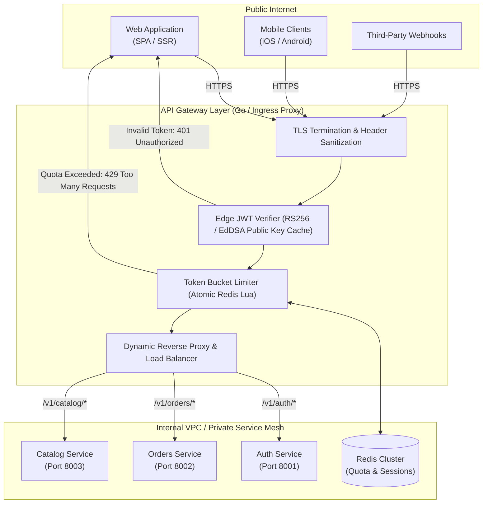

# Cloud-Native API Gateway & Reverse Proxy

Exposing internal microservices directly to the public internet is an anti-pattern. Direct exposure introduces massive attack surfaces, duplicate authentication logic across polyglot services, lack of centralized rate limiting, and observability blind spots.

An **Edge API Gateway & Reverse Proxy** acts as the single, hardened ingress controller for the entire architecture. It terminates TLS, validates cryptographic JWT tokens before requests hit internal networks, enforces distributed rate limits, and propagates distributed tracing contexts across downstream services.

---

## 1. Edge Ingress Architecture



---

## 2. Gateway vs Direct Service Exposure

| Requirement | Direct Microservice Exposure | Centralized Edge API Gateway |
| :--- | :--- | :--- |
| **Authentication & AuthZ** | Every team implements duplicate JWT parsers & JWKS fetchers | **Unified:** Edge validates signature in under 0.2ms; services receive verified claims |
| **DDoS & Abusive Quotas** | Downstream service pools easily starved by single bad client | **Isolated:** Atomic Redis Token Bucket rejects traffic at perimeter |
| **SSL / TLS Management** | Certificate distribution required on every internal container | **Centralized:** Auto-renewing Let's Encrypt / Cloudflare certs at edge |
| **Request ID & Tracing** | Headers often missing or spoofed by external callers | **Sanitized:** Gateway injects standardized W3C `traceparent` and `X-Request-ID` |
| **Protocol Translation** | Public clients forced to speak internal gRPC or Kafka protocols | Public REST/JSON smoothly translated to internal gRPC/Protobuf |

---

## 3. Production Go Streaming Reverse Proxy

Below is a production-grade API gateway implementation in Go using standard library `httputil.ReverseProxy`, featuring header sanitization, hop-by-hop cleanup, dynamic routing, connection pool tuning, and error recovery.

```go
package main

import (
	"crypto/rsa"
	"crypto/x509"
	"encoding/pem"
	"errors"
	"fmt"
	"log"
	"net"
	"net/http"
	"net/http/httputil"
	"net/url"
	"os"
	"strings"
	"sync"
	"time"

	"github.com/golang-jwt/jwt/v5"
	"github.com/google/uuid"
)

// RouteConfig maps URL prefix patterns to upstream microservice targets
type RouteConfig struct {
	Prefix          string
	TargetURL       *url.URL
	RequireAuth     bool
	StripPrefix     bool
	RateLimitPerMin int
}

type APIGateway struct {
	routes        []RouteConfig
	jwtPublicKey  *rsa.PublicKey
	proxyPool     map[string]*httputil.ReverseProxy
	mu            sync.RWMutex
	client        *http.Client
}

func NewAPIGateway(pubKeyPEM string) (*APIGateway, error) {
	block, _ := pem.Decode([]byte(pubKeyPEM))
	if block == nil {
		return nil, errors.New("failed to parse PEM block containing public key")
	}
	pubKey, err := x509.ParsePKIXPublicKey(block.Bytes)
	if err != nil {
		return nil, fmt.Errorf("failed to parse RSA public key: %w", err)
	}
	rsaPub, ok := pubKey.(*rsa.PublicKey)
	if !ok {
		return nil, errors.New("key is not of type *rsa.PublicKey")
	}

	// Optimized HTTP transport for high-throughput connection pooling
	transport := &http.Transport{
		Proxy: http.ProxyFromEnvironment,
		DialContext: (&net.Dialer{
			Timeout:   5 * time.Second,
			KeepAlive: 30 * time.Second,
		}).DialContext,
		ForceAttemptHTTP2:     true,
		MaxIdleConns:          500,
		MaxIdleConnsPerHost:   100,
		IdleConnTimeout:       90 * time.Second,
		TLSHandshakeTimeout:   5 * time.Second,
		ExpectContinueTimeout: 1 * time.Second,
		ResponseHeaderTimeout: 10 * time.Second,
	}

	return &APIGateway{
		jwtPublicKey: rsaPub,
		proxyPool:    make(map[string]*httputil.ReverseProxy),
		client:       &http.Client{Transport: transport},
	}, nil
}

func (gw *APIGateway) RegisterRoute(route RouteConfig) {
	proxy := httputil.NewSingleHostReverseProxy(route.TargetURL)
	proxy.Transport = gw.client.Transport

	originalDirector := proxy.Director
	proxy.Director = func(req *http.Request) {
		originalDirector(req)
		gw.sanitizeAndEnrichHeaders(req, route)
	}

	proxy.ErrorHandler = func(w http.ResponseWriter, r *http.Request, err error) {
		log.Printf("[GATEWAY ERROR] Upstream %v unreachable: %v", route.TargetURL, err)
		w.Header().Set("Content-Type", "application/json")
		w.WriteHeader(http.StatusBadGateway)
		fmt.Fprintf(w, `{"error": "Upstream service temporarily unavailable", "code": 502}`)
	}

	gw.mu.Lock()
	gw.routes = append(gw.routes, route)
	gw.proxyPool[route.Prefix] = proxy
	gw.mu.Unlock()
}

func (gw *APIGateway) sanitizeAndEnrichHeaders(req *http.Request, route RouteConfig) {
	if route.StripPrefix {
		req.URL.Path = strings.TrimPrefix(req.URL.Path, route.Prefix)
		if !strings.HasPrefix(req.URL.Path, "/") {
			req.URL.Path = "/" + req.URL.Path
		}
	}

	// 1. Hop-by-hop headers cleanup (RFC 7230)
	req.Header.Del("Connection")
	req.Header.Del("Keep-Alive")
	req.Header.Del("Proxy-Authenticate")
	req.Header.Del("Proxy-Authorization")
	req.Header.Del("TE")
	req.Header.Del("Trailers")
	req.Header.Del("Transfer-Encoding")
	req.Header.Del("Upgrade")

	// 2. Inject or sanitize correlation ID
	reqID := req.Header.Get("X-Request-ID")
	if reqID == "" {
		reqID = uuid.New().String()
		req.Header.Set("X-Request-ID", reqID)
	}

	// 3. Forward real client IP
	clientIP, _, err := net.SplitHostPort(req.RemoteAddr)
	if err == nil {
		prior := req.Header.Get("X-Forwarded-For")
		if prior != "" {
			req.Header.Set("X-Forwarded-For", prior+", "+clientIP)
		} else {
			req.Header.Set("X-Forwarded-For", clientIP)
		}
	}
}

func (gw *APIGateway) ServeHTTP(w http.ResponseWriter, r *http.Request) {
	// Find matching route
	var matchedRoute *RouteConfig
	var matchedProxy *httputil.ReverseProxy

	gw.mu.RLock()
	for _, route := range gw.routes {
		if strings.HasPrefix(r.URL.Path, route.Prefix) {
			matchedRoute = &route
			matchedProxy = gw.proxyPool[route.Prefix]
			break
		}
	}
	gw.mu.RUnlock()

	if matchedRoute == nil {
		http.Error(w, `{"error": "Route not found", "status": 404}`, http.StatusNotFound)
		return
	}

	// Edge Authentication Verification
	if matchedRoute.RequireAuth {
		authHeader := r.Header.Get("Authorization")
		if !strings.HasPrefix(authHeader, "Bearer ") {
			http.Error(w, `{"error": "Missing or malformed Authorization header", "status": 401}`, http.StatusUnauthorized)
			return
		}
		rawToken := strings.TrimPrefix(authHeader, "Bearer ")
		claims, err := gw.verifyJWT(rawToken)
		if err != nil {
			http.Error(w, fmt.Sprintf(`{"error": "Unauthorized: %v", "status": 401}`, err.Error()), http.StatusUnauthorized)
			return
		}

		// Inject verified identity into internal headers
		if sub, ok := claims["sub"].(string); ok {
			r.Header.Set("X-Authenticated-User-ID", sub)
		}
		if tenant, ok := claims["tenant_id"].(string); ok {
			r.Header.Set("X-Authenticated-Tenant-ID", tenant)
		}
	}

	// Delegate to streaming reverse proxy
	matchedProxy.ServeHTTP(w, r)
}

func (gw *APIGateway) verifyJWT(tokenString string) (jwt.MapClaims, error) {
	token, err := jwt.Parse(tokenString, func(t *jwt.Token) (interface{}, error) {
		if _, ok := t.Method.(*jwt.SigningMethodRSA); !ok {
			return nil, fmt.Errorf("unexpected signing algorithm: %v", t.Header["alg"])
		}
		return gw.jwtPublicKey, nil
	})

	if err != nil || !token.Valid {
		return nil, errors.New("invalid signature or expired token")
	}

	if claims, ok := token.Claims.(jwt.MapClaims); ok {
		return claims, nil
	}
	return nil, errors.New("failed to cast token claims")
}
```

---

## 4. Redis Token Bucket Lua Script for Perimeter Defense

This Lua script is evaluated directly inside Redis in under 1ms, guaranteeing atomic token replenishment without distributed concurrency race conditions.

```lua
-- KEYS[1]: Rate limit key (e.g. "rate:tenant_1029:orders")
-- ARGV[1]: Max bucket capacity (burst limit)
-- ARGV[2]: Refill rate per millisecond
-- ARGV[3]: Current epoch timestamp in milliseconds
-- ARGV[4]: Cost of requested tokens (usually 1)

local key = KEYS[1]
local capacity = tonumber(ARGV[1])
local refill_rate = tonumber(ARGV[2])
local now = tonumber(ARGV[3])
local cost = tonumber(ARGV[4])

local data = redis.call("HMGET", key, "tokens", "last_updated")
local tokens = tonumber(data[1])
local last_updated = tonumber(data[2])

if tokens == nil then
    tokens = capacity
    last_updated = now
else
    local elapsed = math.max(0, now - last_updated)
    tokens = math.min(capacity, tokens + (elapsed * refill_rate))
    last_updated = now
end

if tokens >= cost then
    tokens = tokens - cost
    redis.call("HMSET", key, "tokens", tokens, "last_updated", last_updated)
    redis.call("PEXPIRE", key, math.ceil((capacity / refill_rate) * 2))
    return {1, math.floor(tokens)} -- Allowed (1: true)
else
    redis.call("HMSET", key, "tokens", tokens, "last_updated", last_updated)
    return {0, math.floor(tokens)} -- Rejected (0: false)
end
```

---

## 5. Production Hardening Checklist

| Operational Area | Security / Reliability Practice | Vulnerability If Omitted |
| :--- | :--- | :--- |
| **Header Stripping** | Always strip external `X-Authenticated-*` headers before verifying JWT tokens | Attackers forge `X-Authenticated-User-ID: admin` to bypass RBAC |
| **Timeout Hierarchy** | Gateway timeout (10s) > Internal Service timeout (5s) > DB timeout (2s) | Gateway terminates client socket while downstream DB is still computing |
| **Max Body Limits** | Enforce `http.MaxBytesReader` (e.g. 10MB default, 50MB for upload endpoints) | Unauthenticated clients stream gigabytes into memory, crashing the gateway with OOM |
| **Connection Pooling** | Tune `MaxIdleConnsPerHost` to 100+ on internal transport | Proxy constantly renegotiates TCP handshakes, causing socket `TIME_WAIT` saturation |
