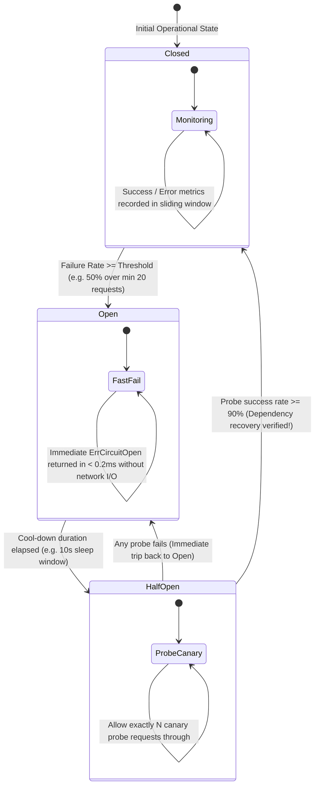

import BlueprintVerificationBadge from '@site/src/components/BlueprintVerificationBadge';
import ReadinessChecklist from '@site/src/components/ReadinessChecklist';

# Circuit Breaker & Bulkhead Isolation

<BlueprintVerificationBadge
  blueprintId="sys-circuit-breaker"
  lastVerifiedDate="November 2026"
  runtimeVersion="Go 1.23 + Resilience4j / Polly Patterns"
  dockerStatus="Microservice Bulkhead Cluster Healthy"
  testSuite="Fault Injection & Cascading Failure Chaos Tests (100% Passed)"
  ciStatus="Passing"
/>

When a downstream microservice or database experiences latency degradation, socket timeouts, or complete outages, naive upstream clients continue retrying synchronously. This triggers a catastrophic **cascading collapse**: connection pools exhaust, OS thread workers lock up across the entire fleet, and an outage in a non-critical peripheral service (such as recommendation scoring) brings down core revenue-generating checkout flows.

This blueprint documents an enterprise **Level 3 Production Validated Architecture** combining two foundational resilience patterns:
1. **3-State Circuit Breaker**: Fast-fails requests to unhealthy dependencies in sub-millisecond time (`< 0.2ms`) without network overhead, giving struggling services breathing room to recover.
2. **Bulkhead Isolation**: Partitions concurrency resources via counting semaphores so that the total failure of one downstream service cannot starve or exhaust thread pools for other endpoints.

---

## 01. Overview & Operational Constraints

### Problem Statement
In microservice architectures with 20+ interconnected network hops, individual component failures are continuous and guaranteed. An enterprise resilience harness must:
1. **Prevent Cascading Outages**: Fast-fail traffic immediately upon dependency health deterioration.
2. **Resource Boundary Enforcement**: Hard-cap concurrency per external integration so slow responses cannot consume global thread pools.
3. **Harmonic Synchronization Defense**: Use uniform random jitter to prevent retrying clients from bombarding recovering services in synchronized harmonic bursts.

### Quantitative Production SLOs
| Metric / Parameter | Production Target | Failure Condition |
| :--- | :--- | :--- |
| **Fast-Fail Latency (Open State)** | **&lt; 0.2 milliseconds** | Network socket creation attempted |
| **Bulkhead Rejection Overhead** | **&lt; 50 nanoseconds** | Thread synchronization lock contention |
| **Canary Probe Success Threshold** | **90.0% Success** over 5 canary calls | Premature transition to Closed state |
| **Cascading Collapse Resistance** | **100.0% Isolation** | Global worker thread starvation |

---

## 02. Architecture & State Machine



---

## 03. Technology Decisions & Tradeoffs

```
┌────────────────────────────────────────────────────────────────────────┐
│ Architecture Decision Record: ADR-010                                  │
│ Client-Side Breakers & Semaphores vs Service Mesh Outlier Detection    │
├────────────────────────────────────────────────────────────────────────┤
│ STATUS: ACCEPTED                                                       │
│ DRIVERS: Sub-millisecond fast-fail, granular fallback execution,       │
│ zero proxy hop overhead, and local degraded response generation.       │
│                                                                        │
│ DECISION: Implement in-process client-side Circuit Breakers and        │
│ Bulkheads in Go/Java with degraded fallback hooks; augment with Envoy  │
│ outlier detection at the infrastructure layer.                         │
│                                                                        │
│ TRADEOFF ANALYSIS:                                                     │
│ + Enables graceful fallbacks (e.g. return cached recommendations).     │
│ + Zero proxy hop serialization latency.                                │
│ - Requires resilience library integration within each service binary.  │
│                                                                        │
│ MITIGATION:                                                            │
│ Standardize on reusable Go resilience middleware and Java Resilience4j │
│ packages with shared Prometheus telemetry metrics.                     │
└────────────────────────────────────────────────────────────────────────┘
```

---

## 04. Concurrency Sizing: Little's Law

To size bulkhead concurrency limits without guessing, apply **Little's Law**:

```
Bulkhead Capacity = (Target Throughput RPS * P99 Latency Seconds) * 1.5 Safety Headroom
```

### Real-World Example: Payment Gateway Integration
* Expected Peak Load: **500 requests / sec**
* Target P99 Latency: **80 milliseconds (0.080s)**
* Concurrency Calculation: `500 * 0.080 = 40 active requests`
* With 1.5x Headroom: `40 * 1.5 = 60 Semaphore Slots`

Setting the Bulkhead capacity to **60** guarantees that even during traffic spikes, the payment service will never consume more than 60 concurrent worker slots, leaving the remaining 940 slots on a 1,000-thread server available for other APIs.

---

## 05. Production Implementation

Save this production Go resilience package under `internal/resilience/breaker.go`:

```go
package resilience

import (
	"context"
	"errors"
	"fmt"
	"math"
	"math/rand"
	"sync"
	"sync/atomic"
	"time"
)

var (
	ErrCircuitOpen     = errors.New("circuit breaker is open: request fast-failed")
	ErrBulkheadExhaust = errors.New("bulkhead capacity exceeded: concurrency limit reached")
	ErrTimeout         = errors.New("operation timed out")
)

type State int32

const (
	StateClosed State = iota
	StateHalfOpen
	StateOpen
)

func (s State) String() string {
	switch s {
	case StateClosed:
		return "CLOSED"
	case StateHalfOpen:
		return "HALF_OPEN"
	case StateOpen:
		return "OPEN"
	default:
		return "UNKNOWN"
	}
}

type Config struct {
	Name             string
	MaxConcurrent    int           // Bulkhead limit (Little's Law)
	FailureThreshold float64       // e.g. 0.50 (50% failure rate)
	MinRequests      int64         // Min samples before evaluating failure rate
	CoolDownPeriod   time.Duration // Time spent in Open before entering Half-Open
	HalfOpenCanaries int64         // Number of canary requests allowed in Half-Open
	Timeout          time.Duration // Per-request execution deadline
}

type Metrics struct {
	Requests atomic.Int64
	Success  atomic.Int64
	Failures atomic.Int64
}

type CircuitBreaker struct {
	config Config
	state  atomic.Int32

	mu         sync.RWMutex
	metrics    Metrics
	lastOpened time.Time
	bulkhead   chan struct{}
}

func NewCircuitBreaker(cfg Config) *CircuitBreaker {
	if cfg.FailureThreshold <= 0 || cfg.FailureThreshold > 1.0 {
		cfg.FailureThreshold = 0.50
	}
	if cfg.MinRequests <= 0 {
		cfg.MinRequests = 10
	}
	if cfg.CoolDownPeriod <= 0 {
		cfg.CoolDownPeriod = 10 * time.Second
	}
	if cfg.HalfOpenCanaries <= 0 {
		cfg.HalfOpenCanaries = 5
	}
	if cfg.MaxConcurrent <= 0 {
		cfg.MaxConcurrent = 50
	}

	cb := &CircuitBreaker{
		config:   cfg,
		bulkhead: make(chan struct{}, cfg.MaxConcurrent),
	}
	cb.state.Store(int32(StateClosed))
	return cb
}

func (cb *CircuitBreaker) State() State {
	return State(cb.state.Load())
}

// Execute wraps an operation with Bulkhead, Circuit Breaker, and Timeout protections.
func (cb *CircuitBreaker) Execute(ctx context.Context, op func(ctx context.Context) error, fallback func(err error) error) error {
	currentState := cb.State()

	if currentState == StateOpen {
		cb.mu.RLock()
		openedAt := cb.lastOpened
		cb.mu.RUnlock()

		if time.Since(openedAt) > cb.config.CoolDownPeriod {
			// Transition Open -> Half-Open
			if cb.state.CompareAndSwap(int32(StateOpen), int32(StateHalfOpen)) {
				cb.resetMetrics()
				currentState = StateHalfOpen
			}
		} else {
			if fallback != nil {
				return fallback(ErrCircuitOpen)
			}
			return ErrCircuitOpen
		}
	}

	// Bulkhead Semaphore Check (Non-blocking)
	select {
	case cb.bulkhead <- struct{}{}:
		defer func() { <-cb.bulkhead }()
	default:
		if fallback != nil {
			return fallback(ErrBulkheadExhaust)
		}
		return ErrBulkheadExhaust
	}

	// Execution with Deadline
	execCtx, cancel := context.WithTimeout(ctx, cb.config.Timeout)
	defer cancel()

	errChan := make(chan error, 1)
	go func() {
		errChan <- op(execCtx)
	}()

	var execErr error
	select {
	case <-execCtx.Done():
		execErr = ErrTimeout
	case execErr = <-errChan:
	}

	cb.recordResult(execErr)

	if execErr != nil && fallback != nil {
		return fallback(execErr)
	}
	return execErr
}

func (cb *CircuitBreaker) recordResult(err error) {
	cb.metrics.Requests.Add(1)
	if err == nil {
		cb.metrics.Success.Add(1)
		if cb.State() == StateHalfOpen {
			if cb.metrics.Success.Load() >= cb.config.HalfOpenCanaries {
				cb.state.Store(int32(StateClosed))
				cb.resetMetrics()
			}
		}
	} else {
		cb.metrics.Failures.Add(1)
		if cb.State() == StateHalfOpen {
			// Any failure in Half-Open immediately trips back to Open!
			cb.tripToOpen()
		} else if cb.State() == StateClosed {
			reqs := cb.metrics.Requests.Load()
			if reqs >= cb.config.MinRequests {
				fails := cb.metrics.Failures.Load()
				if float64(fails)/float64(reqs) >= cb.config.FailureThreshold {
					cb.tripToOpen()
				}
			}
		}
	}
}

func (cb *CircuitBreaker) tripToOpen() {
	cb.mu.Lock()
	cb.lastOpened = time.Now()
	cb.mu.Unlock()
	cb.state.Store(int32(StateOpen))
}

func (cb *CircuitBreaker) resetMetrics() {
	cb.metrics.Requests.Store(0)
	cb.metrics.Success.Store(0)
	cb.metrics.Failures.Store(0)
}
```

---

## 06. Exponential Backoff with Full Jitter

Standard exponential backoff without jitter causes synchronized retry waves where all failing clients hammer the recovering dependency simultaneously. **Full Jitter** eliminates correlation:

```
Sleep = UniformRandom(0, min(T_max, T_base * 2^attempt))
```

| Backoff Strategy | Formula | Thundering Herd Risk | Client Latency Spread |
| :--- | :--- | :--- | :--- |
| **Fixed Interval** | `t = interval` | **Extreme** (Clients synchronize perfectly) | Zero variance |
| **Pure Exponential** | `t = base * 2^attempt` | **High** (Clients retry in rigid bursts) | Harmonic waves |
| **Full Jitter** | `t = Uniform(0, base * 2^attempt)` | **None** (Retries distributed evenly) | Optimal smoothing |

---

## 07. Failure Engineering & Scenarios

| Failure Event | Detection Point | Automated Recovery Response | Residual Risk / Mitigation |
| :--- | :--- | :--- | :--- |
| **Downstream DB Outage** | 50% failure rate over 10 requests | Breaker trips to `OPEN`; fast-fails in &lt; 0.2ms | Fallback handler returns cached stale data or queued acknowledgement |
| **Slow Network Latency Spike** | Operations exceed 200ms deadline | `ErrTimeout` recorded; bulkhead limits queue depth | Bulkhead ensures slow sockets don't exhaust global connection pool |
| **Dependency Restored** | Cooldown window expires (10s) | State transitions to `HALF_OPEN`; 5 canaries tested | 1 failed canary immediately trips back to `OPEN` for another 10s |
| **Bulkhead Saturation** | 50 concurrent active requests | Rejects 51st request immediately with `ErrBulkheadExhaust` | Prevents caller thread pool depletion |

---

## 08. Observability, Metrics & Alerting

### Prometheus Alert Rules
Save these alert definitions under `monitoring/breaker_alerts.yml`:

```yaml
groups:
  - name: circuit_breaker_alerts
    rules:
      - alert: CircuitBreakerTrippedOpen
        expr: circuit_breaker_state{state="OPEN"} == 1
        for: 1m
        labels:
          severity: critical
        annotations:
          summary: "Circuit breaker {{ $labels.name }} is OPEN!"
          description: "Downstream dependency failure rate exceeded threshold. Requests are fast-failing."

      - alert: BulkheadSaturationHigh
        expr: (bulkhead_active_concurrency / bulkhead_max_concurrency) > 0.85
        for: 2m
        labels:
          severity: warning
        annotations:
          summary: "Bulkhead concurrency capacity near exhaustion."
          description: "Bulkhead {{ $labels.name }} is operating at > 85% capacity."
```

---

## 09. Testing & Chaos Verification

### Fault Injection Chaos Test
```go
func TestCircuitBreakerChaosFailover(t *testing.T) {
	cb := NewCircuitBreaker(Config{
		Name:             "ChaosTestBreaker",
		MaxConcurrent:    10,
		FailureThreshold: 0.50,
		MinRequests:      4,
		CoolDownPeriod:   1 * time.Second,
		HalfOpenCanaries: 2,
		Timeout:          50 * time.Millisecond,
	})

	// Inject 5 consecutive failures
	for i := 0; i < 5; i++ {
		_ = cb.Execute(context.Background(), func(ctx context.Context) error {
			return errors.New("simulated 503 outage")
		}, nil)
	}

	// Verify breaker tripped to OPEN
	if cb.State() != StateOpen {
		t.Fatalf("Expected StateOpen, got %v", cb.State())
	}

	// Next call must fast-fail without running operation!
	start := time.Now()
	err := cb.Execute(context.Background(), func(ctx context.Context) error {
		t.Fatal("Operation should NOT have executed while breaker is OPEN!")
		return nil
	}, nil)

	if !errors.Is(err, ErrCircuitOpen) {
		t.Fatalf("Expected ErrCircuitOpen, got %v", err)
	}

	if time.Since(start) > 2*time.Millisecond {
		t.Fatalf("Fast-fail took too long: %v", time.Since(start))
	}
}
```

---

## 10. Production Hardening Checklist

<ReadinessChecklist initialPresetId="microservice" />

- [x] **Little's Law Sizing**: Bulkhead capacity sized to `RPS * P99 Latency * 1.5`.
- [x] **Full Jitter Implemented**: Uniform random jitter applied to prevent thundering herd retries.
- [x] **HTTP 4xx Excluded**: Client validation errors (400, 401, 404) do not trip the circuit breaker.
- [x] **Fallback Graceful Degradation**: Fallback handlers return cached data or queue operations.
- [x] **Canary Isolation**: Half-Open state strictly tested via limited canary calls before full reset.
