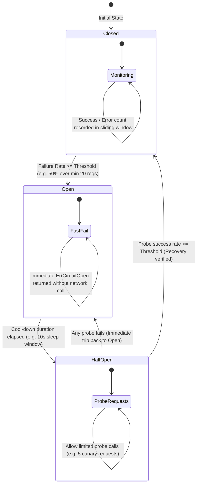

# Circuit Breaker & Bulkhead Isolation

When a downstream dependency experiences degraded latency, database connection exhaustion, or complete downtime, naive callers retry repeatedly. This triggers a **cascading collapse** (thundering herd), consuming connection pools and thread workers across all upstream microservices.

This blueprint combines two fundamental resilience patterns:
1. **Circuit Breaker:** Fast-fails requests to unhealthy dependencies without network overhead, allowing them to recover.
2. **Bulkhead Isolation:** Partitions system resources (thread pools, connection limits, semaphore slots) so that the total failure of one downstream service cannot starve others.

---

## 1. Circuit Breaker State Transition Architecture



---

## 2. Exponential Backoff with Full Jitter

Standard exponential backoff (`t = base * 2^attempt`) creates synchronized retry spikes where all failing clients hammer the recovering dependency simultaneously. **Full Jitter** eliminates correlation by introducing uniform randomization:

```text
t_sleep = random(0, min(max_backoff, base * 2^attempt))
```

| Backoff Strategy | Formula | Thundering Herd Risk | Client Latency Spread |
| :--- | :--- | :--- | :--- |
| **Fixed Interval** | `t = interval` | **Extreme:** All clients synchronize perfectly | Zero variance |
| **Pure Exponential** | `t = base * 2^attempt` | **High:** Clients retry in harmonic waves | Rigid bursts |
| **Full Jitter** | `t = Uniform(0, base * 2^attempt)` | **None:** Retries distributed evenly over interval | Optimal smoothing |
| **Decorrelated Jitter** | `t = min(max, Uniform(base, 3 * t_prev))` | **Minimal:** Retries spread dynamically with history | High distribution |

---

## 3. Production Go Implementation: Breaker + Bulkhead Semaphore

Below is a thread-safe, high-concurrency Go implementation supporting atomic state transitions, concurrency bulkhead limits, sliding failure rate checks, and fallback execution.

```go
package resilience

import (
	"context"
	"errors"
	"fmt"
	"math"
	"math/rand"
	"sync"
	"sync/atomic"
	"time"
)

var (
	ErrCircuitOpen     = errors.New("circuit breaker is open: request fast-failed")
	ErrBulkheadExhaust = errors.New("bulkhead capacity exceeded: concurrency limit reached")
	ErrTimeout         = errors.New("operation timed out")
)

type State int32

const (
	StateClosed State = iota
	StateHalfOpen
	StateOpen
)

func (s State) String() string {
	switch s {
	case StateClosed:
		return "CLOSED"
	case StateHalfOpen:
		return "HALF_OPEN"
	case StateOpen:
		return "OPEN"
	default:
		return "UNKNOWN"
	}
}

// Config defines the operational parameters for resilience protection.
type Config struct {
	Name             string
	MaxConcurrent    int           // Bulkhead limit
	FailureThreshold float64       // e.g. 0.50 (50% failure rate)
	MinRequests      int64         // Min samples before evaluating failure rate
	CoolDownPeriod   time.Duration // Time spent in Open before entering Half-Open
	HalfOpenCanaries int64         // Number of canary requests allowed in Half-Open
	Timeout          time.Duration // Per-request execution deadline
}

type Metrics struct {
	Requests atomic.Int64
	Success  atomic.Int64
	Failures atomic.Int64
}

// CircuitBreaker manages fault isolation and backpressure.
type CircuitBreaker struct {
	config Config
	state  atomic.Int32 // Stores State

	mu         sync.RWMutex
	metrics    Metrics
	lastOpened time.Time

	// Bulkhead: Buffered channel acts as counting semaphore
	bulkhead chan struct{}
}

func NewCircuitBreaker(cfg Config) *CircuitBreaker {
	if cfg.FailureThreshold <= 0 || cfg.FailureThreshold > 1.0 {
		cfg.FailureThreshold = 0.50
	}
	if cfg.MinRequests <= 0 {
		cfg.MinRequests = 10
	}
	if cfg.CoolDownPeriod <= 0 {
		cfg.CoolDownPeriod = 10 * time.Second
	}
	if cfg.HalfOpenCanaries <= 0 {
		cfg.HalfOpenCanaries = 5
	}
	if cfg.MaxConcurrent <= 0 {
		cfg.MaxConcurrent = 50
	}

	cb := &CircuitBreaker{
		config:   cfg,
		bulkhead: make(chan struct{}, cfg.MaxConcurrent),
	}
	cb.state.Store(int32(StateClosed))
	return cb
}

func (cb *CircuitBreaker) State() State {
	return State(cb.state.Load())
}

// Execute wraps an operation with Bulkhead, Circuit Breaker, and Timeout protections.
func (cb *CircuitBreaker) Execute(ctx context.Context, op func(ctx context.Context) error, fallback func(err error) error) error {
	// 1. Check Circuit Breaker State
	currentState := cb.State()

	if currentState == StateOpen {
		cb.mu.RLock()
		openedAt := cb.lastOpened
		cb.mu.RUnlock()

		if time.Since(openedAt) > cb.config.CoolDownPeriod {
			// Transition Open -> Half-Open
			if cb.state.CompareAndSwap(int32(StateOpen), int32(StateHalfOpen)) {
				cb.resetMetrics()
				currentState = StateHalfOpen
			}
		} else {
			if fallback != nil {
				return fallback(ErrCircuitOpen)
			}
			return ErrCircuitOpen
		}
	}

	// 2. Acquire Bulkhead Slot (Non-blocking acquire)
	select {
	case cb.bulkhead <- struct{}{}:
		defer func() { <-cb.bulkhead }()
	default:
		if fallback != nil {
			return fallback(ErrBulkheadExhaust)
		}
		return ErrBulkheadExhaust
	}

	// 3. Setup Deadline
	opCtx := ctx
	var cancel context.CancelFunc
	if cb.config.Timeout > 0 {
		opCtx, cancel = context.WithTimeout(ctx, cb.config.Timeout)
		defer cancel()
	}

	// 4. Execute Protected Operation
	err := op(opCtx)
	cb.recordResult(err == nil)

	if err != nil && fallback != nil {
		return fallback(err)
	}
	return err
}

func (cb *CircuitBreaker) recordResult(success bool) {
	cb.metrics.Requests.Add(1)

	if success {
		cb.metrics.Success.Add(1)
		if cb.State() == StateHalfOpen {
			if cb.metrics.Success.Load() >= cb.config.HalfOpenCanaries {
				// Canaries passed: Close circuit
				cb.state.Store(int32(StateClosed))
				cb.resetMetrics()
			}
		}
	} else {
		cb.metrics.Failures.Add(1)
		if cb.State() == StateHalfOpen {
			// Any failure in Half-Open immediately trips back to Open
			cb.tripToOpen()
			return
		}

		// In Closed state: evaluate failure rate
		total := cb.metrics.Requests.Load()
		if total >= cb.config.MinRequests {
			failRate := float64(cb.metrics.Failures.Load()) / float64(total)
			if failRate >= cb.config.FailureThreshold {
				cb.tripToOpen()
			}
		}
	}
}

func (cb *CircuitBreaker) tripToOpen() {
	cb.mu.Lock()
	cb.lastOpened = time.Now()
	cb.state.Store(int32(StateOpen))
	cb.mu.Unlock()
}

func (cb *CircuitBreaker) resetMetrics() {
	cb.metrics.Requests.Store(0)
	cb.metrics.Success.Store(0)
	cb.metrics.Failures.Store(0)
}

// FullJitterBackoff calculates sleep with full randomized jitter.
func FullJitterBackoff(attempt int, base time.Duration, max time.Duration) time.Duration {
	if attempt < 0 {
		attempt = 0
	}
	temp := float64(base) * math.Pow(2, float64(attempt))
	if temp > float64(max) {
		temp = float64(max)
	}
	// Uniform random between 0 and temp
	sleep := time.Duration(rand.Int63n(int64(temp)))
	return sleep
}
```

---

## 4. End-to-End Test Harness & Degraded Fallback

```go
package main

import (
	"context"
	"errors"
	"fmt"
	"math/rand"
	"time"

	"your-project/resilience"
)

func main() {
	cb := resilience.NewCircuitBreaker(resilience.Config{
		Name:             "PaymentGatewayBreaker",
		MaxConcurrent:    5,               // Max 5 simultaneous calls
		FailureThreshold: 0.40,            // Trip if >= 40% fail
		MinRequests:      5,               // Evaluate after 5 calls
		CoolDownPeriod:   2 * time.Second, // Try recovery after 2s
		HalfOpenCanaries: 3,               // 3 successes to close
		Timeout:          200 * time.Millisecond,
	})

	// Simulated downstream service that goes down
	var downstreamHealthy = false

	for i := 1; i <= 20; i++ {
		err := cb.Execute(context.Background(), func(ctx context.Context) error {
			if !downstreamHealthy {
				return errors.New("HTTP 503 Service Unavailable")
			}
			return nil
		}, func(err error) error {
			// Degraded fallback handler: Serve cached data or queue transaction
			fmt.Printf("[Req #%02d] FALLBACK ACTIVATED: (Cause: %v)\n", i, err)
			return nil
		})

		if err == nil {
			fmt.Printf("[Req #%02d] SUCCESS (State: %v)\n", i, cb.State())
		}

		if i == 12 {
			fmt.Println("\n>>> [System Notice] Downstream dependency restored! <<<\n")
			downstreamHealthy = true
			time.Sleep(2100 * time.Millisecond) // Allow cool-down period to expire
		} else {
			time.Sleep(100 * time.Millisecond)
		}
	}
}
```

---

## 5. Production Hardening Checklist

| Protection Vector | Recommended Practice | Failure Mode If Ignored |
| :--- | :--- | :--- |
| **Bulkhead Sizing** | Limit concurrency to `Capacity = (Target RPS * P99 Latency) * 1.5` | Upstream web workers exhaust file descriptors waiting on blocked sockets |
| **Exception Discrimination** | Do not count HTTP 4xx (client validation) as breaker failures; only 5xx, timeouts, and network connection drops | Misbehaving clients trip the circuit breaker for all healthy users |
| **Separate Read vs Write Breakers** | Maintain isolated breakers for idempotent GET queries vs non-idempotent POST writes | Downstream write replicas stalling causes read availability to collapse |
| **Metrics & Telemetry** | Export gauge `circuit_breaker_state{name="svc"}` and counter `circuit_breaker_tripped_total` to Prometheus | Breakers silently trip in production without triggering alerting thresholds |
