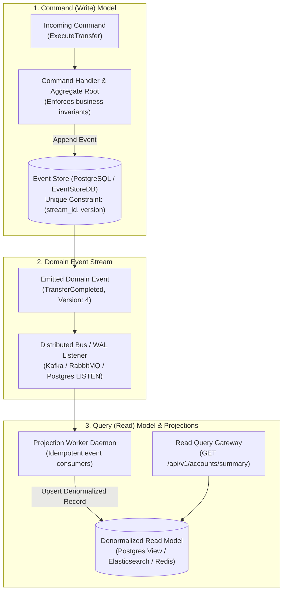

# CQRS & Event Sourcing Architecture

Traditional CRUD systems overwrite database rows in-place (`UPDATE accounts SET balance = 500 WHERE id = 1`). In doing so, they irreversibly destroy **historical context, operational intent, and audit provenance**. When a discrepancy emerges, engineers have no mechanism to determine who initiated the change, when it occurred, or what sequence of states led to the failure.

**Event Sourcing** persists every mutation as an **immutable, past-tense domain event** (`AccountOpened`, `FundsDeposited`, `TransferExecuted`). Current state is derived by replaying these events. **CQRS (Command Query Responsibility Segregation)** separates the write model (optimizing for transactional consistency) from the read model (optimizing for denormalized query performance).

---

## 1. CQRS & Event Sourcing Architecture



---

## 2. Event Store Schema & Optimistic Concurrency Control

The cornerstone of Event Sourcing is **Optimistic Concurrency Control**. By enforcing a database-level unique constraint on `(stream_id, version)`, concurrent writers attempting to emit conflicting state mutations are rejected with a unique constraint violation.

```sql
-- Production Event Store Schema

CREATE TABLE IF NOT EXISTS event_streams (
    stream_id UUID PRIMARY KEY,
    stream_type VARCHAR(64) NOT NULL,
    current_version BIGINT NOT NULL DEFAULT 0,
    created_at TIMESTAMPTZ DEFAULT NOW()
);

CREATE TABLE IF NOT EXISTS domain_events (
    id UUID PRIMARY KEY DEFAULT gen_random_uuid(),
    stream_id UUID NOT NULL REFERENCES event_streams(stream_id) ON DELETE RESTRICT,
    version BIGINT NOT NULL,
    event_type VARCHAR(128) NOT NULL,
    payload JSONB NOT NULL,
    metadata JSONB DEFAULT '{}'::jsonb,
    recorded_at TIMESTAMPTZ DEFAULT NOW(),
    
    -- Absolute guarantee against concurrent write races!
    CONSTRAINT uq_stream_version UNIQUE (stream_id, version)
);

CREATE INDEX idx_events_stream_ver ON domain_events(stream_id, version ASC);

-- Materialized Snapshot Store (For high-frequency aggregates)
CREATE TABLE IF NOT EXISTS aggregate_snapshots (
    stream_id UUID PRIMARY KEY,
    snapshot_version BIGINT NOT NULL,
    state_payload JSONB NOT NULL,
    created_at TIMESTAMPTZ DEFAULT NOW()
);
```

---

## 3. Production Implementation: Aggregate & Event Store

Save this domain engine under `src/eventsourcing/aggregate.py`.

```python
"""
Event Sourced Aggregate & Event Store
Framework: Python 3.11 + Pydantic v2 + Psycopg3
"""

from __future__ import annotations

from dataclasses import dataclass, field
from typing import Any, Dict, List, Optional
import psycopg
from psycopg.rows import dict_row


# ---------------------------------------------------------------------------
# 1. Domain Event Definitions
# ---------------------------------------------------------------------------

@dataclass
class DomainEvent:
    event_type: str
    payload: Dict[str, Any]
    version: int


# ---------------------------------------------------------------------------
# 2. Aggregate Root (Account Entity)
# ---------------------------------------------------------------------------

class AccountAggregate:
    def __init__(self, account_id: str):
        self.id = account_id
        self.version = 0
        self.balance_cents = 0
        self.is_closed = False
        self.uncommitted_events: List[DomainEvent] = []

    def apply_event(self, event: DomainEvent):
        """Mutates internal state based on historical events."""
        if event.event_type == "AccountOpened":
            self.balance_cents = event.payload["initial_deposit_cents"]
        elif event.event_type == "FundsDeposited":
            self.balance_cents += event.payload["amount_cents"]
        elif event.event_type == "FundsWithdrawn":
            self.balance_cents -= event.payload["amount_cents"]
        elif event.event_type == "AccountClosed":
            self.is_closed = True

        self.version = event.version

    def withdraw_funds(self, amount_cents: int):
        """Command method: enforces business invariant before creating event."""
        if self.is_closed:
            raise ValueError("Cannot withdraw from a closed account.")
        if amount_cents <= 0:
            raise ValueError("Withdrawal amount must be greater than zero.")
        if self.balance_cents < amount_cents:
            raise ValueError(f"Insufficient funds: Balance is {self.balance_cents}, requested {amount_cents}.")

        # Create past-tense event
        new_event = DomainEvent(
            event_type="FundsWithdrawn",
            payload={"amount_cents": amount_cents},
            version=self.version + 1
        )
        self.apply_event(new_event)
        self.uncommitted_events.append(new_event)


# ---------------------------------------------------------------------------
# 3. Event Store Repository with Optimistic Concurrency
# ---------------------------------------------------------------------------

class EventStoreRepository:
    def __init__(self, db_conn_str: str):
        self.db_url = db_conn_str

    def load_aggregate(self, account_id: str) -> AccountAggregate:
        """Hydrates an aggregate by replaying all historical domain events."""
        aggregate = AccountAggregate(account_id)
        with psycopg.connect(self.db_url, row_factory=dict_row) as conn:
            with conn.cursor() as cur:
                cur.execute(
                    """
                    SELECT event_type, payload, version 
                    FROM domain_events 
                    WHERE stream_id = %s 
                    ORDER BY version ASC;
                    """,
                    (account_id,)
                )
                for row in cur.fetchall():
                    event = DomainEvent(
                        event_type=row["event_type"],
                        payload=row["payload"],
                        version=row["version"]
                    )
                    aggregate.apply_event(event)

        return aggregate

    def save_aggregate(self, aggregate: AccountAggregate, expected_version: int):
        """
        Commits uncommitted domain events.
        Raises ConcurrencyError if expected_version does not match database version!
        """
        if not aggregate.uncommitted_events:
            return

        with psycopg.connect(self.db_url) as conn:
            with conn.transaction():
                with conn.cursor() as cur:
                    for event in aggregate.uncommitted_events:
                        try:
                            cur.execute(
                                """
                                INSERT INTO domain_events (stream_id, version, event_type, payload)
                                VALUES (%s, %s, %s, %s);
                                """,
                                (aggregate.id, event.version, event.event_type, psycopg.types.json.Jsonb(event.payload))
                            )
                        except psycopg.errors.UniqueViolation:
                            raise RuntimeError(
                                f"Optimistic Concurrency Conflict on stream {aggregate.id}! "
                                f"Expected version {expected_version}, but concurrent write occurred."
                            )

                    # Update stream version
                    cur.execute(
                        """
                        UPDATE event_streams 
                        SET current_version = %s 
                        WHERE stream_id = %s;
                        """,
                        (aggregate.version, aggregate.id)
                    )

        aggregate.uncommitted_events.clear()
```

---

## 4. Asynchronous Projection Worker (Read Model)

```python
"""
Read Model Projector Daemon
File: src/projections/account_summary_projector.py
"""

import psycopg

def project_event_to_read_db(event_row: dict, read_db_conn):
    """Updates denormalized reporting views when domain events fire."""
    stream_id = event_row["stream_id"]
    event_type = event_row["event_type"]
    payload = event_row["payload"]

    with read_db_conn.cursor() as cur:
        if event_type == "FundsDeposited":
            cur.execute(
                """
                INSERT INTO account_summary_views (account_id, balance_cents, last_transaction_at)
                VALUES (%s, %s, NOW())
                ON CONFLICT (account_id) DO UPDATE 
                SET balance_cents = account_summary_views.balance_cents + EXCLUDED.balance_cents,
                    last_transaction_at = NOW();
                """,
                (stream_id, payload["amount_cents"])
            )
        read_db_conn.commit()
```

---

## 5. Production Hardening Checklist

- [ ] **Periodic Snapshotting**: If an aggregate exceeds 100 historical events, store a serialized state snapshot every 100th event. When loading the aggregate, restore the snapshot first and replay only events created after `snapshot_version`.
- [ ] **Immutable Events**: Enforce strict database privileges: revoke `UPDATE` and `DELETE` on `domain_events` for all application service database users. Domain events can only ever be inserted.
- [ ] **Idempotent Projections**: Read model projectors must track `last_processed_version`. If a message broker redelivers an event with `version <= last_processed_version`, discard it immediately.
- [ ] **Upcasting Schema Evolutions**: When domain event structures change across software versions, write an upcaster transform function that migrates legacy JSON payloads to modern schemas in-memory before hydration.
