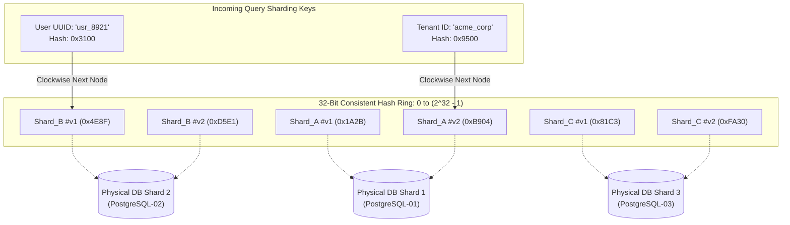

# Database Sharding Ring & Consistent Hashing

When relational databases outgrow vertical scaling limits (RAM saturation, disk IOPS limits, and WAL contention), horizontal partitioning (**sharding**) becomes essential.

Traditional modulo sharding:

```text
Shard ID = hash(key) % N
```

suffers from a catastrophic flaw: adding or removing a single node invalidates nearly `(N-1)/N` of all key mappings, requiring a full cluster rehash and downtime.

**Consistent Hashing** maps both data keys and database nodes onto a circular continuous keyspace `[0, 2^32 - 1]`. When a new shard is provisioned, only `K/N` keys are migrated on average, allowing seamless horizontal scale-out.

---

## 1. Consistent Hash Ring with Virtual Nodes



---

## 2. Modulo Sharding vs Consistent Hashing

| Parameter | Modulo Sharding (`hash(k) % N`) | Consistent Hashing Ring | Consistent Hashing with Vnodes (150+) |
| :--- | :--- | :--- | :--- |
| **Resharding Cost on Node Add** | **Catastrophic:** ~(N-1)/N keys must move | Minimal: ~1/(N+1) keys move | Minimal: ~1/(N+1) keys smoothly dispersed |
| **Key Distribution Uniformity** | High (if hash is uniform) | **Poor:** Non-uniform gaps between physical nodes | **Optimal:** Standard deviation < 3% across nodes |
| **Heterogeneous Hardware** | Difficult; all shards must be identical | Rigid | **Supported:** Assign more vnodes to larger servers |
| **Cascading Failure Risk** | Extreme; cluster rebalance overwhelms network | High for immediate neighbor node | Low; load shifts across all surviving shards |

---

## 3. Production TypeScript Hash Ring Implementation

Below is a production-grade, high-throughput Consistent Hash Ring with Virtual Nodes, logarithmic binary search lookup (`O(log(V * N))`), and multi-replica routing.

```typescript
/**
 * Production Consistent Hash Ring with Virtual Nodes.
 * Uses 32-bit FNV-1a hashing and binary search (bisect).
 */

export interface ShardNode {
  id: string;
  host: string;
  port: number;
  weight?: number; // Weight multiplier for vnodes (default: 1.0)
}

export class ConsistentHashRing {
  private readonly defaultVnodes: number;
  private ring: number[] = []; // Sorted array of hash integers
  private vnodeMap: Map<number, ShardNode> = new Map();
  private nodes: Map<string, ShardNode> = new Map();

  constructor(nodes: ShardNode[] = [], defaultVnodes: number = 150) {
    this.defaultVnodes = defaultVnodes;
    for (const node of nodes) {
      this.addNode(node);
    }
  }

  /**
   * 32-bit FNV-1a Hash Algorithm
   * High distribution uniformity, non-cryptographic, zero native C-binding overhead.
   */
  public hash(key: string): number {
    let hash = 0x811c9dc5;
    for (let i = 0; i < key.length; i++) {
      hash ^= key.charCodeAt(i);
      hash = Math.imul(hash, 0x01000193);
    }
    return hash >>> 0; // Convert to unsigned 32-bit integer [0, 4294967295]
  }

  /**
   * Add a physical shard to the ring, allocating virtual nodes.
   */
  public addNode(node: ShardNode): void {
    if (this.nodes.has(node.id)) {
      throw new Error(`Node with id '${node.id}' already exists in ring.`);
    }

    this.nodes.set(node.id, node);
    const vnodeCount = Math.floor(this.defaultVnodes * (node.weight ?? 1.0));

    for (let i = 0; i < vnodeCount; i++) {
      const vnodeKey = `${node.id}#vnode_${i}`;
      const hashVal = this.hash(vnodeKey);

      this.ring.push(hashVal);
      this.vnodeMap.set(hashVal, node);
    }

    // Keep ring sorted for binary search
    this.ring.sort((a, b) => a - b);
  }

  /**
   * Remove a physical shard and its virtual nodes from the ring.
   */
  public removeNode(nodeId: string): void {
    if (!this.nodes.has(nodeId)) return;
    this.nodes.delete(nodeId);

    // Filter out all vnode hashes belonging to this physical node
    this.ring = this.ring.filter((hashVal) => {
      const target = this.vnodeMap.get(hashVal);
      if (target && target.id === nodeId) {
        this.vnodeMap.delete(hashVal);
        return false;
      }
      return true;
    });
  }

  /**
   * Route a sharding key to its responsible physical shard.
   * Binary search executes in O(log(V * N)) time (~12 operations for 4,000 vnodes).
   */
  public getNode(key: string): ShardNode {
    if (this.ring.length === 0) {
      throw new Error("ConsistentHashRing is empty. No shards registered.");
    }

    const keyHash = this.hash(key);
    let low = 0;
    let high = this.ring.length - 1;

    // Binary search for first ring hash >= keyHash
    while (low <= high) {
      const mid = (low + high) >>> 1;
      if (this.ring[mid] >= keyHash) {
        high = mid - 1;
      } else {
        low = mid + 1;
      }
    }

    // Wrap around to the start of the circular ring if beyond the largest hash
    const index = low < this.ring.length ? low : 0;
    const ringHash = this.ring[index];
    return this.vnodeMap.get(ringHash)!;
  }

  /**
   * Get primary node + N replica nodes for replication.
   */
  public getReplicaNodes(key: string, replicaCount: number): ShardNode[] {
    if (this.nodes.size === 0) return [];
    const count = Math.min(replicaCount, this.nodes.size);
    const keyHash = this.hash(key);

    let low = 0;
    let high = this.ring.length - 1;
    while (low <= high) {
      const mid = (low + high) >>> 1;
      if (this.ring[mid] >= keyHash) {
        high = mid - 1;
      } else {
        low = mid + 1;
      }
    }

    const selected: ShardNode[] = [];
    const seenNodeIds = new Set<string>();

    for (let i = 0; i < this.ring.length && selected.length < count; i++) {
      const ringIndex = (low + i) % this.ring.length;
      const node = this.vnodeMap.get(this.ring[ringIndex])!;
      if (!seenNodeIds.has(node.id)) {
        seenNodeIds.add(node.id);
        selected.push(node);
      }
    }

    return selected;
  }
}
```

---

## 4. Scatter-Gather Query Router for Cross-Shard Queries

While single-shard lookups route cleanly by primary partition key (e.g. `WHERE tenant_id = 'acme'`), analytical queries or multi-tenant reports require a **Scatter-Gather** aggregator:

```typescript
import { ConsistentHashRing, ShardNode } from './consistentHashRing';

export class ShardedQueryRouter {
  private ring: ConsistentHashRing;

  constructor(ring: ConsistentHashRing) {
    this.ring = ring;
  }

  /**
   * Point Query: Routes directly to exact shard
   */
  async executePointQuery<T>(shardKey: string, querySql: string, params: any[]): Promise<T[]> {
    const targetShard = this.ring.getNode(shardKey);
    return this.executeOnShard<T>(targetShard, querySql, params);
  }

  /**
   * Scatter-Gather: Concurrently fans out to ALL shards and merges results
   */
  async executeScatterGather<T>(querySql: string, params: any[]): Promise<T[]> {
    // Unique physical shards
    const allShards = Array.from(new Set(this.ring['nodes'].values()));

    // Parallel execution across all database instances
    const promises = allShards.map((shard) =>
      this.executeOnShard<T>(shard, querySql, params).catch((err) => {
        console.error(`Shard ${shard.id} failed:`, err);
        return [] as T[];
      })
    );

    const results = await Promise.all(promises);
    return results.flat(); // Flatten combined result rows
  }

  private async executeOnShard<T>(shard: ShardNode, sql: string, params: any[]): Promise<T[]> {
    // In production, delegate to connection pool for target shard
    // console.log(`Routing SQL to ${shard.host}:${shard.port}`);
    return [] as T[];
  }
}
```

---

## 5. PostgreSQL Shard Table Schema

To guarantee that composite primary keys remain unique and prevent cross-shard index corruption:

```sql
-- Composite Key Schema: Always include the Shard Partition Key
CREATE TABLE tenant_invoices (
    tenant_id VARCHAR(64) NOT NULL,
    invoice_id UUID NOT NULL,
    amount NUMERIC(14, 2) NOT NULL,
    status VARCHAR(32) NOT NULL DEFAULT 'PENDING',
    created_at TIMESTAMPTZ NOT NULL DEFAULT NOW(),
    PRIMARY KEY (tenant_id, invoice_id)
);

-- Global Secondary Index Lookup Table (Hosted on Central Routing DB)
-- Maps non-sharded lookups (e.g. search by global invoice UUID) to responsible shard
CREATE TABLE invoice_shard_lookup (
    invoice_id UUID PRIMARY KEY,
    tenant_id VARCHAR(64) NOT NULL,
    created_at TIMESTAMPTZ NOT NULL DEFAULT NOW()
);
CREATE INDEX idx_lookup_created ON invoice_shard_lookup(created_at);
```

---

## 6. Production Hardening Checklist

| Architecture Vector | Recommended Practice | Catastrophic Risk If Omitted |
| :--- | :--- | :--- |
| **Vnode Density** | Use 150–256 virtual nodes per physical shard | Hot-spot imbalance where one shard holds 300% more records than peers |
| **Consistent Shard Keys** | Choose high-cardinality keys with uniform distribution (e.g. `tenant_id` or `user_uuid`); avoid timestamps or booleans | Every request routes to the latest shard, re-creating vertical bottleneck |
| **Scatter-Gather Timeouts** | Always attach a hard deadline (e.g. 1.5s) to fanout queries | A single lagging shard stalls the entire API response |
| **Dual-Writing during Migration** | When moving keys between shards, enable dual-writing + verification before switching read traffic | Data loss or silent record desynchronization |
