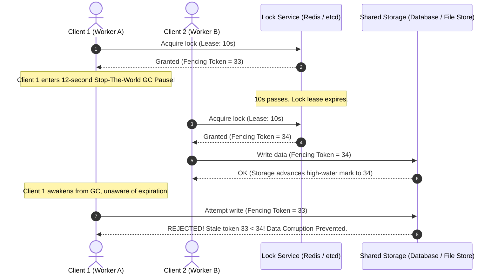

# Distributed Locks & Fencing Tokens

Coordinating exclusive access to shared resources across distributed worker fleets requires distributed mutual exclusion. However, naive distributed locks are fundamentally vulnerable to **asynchronous network delays, OS thread scheduling stalls, and Garbage Collection (GC) pauses**.

If Client A acquires a 10-second lock and encounters an 11-second GC pause, the lock expires in Redis. Client B acquires the lock. Client A then awakens, unaware its lock was revoked, and performs an unsafe concurrent mutation.

This blueprint implements production-grade distributed locking using **Redis lease renewals (Watchdog)**, **safe Lua releases**, and **Monotonic Fencing Tokens** to guarantee mutual exclusion even during process pauses.

---

## 1. The GC Pause Problem & Fencing Tokens



---

## 2. Lock Technology Tradeoffs

| Technology | Consensus Model | Safety Guarantee | Performance | Best Suited For |
| :--- | :--- | :--- | :--- | :--- |
| **Single Redis Instance** | Async replication (None) | Low (Fails on primary failover) | Ultra-Fast (~1ms) | Non-critical efficiency deduplication (e.g., cron jobs) |
| **Redlock (5 Redis Nodes)** | Quorum majority voting | Medium (Requires tight clock skew bounds) | Fast (~5ms) | High-throughput distributed tasks |
| **etcd / Consul** | Raft Consensus | **Absolute (Mathematically proven)** | Moderate (~15ms) | Mission-critical financial mutations & leader election |
| **PostgreSQL Advisory Locks** | ACID Database transaction | High (Tied to DB connection) | Moderate (~8ms) | Architectures already centered on PostgreSQL |

---

## 3. Production Redis Lock Implementation with Watchdog

Save this distributed lock manager under `src/locks/distributed_lock.py`.

```python
"""
Production Distributed Lock with Watchdog Auto-Renewal
Framework: Redis Asyncio + Pure Python 3.11
"""

from __future__ import annotations

import asyncio
import uuid
from typing import Optional
import redis.asyncio as redis


# Atomic Lua Script: Releases the lock ONLY if the stored value matches client's UUID
RELEASE_LUA_SCRIPT = """
if redis.call('get', KEYS[1]) == ARGV[1] then
    return redis.call('del', KEYS[1])
else
    return 0
end
"""

# Atomic Lua Script: Renews TTL only if client still owns the lock
RENEW_LUA_SCRIPT = """
if redis.call('get', KEYS[1]) == ARGV[1] then
    return redis.call('pexpire', KEYS[1], ARGV[2])
else
    return 0
end
"""


class DistributedLock:
    def __init__(
        self,
        redis_client: redis.Redis,
        resource_key: str,
        ttl_seconds: int = 10,
        retry_delay_seconds: float = 0.2,
        max_retries: int = 25
    ):
        self.redis = redis_client
        self.key = f"lock:{resource_key}"
        self.ttl_ms = ttl_seconds * 1000
        self.ttl_seconds = ttl_seconds
        self.retry_delay = retry_delay_seconds
        self.max_retries = max_retries
        self.token = str(uuid.uuid4())
        self._watchdog_task: Optional[asyncio.Task] = None
        self._release_script = self.redis.register_script(RELEASE_LUA_SCRIPT)
        self._renew_script = self.redis.register_script(RENEW_LUA_SCRIPT)

    async def acquire(self) -> bool:
        """Attempts to acquire lock with retries and launches the watchdog daemon."""
        for _ in range(self.max_retries):
            # SET resource_key client_uuid NX PX ttl_ms
            acquired = await self.redis.set(self.key, self.token, nx=True, px=self.ttl_ms)
            if acquired:
                # Start watchdog to renew lease while long-running work executes
                self._watchdog_task = asyncio.create_task(self._watchdog_loop())
                return True
            await asyncio.sleep(self.retry_delay)
        return False

    async def release(self) -> bool:
        """Cancels watchdog and atomically releases lock via Lua script."""
        if self._watchdog_task:
            self._watchdog_task.cancel()
            try:
                await self._watchdog_task
            except asyncio.CancelledError:
                pass

        result = await self._release_script(keys=[self.key], args=[self.token])
        return bool(result)

    async def _watchdog_loop(self):
        """Automatically extends TTL every ttl/3 seconds to prevent expiration during slow work."""
        renew_interval = self.ttl_seconds / 3.0
        try:
            while True:
                await asyncio.sleep(renew_interval)
                success = await self._renew_script(keys=[self.key], args=[self.token, self.ttl_ms])
                if not success:
                    break
        except asyncio.CancelledError:
            pass

    async def __aenter__(self):
        success = await self.acquire()
        if not success:
            raise TimeoutError(f"Could not acquire distributed lock for '{self.key}'")
        return self

    async def __aexit__(self, exc_type, exc_val, exc_tb):
        await self.release()
```

---

## 4. Fencing Token Pattern at the Storage Layer

A distributed lock alone cannot prevent race conditions caused by process pauses. Storage systems must validate an incrementing fencing token:

```sql
-- Storage Table with Fencing Token Protection
CREATE TABLE IF NOT EXISTS resource_records (
    id VARCHAR(64) PRIMARY KEY,
    payload JSONB NOT NULL,
    last_fencing_token BIGINT NOT NULL DEFAULT 0
);

-- Write Mutation with Fencing Condition
-- If another client committed with token 34, this query with token 33 affects 0 rows!
UPDATE resource_records 
SET payload = '{"status": "PROCESSED"}'::jsonb,
    last_fencing_token = 35
WHERE id = 'order_9988' 
  AND last_fencing_token < 35;
```

---

## 5. Production Hardening Checklist

- [ ] **Always Use Unique Tokens**: Never set a static string (like `"locked"`) as the lock value. Always generate a random UUID so a slow worker cannot delete a lock that was subsequently acquired by a new worker.
- [ ] **Release with Lua**: Never execute `GET` then `DEL` to release a lock. Always release via an atomic Lua script verifying that the caller's UUID still matches.
- [ ] **Mandatory Watchdog Timers**: For tasks with non-deterministic runtimes (e.g., video encoding, third-party payment calls), run an active watchdog thread that heartbeats TTL renewals until completion.
- [ ] **etcd for Financial Consensus**: If financial ledger consistency is at stake, do not rely on Redis. Use `etcd` leases backed by Raft consensus to guarantee zero lock loss even during node network splits.
