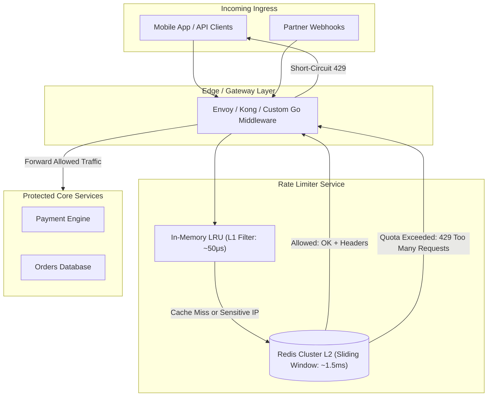

# 🛡️ High-Scale Distributed Rate Limiter: Sliding Window & Token Bucket

An enterprise system design blueprint for low-latency (under 2ms) distributed rate limiting handling hundreds of thousands of requests per second across multi-region API gateways.

---

## 1. System Architecture



---

## 2. Algorithm Comparison & Selection

| Algorithm | Precision | Memory Footprint | Burst Handling | Use-Case Fit |
| :--- | :--- | :--- | :--- | :--- |
| **Fixed Window** | Low (allows 2x burst across window edges) | Minimal ($O(1)$) | Poor | Simple uncritical APIs |
| **Token Bucket** | High | Minimal (stores token count + last refilled) | **Excellent** | Bursty traffic, payment gateways |
| **Sliding Window Log** | Extreme | High ($O(N)$ requests in memory) | Excellent | Low-volume high-security auth endpoints |
| **Sliding Window Counter** | High (weighted sum) | **Optimal ($O(1)$)** | **Very Good** | **Enterprise API Gateway standard** |

---

## 3. Production Atomic Redis Lua Script (Sliding Window Counter)

Using standard multi-command Redis calls introduces race conditions. An atomic Lua script executes in a single Redis tick:

```lua
-- KEYS[1]: Rate limit key (e.g. rate:user_9281:minute)
-- ARGV[1]: Current UNIX timestamp in milliseconds
-- ARGV[2]: Window duration in milliseconds (e.g. 60000 for 1m)
-- ARGV[3]: Maximum allowed requests in window (e.g. 100)

local key = KEYS[1]
local now = tonumber(ARGV[1])
local window = tonumber(ARGV[2])
local limit = tonumber(ARGV[3])
local clearBefore = now - window

-- 1. Remove old requests outside the current sliding window
redis.call('ZREMRANGEBYSCORE', key, 0, clearBefore)

-- 2. Count current remaining requests in window
local currentRequests = redis.call('ZCARD', key)

if currentRequests < limit then
    -- Add unique member for current millisecond tick
    redis.call('ZADD', key, now, now .. '-' .. redis.call('INCR', key .. ':seq'))
    -- Set TTL to ensure key auto-expires if idle
    redis.call('PEXPIRE', key, window)
    return {1, limit - currentRequests - 1} -- Allowed (1), Remaining Quota
else
    return {0, 0} -- Blocked (0), Remaining Quota (0)
end
```

---

## 4. Standard Response Headers

When returning rate limit state to API consumers, conform to IETF draft specifications:

```http
HTTP/1.1 429 Too Many Requests
Content-Type: application/json
Retry-After: 28
X-RateLimit-Limit: 100
X-RateLimit-Remaining: 0
X-RateLimit-Reset: 1730811658

{
  "error": "rate_limit_exceeded",
  "message": "Too many requests. Please wait 28 seconds before retrying.",
  "quota_limit": 100,
  "window_seconds": 60
}
```
