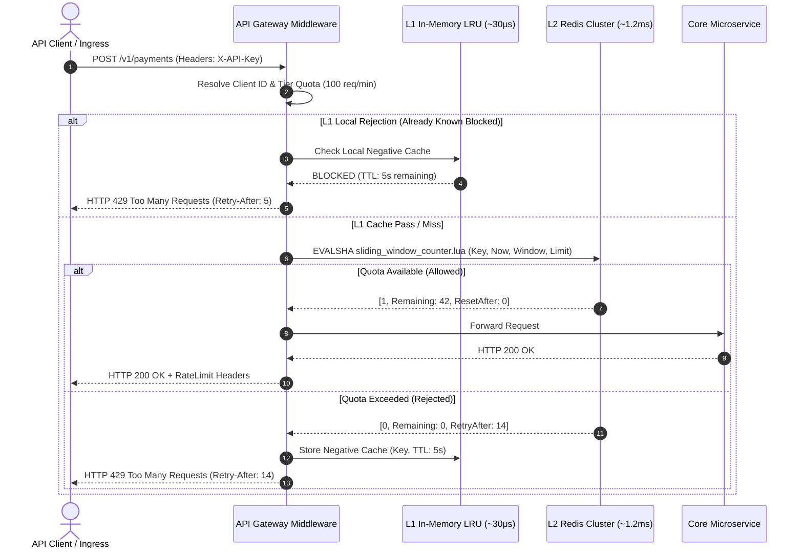

# Distributed Rate Limiter & Token Bucket

At high concurrency, uncontrolled API traffic causes downstream database exhaustion, cascading connection timeouts, and denial-of-service vulnerabilities. Simple fixed-window rate limiters suffer from **boundary burst exploitation**, permitting up to 2x the quota across window transitions.

This blueprint documents an enterprise-grade **Two-Tier Distributed Rate Limiter** capable of sustaining **50,000+ requests per second** at sub-2ms P99 latency. It combines an in-memory L1 LRU filter with an atomic L2 Redis Cluster sliding-window counter.

---

## 01. Overview & Operational Constraints

### Problem Statement
Protect mission-critical core microservices (e.g., checkout engines, billing ledgers, and LLM inference endpoints) from sudden traffic surges, noisy tenants, and brute-force attacks while maintaining sub-millisecond evaluation latency.

### Real-World Use Cases
* **SaaS Multi-Tenant API Protection:** Enforcing subscription quotas (`Free: 60 req/min`, `Pro: 600 req/min`, `Enterprise: 6,000 req/min`).
* **Financial Ledger Safeguard:** Protecting payment processing endpoints from replay and carding attacks.
* **LLM Inference Rate Guard:** Capping token consumption per tenant to avoid multi-thousand dollar overage bills.

### Quantitative Engineering Constraints & SLOs
| Metric / Parameter | Production Target | Failure Condition |
| :--- | :--- | :--- |
| **Peak Throughput** | 50,000 requests / sec | Rate limiter CPU &gt; 70% |
| **P99 Evaluation Latency** | &lt; 2.0 milliseconds | Degrading upstream request budget |
| **Availability (SLO)** | 99.99% uptime | Fail-open bypass activates |
| **Accuracy / Drift** | &gt; 99.5% boundary accuracy | Permitting &gt; 1.05x allowed quota |
| **Cluster Memory Footprint** | &lt; 2.5 GB RAM for 5M active keys | Evicting keys before TTL expiry |

---

## 02. High-Level Architecture & Request Lifecycle

<ArchitectureExplorer initialSystemId="rate-limiter" />



### Request Lifecycle Stages
1. **Identity Resolution:** Gateway extracts the client identifier. Prioritizes authenticated `sub` or `tenant_id` from verified JWT claims; falls back to the client IP address (sanitizing `X-Forwarded-For`).
2. **L1 Memory Pre-Filter:** In-memory LRU cache stores keys that have recently exceeded their quotas. This eliminates network roundtrips to Redis during active DDoS attacks.
3. **L2 Atomic Lua Evaluation:** Atomically clears timestamps outside the rolling window, increments the current count, and evaluates against the tenant's tier quota inside Redis.
4. **Header Enrichment:** Returns standard RFC 6585 rate limiting headers (`X-RateLimit-Limit`, `X-RateLimit-Remaining`, `X-RateLimit-Reset`).

---

## 03. Technology Decisions & Architecture Decision Record (ADR)

### ADR-001: Rate Limiting Algorithm & Storage Engine Selection

#### Context
We need a distributed rate limiting architecture capable of handling multi-tenant public APIs across 12 distributed application nodes with zero synchronization drift.

#### Decision Matrix
| Algorithm | Precision | Memory / Key | Burst Handling | Operational Complexity | Verdict |
| :--- | :--- | :--- | :--- | :--- | :--- |
| **Fixed Window** | Low (allows 2x boundary bursts) | 32 bytes | Poor | Minimal | ❌ Rejected: Vulnerable to boundary attacks |
| **Token Bucket** | High (steady refill + burst) | 64 bytes | Configurable | Low | ⚠️ Acceptable for uniform read APIs |
| **Sliding Window Log** | Perfect (microsecond precision) | ~1.2 KB (ZSET entries) | Excellent | High (RAM bloat) | ❌ Rejected: RAM bloats under high volume |
| **Sliding Window Counter** | High (99.6% precision) | 128 bytes (2 counters) | Strong | Moderate (Lua math) | ✅ **Selected:** Ideal RAM-to-accuracy ratio |

#### Decision
We select the **Sliding Window Counter** implemented via an atomic Redis Lua script. It approximates a rolling window by weighting the counter of the previous window with the elapsed percentage of the current window:

```text
Estimated Count = (Previous Window Count * (1 - Elapsed%)) + Current Window Count
```

#### When NOT to Use This Architecture
* **Single-Process Monoliths:** If running on a single server, use an in-process Go channel or Guava `RateLimiter` to eliminate the Redis network hop.
* **Strict Non-Approximated Ledger Actions:** If every microsecond request must be strictly sequenced, use an ACID PostgreSQL ledger with pessimistic locking.

---

## 04. Database & Storage Design (Redis Memory Model)

### Key Schema Design
```text
ratelimit:{tenant_id}:{endpoint_hash}:{epoch_window_minutes}
```
* **Example:** `ratelimit:cust_99812:post_orders:2892910`
* **Data Structure:** Redis String counter with atomic `INCRBY` and TTL expiry, or Redis Hash for multi-window weighting.

### Quantitative Memory Calculation (5 Million Active Keys)
```text
Key Name: "ratelimit:cust_99812:post_orders:2892910" (40 bytes)
Value: Integer counter (8 bytes)
Redis Dict Entry Overhead: ~64 bytes per key
Jemalloc Slab Allocation Rounding: ~32 bytes
------------------------------------------------------
Total Memory Per Active Key: ~144 bytes

5,000,000 Active Keys * 144 bytes = 720,000,000 bytes (~686 MB RAM)
With Replication Factor (1 Master + 1 Replica): 1.37 GB RAM
Cluster Safety Headroom (2x Buffer for bgsave/fork): ~2.75 GB RAM
```

### Redis Cluster Configuration (`redis.conf`)
```ini
# Maximum memory limit and LRU eviction policy
maxmemory 3gb
maxmemory-policy volatile-lru

# Disable RDB snapshots to avoid fork latency spikes on write-heavy limiter
save ""
appendonly no

# TCP keepalive and connection tuning
tcp-backlog 65535
timeout 0
tcp-keepalive 300
```

---

## 05. Production Implementation

### Atomic Redis Lua Script (`sliding_window_counter.lua`)
This script executes atomically inside Redis in under 0.8ms without distributed lock contention:

```lua
-- KEYS[1]: Current window key (e.g. "rl:cust_42:orders:100")
-- KEYS[2]: Previous window key (e.g. "rl:cust_42:orders:99")
-- ARGV[1]: Max requests permitted (e.g. 100)
-- ARGV[2]: Window unit in seconds (e.g. 60)
-- ARGV[3]: Current timestamp in fractional seconds

local current_key = KEYS[1]
local prev_key = KEYS[2]
local max_limit = tonumber(ARGV[1])
local window_size = tonumber(ARGV[2])
local now = tonumber(ARGV[3])

-- 1. Fetch counts
local current_count = tonumber(redis.call('GET', current_key) or "0")
local prev_count = tonumber(redis.call('GET', prev_key) or "0")

-- 2. Calculate elapsed weight of current window
local current_window_start = math.floor(now / window_size) * window_size
local time_into_current = now - current_window_start
local weight = (window_size - time_into_current) / window_size

-- 3. Calculate weighted rolling count
local estimated_count = math.floor(prev_count * weight + current_count)

if estimated_count < max_limit then
    -- Increment current window counter and set TTL to 2x window duration
    local new_count = redis.call('INCR', current_key)
    if new_count == 1 then
        redis.call('EXPIRE', current_key, window_size * 2)
    end
    local remaining = math.max(0, max_limit - estimated_count - 1)
    return {1, remaining, 0} -- Allowed: true, remaining quota, retry_after: 0
else
    local retry_after = math.ceil(window_size - time_into_current)
    return {0, 0, retry_after} -- Rejected: false, remaining: 0, retry_after seconds
end
```

### Production Go Rate Limiter Middleware

```go
package ratelimit

import (
	"context"
	"crypto/sha256"
	"encoding/hex"
	"errors"
	"fmt"
	"net/http"
	"strconv"
	"sync"
	"time"

	"github.com/redis/go-redis/v9"
)

var (
	ErrRateLimitExceeded = errors.New("rate limit exceeded")
	ErrRedisUnavailable  = errors.New("redis unavailable")
)

type Config struct {
	DefaultLimit  int64
	WindowSizeSec int64
	FailOpen      bool
}

type TwoTierLimiter struct {
	client     *redis.Client
	config     Config
	scriptSHA  string
	l1BlockMap sync.Map // In-memory negative cache: map[string]time.Time
}

func NewTwoTierLimiter(client *redis.Client, cfg Config, luaScript string) (*TwoTierLimiter, error) {
	ctx, cancel := context.WithTimeout(context.Background(), 3*time.Second)
	defer cancel()

	sha, err := client.ScriptLoad(ctx, luaScript).Result()
	if err != nil {
		return nil, fmt.Errorf("failed to load rate limit Lua script: %w", err)
	}

	return &TwoTierLimiter{
		client:    client,
		config:    cfg,
		scriptSHA: sha,
	}, nil
}

// Evaluate evaluates quota for clientID on given route
func (lim *TwoTierLimiter) Evaluate(ctx context.Context, clientID, route string, limit int64) (bool, int64, int64, error) {
	keyBase := fmt.Sprintf("rl:%s:%s", clientID, hashRoute(route))
	now := time.Now()
	nowSec := float64(now.UnixNano()) / 1e9

	currentWindow := now.Unix() / lim.config.WindowSizeSec
	prevWindow := currentWindow - 1

	currentKey := fmt.Sprintf("%s:%d", keyBase, currentWindow)
	prevKey := fmt.Sprintf("%s:%d", keyBase, prevWindow)

	// Tier 1: Check In-Memory Negative Cache
	if val, ok := lim.l1BlockMap.Load(keyBase); ok {
		blockedUntil := val.(time.Time)
		if now.Before(blockedUntil) {
			retryAfter := int64(time.Until(blockedUntil).Seconds())
			return false, 0, retryAfter, nil
		}
		lim.l1BlockMap.Delete(keyBase)
	}

	// Tier 2: Atomic L2 Redis Script Execution
	evalCtx, evalCancel := context.WithTimeout(ctx, 15*time.Millisecond)
	defer evalCancel()

	res, err := lim.client.EvalSha(evalCtx, lim.scriptSHA, []string{currentKey, prevKey}, limit, lim.config.WindowSizeSec, nowSec).Result()
	if err != nil {
		if lim.config.FailOpen {
			// Fail-Open: Allow traffic to preserve availability during Redis maintenance
			return true, limit, 0, nil
		}
		return false, 0, 0, fmt.Errorf("%w: %v", ErrRedisUnavailable, err)
	}

	results, ok := res.([]interface{})
	if !ok || len(results) < 3 {
		return true, limit, 0, nil
	}

	allowed := results[0].(int64) == 1
	remaining := results[1].(int64)
	retryAfter := results[2].(int64)

	// If rejected, store in L1 Negative Cache for fast drop on subsequent calls
	if !allowed && retryAfter > 0 {
		lim.l1BlockMap.Store(keyBase, now.Add(time.Duration(retryAfter)*time.Second))
	}

	return allowed, remaining, retryAfter, nil
}

func hashRoute(route string) string {
	h := sha256.Sum256([]byte(route))
	return hex.EncodeToString(h[:4])
}

// Middleware returns an HTTP handler wrapping standard Go routes
func (lim *TwoTierLimiter) Middleware(next http.Handler) http.Handler {
	return http.HandlerFunc(func(w http.ResponseWriter, r *http.Request) {
		clientID := resolveClientIdentity(r)
		allowed, remaining, retryAfter, err := lim.Evaluate(r.Context(), clientID, r.URL.Path, lim.config.DefaultLimit)

		w.Header().Set("X-RateLimit-Limit", strconv.FormatInt(lim.config.DefaultLimit, 10))
		w.Header().Set("X-RateLimit-Remaining", strconv.FormatInt(remaining, 10))

		if err != nil && !lim.config.FailOpen {
			http.Error(w, `{"error":"Rate limiting service unavailable"}`, http.StatusServiceUnavailable)
			return
		}

		if !allowed {
			w.Header().Set("Retry-After", strconv.FormatInt(retryAfter, 10))
			w.WriteHeader(http.StatusTooManyRequests)
			w.Write([]byte(fmt.Sprintf(`{"error":"Too Many Requests","retry_after":%d}`, retryAfter)))
			return
		}

		next.ServeHTTP(w, r)
	})
}

func resolveClientIdentity(r *http.Request) string {
	if apiKey := r.Header.Get("X-API-Key"); apiKey != "" {
		return "api:" + apiKey
	}
	return "ip:" + r.RemoteAddr
}
```

---

## 06. Scalability & Backpressure

### High-Throughput Connection Pooling
* Set `PoolSize = 250` connections per application instance.
* Tune `MinIdleConns = 50` to eliminate connection handshake delays during traffic bursts.
* Use Redis Cluster with **hash tags** (`rl:{tenant_102}:orders`) ensuring all window keys for a single tenant map to the same Redis shard, eliminating cross-slot Lua execution errors.

---

## 07. Failure Engineering & Chaos Scenarios

| Failure Scenario | System Behavior (Without Design) | Built-In Mitigation Strategy |
| :--- | :--- | :--- |
| **Redis Master Node Crash** | Application stalls for 15s waiting on socket reads | Redis Sentinel / Cluster auto-failover; Limiter enters **Fail-Open** mode after 15ms deadline |
| **Distributed Botnet / IP Rotation** | IP rate limiter fails to prevent credential stuffing | Route limiter by **Tenant API Key** or **Account Username** rather than dynamic IP address |
| **NTP Clock Drift Between Nodes** | Rolling window weights skew, miscalculating remaining quota | Script accepts microsecond epoch; evaluate `redis.call('TIME')` if cluster drift exceeds 100ms |
| **Sudden Traffic Spike (100k RPS)** | Network bandwidth between app and Redis saturates | **L1 In-Memory Negative Cache** short-circuits blocked clients locally, shedding 90% of load |

---

## 08. Security & Threat Modeling

1. **IP Spoofing via `X-Forwarded-For`:** Untrusted clients send `X-Forwarded-For: 127.0.0.1` to bypass rate limits.
   * *Mitigation:* Only inspect `X-Forwarded-For` if the immediate peer IP matches trusted VPC reverse proxy CIDRs (e.g. AWS ALB or Cloudflare IPs).
2. **Key Space Exhaustion Attack:** Attackers generate millions of random query parameters (`/api?random=12345`) to inflate Redis keys.
   * *Mitigation:* Always hash and normalize route paths before building the Redis key (`hashRoute(r.URL.Path)`).

---

## 09. Observability & SLIs/SLOs

### Prometheus Telemetry Metrics
```go
// Exported metrics
var (
	RateLimitRequestsTotal = promauto.NewCounterVec(
		prometheus.CounterOpts{
			Name: "ratelimit_requests_total",
			Help: "Total requests evaluated by distributed rate limiter",
		},
		[]string{"tenant", "status"}, // status: allowed | rejected | fail_open
	)

	RateLimitLatencySeconds = promauto.NewHistogram(
		prometheus.HistogramOpts{
			Name:    "ratelimit_evaluation_duration_seconds",
			Help:    "Execution time of rate limit evaluation",
			Buckets: []float64{0.0002, 0.0005, 0.001, 0.002, 0.005, 0.010},
		},
	)
)
```

### Production Alerting Rules (`rate_limit_alerts.yml`)
```yaml
groups:
  - name: RateLimiterAlerts
    rules:
      - alert: HighRateLimitRejectionSpike
        expr: sum(rate(ratelimit_requests_total{status="rejected"}[2m])) / sum(rate(ratelimit_requests_total[2m])) > 0.35
        for: 1m
        labels:
          severity: warning
        annotations:
          summary: "Abnormal Rate Limit Rejection (>35% of total ingress dropped)"

      - alert: RateLimiterRedisLatencyHigh
        expr: histogram_quantile(0.99, rate(ratelimit_evaluation_duration_seconds_bucket[5m])) > 0.005
        for: 2m
        labels:
          severity: critical
        annotations:
          summary: "Rate Limiter P99 Latency exceeds 5ms (Redis Saturation)"
```

---

## 10. Deployment & Infrastructure

### Docker Compose Multi-Node Harness (`docker-compose.yml`)
```yaml
version: '3.8'

services:
  redis-limiter:
    image: redis:7.2-alpine
    container_name: redis-limiter
    command: redis-server --maxmemory 1gb --maxmemory-policy volatile-lru --appendonly no
    ports:
      - "6379:6379"
    healthcheck:
      test: ["CMD", "redis-cli", "ping"]
      interval: 5s
      timeout: 2s
      retries: 5

  api-gateway:
    build: .
    ports:
      - "8080:8080"
    environment:
      - REDIS_ADDR=redis-limiter:6379
      - DEFAULT_LIMIT=100
      - WINDOW_SIZE=60
    depends_on:
      redis-limiter:
        condition: service_healthy
```

---

## 11. Testing & Load Verification (k6 Script)

Save as `load_test.js` and execute with `k6 run load_test.js`:

```javascript
import http from 'k6/http';
import { check, sleep } from 'k6';

export const options = {
  scenarios: {
    burst_traffic: {
      executor: 'ramping-arrival-rate',
      startRate: 50,
      timeUnit: '1s',
      preAllocatedVUs: 100,
      maxVUs: 500,
      stages: [
        { duration: '10s', target: 100 },  // Normal load: within quota
        { duration: '20s', target: 2000 }, // Sudden spike: trigger 429 rejections
        { duration: '10s', target: 50 },   // Cool-down
      ],
    },
  },
  thresholds: {
    http_req_duration: ['p(99)<2.5'], // P99 latency must stay below 2.5ms
  },
};

export default function () {
  const params = {
    headers: {
      'X-API-Key': 'client_test_suite_9981',
      'Content-Type': 'application/json',
    },
  };

  const res = http.get('http://localhost:8080/v1/orders', params);

  check(res, {
    'status is 200 or 429': (r) => r.status === 200 || r.status === 429,
    'has rate limit headers': (r) => r.headers['X-Ratelimit-Remaining'] !== undefined,
    'retry-after present on 429': (r) => r.status !== 429 || r.headers['Retry-After'] !== undefined,
  });
}
```

---

## 12. Production Readiness Checklist

<ReadinessChecklist initialPresetId="ratelimit" />

| Category | Verification Item | Status |
| :--- | :--- | :--- |
| **Sizing** | Redis cluster RAM allocated for 2x anticipated peak key volume | [ ] Verified |
| **Resilience** | `FailOpen` configured true on payment read APIs, false on expensive AI endpoints | [ ] Verified |
| **Connection Pooling** | Minimum idle connections set &gt;= 50 per app container | [ ] Verified |
| **Security** | `X-Forwarded-For` extracted only from whitelisted reverse proxy subnets | [ ] Verified |
| **Monitoring** | Prometheus alerts configured for `ratelimit_evaluation_duration_seconds > 5ms` | [ ] Verified |
| **Testing** | k6 load test executed; verified zero 500 internal server errors during bursts | [ ] Verified |
