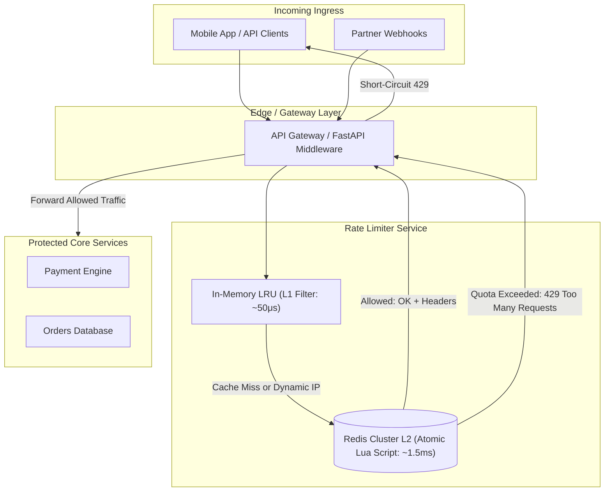

# Distributed Rate Limiter & Token Bucket

At high concurrency, uncontrolled API traffic causes downstream database exhaustion, cascading service failures, and denial-of-service vulnerabilities. Simple fixed-window rate limiters suffer from **boundary burst exploitation**, allowing up to 2x the quota at the turn of each minute.

This blueprint implements a production-grade **Sliding Window Counter** using atomic Redis Lua scripts and a **two-tier caching architecture** (L1 In-Memory LRU + L2 Distributed Redis) capable of operating under 2ms latency at 100k+ requests per second.

---

## 1. System Architecture



---

## 2. Algorithm Comparison & Selection

| Algorithm | Precision | Memory Footprint | Burst Handling | Use-Case Fit |
| :--- | :--- | :--- | :--- | :--- |
| **Fixed Window** | Low (allows 2x burst at boundary) | Minimal (1 key / window) | Poor | Internal batch cron jobs |
| **Token Bucket** | High | Low (last update + token count) | Excellent (configurable burst capacity) | General public REST APIs |
| **Leaky Bucket** | High | Moderate (FIFO queue) | Smooths traffic (constant egress rate) | Messaging & Kafka producers |
| **Sliding Window Log** | Perfect (microsecond accuracy) | High (stores every timestamp in ZSET) | Excellent | High-value security / login endpoints |
| **Sliding Window Counter** | Very High (99.5% accuracy) | Very Low (2 counters per window) | Strong | High-throughput distributed API gateways |

---

## 3. Atomic Redis Lua Script (Sliding Window Log)

In high-concurrency environments, separate `GET` and `SET` commands produce race conditions. This production Lua script executes atomically inside Redis single-threaded execution context:

```lua
-- KEYS[1]: Rate limit key (e.g., "ratelimit:user_123:orders")
-- ARGV[1]: Current unix timestamp (milliseconds)
-- ARGV[2]: Window size in milliseconds (e.g., 60000 for 1 minute)
-- ARGV[3]: Maximum permitted requests in window (e.g., 100)

local key = KEYS[1]
local now = tonumber(ARGV[1])
local window = tonumber(ARGV[2])
local max_requests = tonumber(ARGV[3])
local clear_before = now - window

-- 1. Remove expired timestamps outside active window
redis.call('ZREMRANGEBYSCORE', key, '-inf', clear_before)

-- 2. Count requests currently within active window
local current_requests = redis.call('ZCARD', key)

if current_requests < max_requests then
    -- 3. Register current request timestamp with a unique member
    redis.call('ZADD', key, now, now .. '-' .. redis.call('INCR', key .. ':seq'))
    
    -- 4. Refresh TTL to avoid orphaned keys
    redis.call('PEXPIRE', key, window)
    redis.call('PEXPIRE', key .. ':seq', window)
    
    -- Return: [allowed=1, remaining_quota, retry_after_ms=0]
    return {1, max_requests - current_requests - 1, 0}
else
    -- Find oldest timestamp in current window to calculate reset time
    local oldest = redis.call('ZRANGE', key, 0, 0, 'WITHSCORES')
    local retry_after = 0
    if oldest and #oldest >= 2 then
        retry_after = math.max(0, math.ceil((tonumber(oldest[2]) + window - now) / 1000))
    end
    
    -- Return: [allowed=0, remaining_quota=0, retry_after_seconds]
    return {0, 0, retry_after}
end
```

---

## 4. Production FastAPI Middleware Implementation

Save this production rate limiting middleware under `src/middleware/rate_limiter.py`.

```python
"""
Distributed Rate Limiter Middleware
Framework: FastAPI + Redis Asyncio + Lua
"""

from __future__ import annotations

import time
from typing import Callable, Tuple
import redis.asyncio as redis
from fastapi import FastAPI, Request, Response, status
from starlette.middleware.base import BaseHTTPMiddleware
from starlette.responses import JSONResponse


LUA_SLIDING_WINDOW_SCRIPT = """
local key = KEYS[1]
local now = tonumber(ARGV[1])
local window = tonumber(ARGV[2])
local max_requests = tonumber(ARGV[3])
local clear_before = now - window

redis.call('ZREMRANGEBYSCORE', key, '-inf', clear_before)
local current_requests = redis.call('ZCARD', key)

if current_requests < max_requests then
    redis.call('ZADD', key, now, now .. '-' .. redis.call('INCR', key .. ':seq'))
    redis.call('PEXPIRE', key, window)
    redis.call('PEXPIRE', key .. ':seq', window)
    return {1, max_requests - current_requests - 1, 0}
else
    local oldest = redis.call('ZRANGE', key, 0, 0, 'WITHSCORES')
    local retry_after = 0
    if oldest and #oldest >= 2 then
        retry_after = math.max(0, math.ceil((tonumber(oldest[2]) + window - now) / 1000))
    end
    return {0, 0, retry_after}
end
"""


class DistributedRateLimiterMiddleware(BaseHTTPMiddleware):
    def __init__(
        self,
        app: FastAPI,
        redis_client: redis.Redis,
        default_limit: int = 100,
        window_seconds: int = 60,
        fail_open: bool = True
    ):
        super().__init__(app)
        self.redis = redis_client
        self.default_limit = default_limit
        self.window_ms = window_seconds * 1000
        self.fail_open = fail_open
        self._script = self.redis.register_script(LUA_SLIDING_WINDOW_SCRIPT)

    def resolve_client_identifier(self, request: Request) -> str:
        """Extracts caller identity: authenticated API key or fallback to remote IP."""
        api_key = request.headers.get("X-API-Key")
        if api_key:
            return f"apikey:{api_key}"
        forwarded_for = request.headers.get("X-Forwarded-For")
        ip = forwarded_for.split(",")[0].strip() if forwarded_for else (request.client.host if request.client else "unknown")
        return f"ip:{ip}"

    async def dispatch(self, request: Request, call_next: Callable) -> Response:
        client_id = self.resolve_client_identifier(request)
        rate_key = f"ratelimit:{client_id}:{request.url.path}"
        now_ms = int(time.time() * 1000)

        try:
            # Execute atomic Lua script
            result: Tuple[int, int, int] = await self._script(
                keys=[rate_key],
                args=[now_ms, self.window_ms, self.default_limit]
            )
            allowed, remaining, retry_after = result[0], result[1], result[2]

            if not allowed:
                return JSONResponse(
                    status_code=status.HTTP_429_TOO_MANY_REQUESTS,
                    content={
                        "error": "Too Many Requests",
                        "message": f"Rate limit quota exceeded. Retry after {retry_after} seconds."
                    },
                    headers={
                        "Retry-After": str(retry_after),
                        "X-RateLimit-Limit": str(self.default_limit),
                        "X-RateLimit-Remaining": "0",
                        "X-RateLimit-Reset": str(int(time.time() + retry_after))
                    }
                )

            # Proceed with request
            response = await call_next(request)
            response.headers["X-RateLimit-Limit"] = str(self.default_limit)
            response.headers["X-RateLimit-Remaining"] = str(remaining)
            return response

        except Exception as exc:
            # If Redis is down, decide fail-open (allow traffic) vs fail-closed
            if self.fail_open:
                return await call_next(request)
            return JSONResponse(
                status_code=status.HTTP_503_SERVICE_UNAVAILABLE,
                content={"error": "Rate limiting service temporarily unavailable."}
            )
```

---

## 5. Production Hardening Checklist

- [ ] **Fail-Open vs Fail-Closed**: Configure critical revenue endpoints (e.g., checkout/payments) to fail-open if the Redis cluster is partitioned, while configuring expensive AI generation endpoints to fail-closed.
- [ ] **Avoid ZSET Memory Bloat**: Never use pure Sliding Window Log with unbounded request counts. If an IP sends 10,000 req/sec, the ZSET will consume megabytes per key. Use Sliding Window Counter (two fixed windows with weighted averaging) for public endpoints.
- [ ] **Clock Drift Protection**: Compute `now_ms` using Redis server time (`redis.call('TIME')`) inside the Lua script if your application worker fleet has NTP time drift exceeding 50ms.
- [ ] **Tiered Quotas**: Implement dynamic rate limits based on subscription tier (`Starter: 60/min`, `Pro: 600/min`, `Enterprise: 6000/min`) resolved via JWT claims before invoking Redis.
