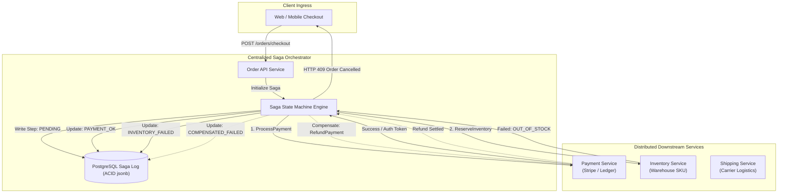

# Distributed Saga Pattern: Orchestrator vs Choreography

In distributed microservices, maintaining ACID consistency across multiple independent databases using traditional Two-Phase Commit (2PC) is an anti-pattern. 2PC introduces blocking coordinators, single points of failure, exponential latency amplification, and catastrophic lock contention across network boundaries.

The **Saga Pattern** solves distributed transactions by decomposing a global transaction into a sequence of local transactions. Each step updates a single service database and emits an event or command. If any step fails, the Saga executes **compensating transactions** in reverse order to undo earlier mutations, ensuring eventual consistency.

---

## 1. System Architecture: Orchestrator vs Choreography



---

## 2. Architectural Comparison: Orchestration vs Choreography

| Dimension | Orchestrator-Driven Saga | Choreography-Driven Saga (Event-Driven) |
| :--- | :--- | :--- |
| **Coordination Model** | Central coordinator directs services via explicit commands | Decentralized; services react to domain events via message broker |
| **Visibility & Monitoring** | **High:** Centralized dashboard and single source of state | **Low:** Distributed traces required to track multi-hop event cascades |
| **Coupling** | Services coupled to coordinator commands, but unaware of peers | Services loosely coupled, but high risk of cyclical event loops |
| **Complexity Growth** | Predictable as workflows expand; linear state machine updates | High cognitive load at scale; catastrophic cascading changes |
| **Failure Recovery** | **Deterministic:** Orchestrator drives exact compensating order | Complex: Services must know how to react to failure events from peers |
| **Best Suited For** | High-value business transactions (Payments, Checkout, Booking) | Simple 2–3 step asynchronous domain workflows (User Signup, Welcome Mail) |

---

## 3. Production PostgreSQL Saga State Schema

Every orchestrator execution requires persistent, crash-resilient state logging to survive coordinator restarts mid-transaction.

```sql
-- PostgreSQL Saga Transaction State Machine Table
CREATE TABLE saga_instances (
    id UUID PRIMARY KEY DEFAULT gen_random_uuid(),
    saga_type VARCHAR(64) NOT NULL,
    correlation_id VARCHAR(128) NOT NULL UNIQUE,
    current_step VARCHAR(64) NOT NULL,
    status VARCHAR(32) NOT NULL DEFAULT 'PENDING' 
        CHECK (status IN ('PENDING', 'RUNNING', 'COMPLETED', 'COMPENSATING', 'FAILED', 'MANUAL_INTERVENTION')),
    payload JSONB NOT NULL DEFAULT '{}'::jsonb,
    step_history JSONB NOT NULL DEFAULT '[]'::jsonb,
    error_details JSONB,
    retry_count INT NOT NULL DEFAULT 0,
    max_retries INT NOT NULL DEFAULT 3,
    created_at TIMESTAMPTZ NOT NULL DEFAULT NOW(),
    updated_at TIMESTAMPTZ NOT NULL DEFAULT NOW()
);

CREATE INDEX idx_saga_status_updated ON saga_instances(status, updated_at);
CREATE INDEX idx_saga_correlation ON saga_instances(correlation_id);

-- Idempotent Action Lock Ledger
CREATE TABLE saga_idempotency_keys (
    key VARCHAR(255) PRIMARY KEY,
    saga_id UUID NOT NULL REFERENCES saga_instances(id) ON DELETE CASCADE,
    response_payload JSONB,
    created_at TIMESTAMPTZ NOT NULL DEFAULT NOW()
);
```

---

## 4. Production Orchestrator Implementation (Python / Async Engine)

Below is an end-to-end, crash-resilient Saga orchestrator featuring forward execution, automatic reverse compensation, retry budgets with exponential backoff, and state persistence.

```python
"""
Production Distributed Saga Orchestrator Engine.
Supports typed step definitions, forward execution, and backward compensation.
"""
import asyncio
import enum
import json
import logging
from dataclasses import dataclass, field
from datetime import datetime
from typing import Any, Callable, Coroutine, Dict, List, Optional
import uuid

logging.basicConfig(level=logging.INFO)
logger = logging.getLogger("saga_orchestrator")


class SagaStatus(str, enum.Enum):
    PENDING = "PENDING"
    RUNNING = "RUNNING"
    COMPLETED = "COMPLETED"
    COMPENSATING = "COMPENSATING"
    FAILED = "FAILED"
    MANUAL_INTERVENTION = "MANUAL_INTERVENTION"


@dataclass
class SagaStep:
    name: str
    action: Callable[[Dict[str, Any]], Coroutine[Any, Any, Dict[str, Any]]]
    compensate: Callable[[Dict[str, Any]], Coroutine[Any, Any, None]]
    retry_limit: int = 3
    timeout_seconds: float = 5.0


@dataclass
class SagaContext:
    saga_id: str = field(default_factory=lambda: str(uuid.uuid4()))
    correlation_id: str = ""
    status: SagaStatus = SagaStatus.PENDING
    data: Dict[str, Any] = field(default_factory=dict)
    completed_steps: List[str] = field(default_factory=list)
    failure_reason: Optional[str] = None


class SagaOrchestrator:
    def __init__(self, name: str):
        self.name = name
        self.steps: List[SagaStep] = []

    def add_step(self, step: SagaStep) -> "SagaOrchestrator":
        self.steps.append(step)
        return self

    async def execute(self, ctx: SagaContext) -> SagaContext:
        ctx.status = SagaStatus.RUNNING
        logger.info(f"[{ctx.saga_id}] Starting Saga '{self.name}' with correlation: {ctx.correlation_id}")

        for step in self.steps:
            logger.info(f"[{ctx.saga_id}] Executing forward step: {step.name}")
            step_success = False
            last_err = None

            for attempt in range(1, step.retry_limit + 1):
                try:
                    result = await asyncio.wait_for(
                        step.action(ctx.data),
                        timeout=step.timeout_seconds
                    )
                    # Merge step output into shared saga data context
                    if result and isinstance(result, dict):
                        ctx.data.update(result)
                    ctx.completed_steps.append(step.name)
                    step_success = True
                    break
                except Exception as ex:
                    last_err = str(ex)
                    logger.warning(
                        f"[{ctx.saga_id}] Step {step.name} attempt {attempt}/{step.retry_limit} failed: {ex}"
                    )
                    if attempt < step.retry_limit:
                        await asyncio.sleep(0.5 * (2 ** (attempt - 1)))  # Exponential backoff

            if not step_success:
                ctx.status = SagaStatus.COMPENSATING
                ctx.failure_reason = f"Step '{step.name}' failed after {step.retry_limit} attempts: {last_err}"
                logger.error(f"[{ctx.saga_id}] Initiating compensation rollback. Reason: {ctx.failure_reason}")
                await self._compensate(ctx)
                return ctx

        ctx.status = SagaStatus.COMPLETED
        logger.info(f"[{ctx.saga_id}] Saga '{self.name}' completed successfully.")
        return ctx

    async def _compensate(self, ctx: SagaContext):
        # Reverse compensation: unwind completed steps in reverse order
        steps_dict = {s.name: s for s in self.steps}
        unwind_queue = list(reversed(ctx.completed_steps))

        for step_name in unwind_queue:
            step = steps_dict.get(step_name)
            if not step:
                continue

            logger.info(f"[{ctx.saga_id}] Compensating step: {step_name}")
            try:
                await asyncio.wait_for(step.compensate(ctx.data), timeout=step.timeout_seconds)
                logger.info(f"[{ctx.saga_id}] Compensation for {step_name} succeeded.")
            except Exception as ex:
                logger.critical(
                    f"[{ctx.saga_id}] CRITICAL: Compensation for {step_name} failed: {ex}. "
                    f"Manual intervention required!"
                )
                ctx.status = SagaStatus.MANUAL_INTERVENTION
                return

        ctx.status = SagaStatus.FAILED


# ============================================================================
# Example Scenario: E-Commerce Order Checkout Saga
# ============================================================================

async def authorize_payment(data: Dict[str, Any]) -> Dict[str, Any]:
    logger.info(f"PaymentService: Authorizing ${data['amount']} for customer {data['customer_id']}")
    return {"payment_auth_id": f"AUTH_{uuid.uuid4().hex[:8]}"}

async def refund_payment(data: Dict[str, Any]) -> None:
    logger.info(f"PaymentService: Refunding charge {data.get('payment_auth_id')}")

async def reserve_warehouse_inventory(data: Dict[str, Any]) -> Dict[str, Any]:
    logger.info(f"InventoryService: Checking stock for SKU {data['sku']}")
    if data.get("simulate_inventory_failure"):
        raise ValueError(f"SKU {data['sku']} is completely OUT OF STOCK")
    return {"reservation_id": f"RES_{uuid.uuid4().hex[:8]}"}

async def release_warehouse_inventory(data: Dict[str, Any]) -> None:
    logger.info(f"InventoryService: Releasing reservation {data.get('reservation_id')}")

async def create_carrier_shipment(data: Dict[str, Any]) -> Dict[str, Any]:
    logger.info(f"ShippingService: Creating label for shipment to {data['shipping_address']}")
    return {"tracking_number": f"TRK_FEDEX_{uuid.uuid4().hex[:6].upper()}"}

async def cancel_carrier_shipment(data: Dict[str, Any]) -> None:
    logger.info(f"ShippingService: Voiding tracking label {data.get('tracking_number')}")


# Assembly
order_saga = (
    SagaOrchestrator("OrderCheckoutSaga")
    .add_step(SagaStep("AuthorizePayment", authorize_payment, refund_payment))
    .add_step(SagaStep("ReserveInventory", reserve_warehouse_inventory, release_warehouse_inventory))
    .add_step(SagaStep("CreateShipment", create_carrier_shipment, cancel_carrier_shipment))
)


async def main():
    # 1. Normal successful execution
    print("\n--- TEST 1: SUCCESSFUL SAGA ---")
    ctx_success = SagaContext(
        correlation_id="order_99812",
        data={"customer_id": "cust_42", "amount": 250.00, "sku": "M3_MACBOOK_PRO", "shipping_address": "Bengaluru, KA"}
    )
    result = await order_saga.execute(ctx_success)
    print(f"Result Status: {result.status.value}, Data: {result.data}\n")

    # 2. Failing execution with compensation
    print("--- TEST 2: FAILED SAGA WITH REVERSE COMPENSATION ---")
    ctx_fail = SagaContext(
        correlation_id="order_99813",
        data={"customer_id": "cust_99", "amount": 1200.00, "sku": "RTX_5090_TI", "simulate_inventory_failure": True}
    )
    result_fail = await order_saga.execute(ctx_fail)
    print(f"Result Status: {result_fail.status.value}, Reason: {result_fail.failure_reason}")


if __name__ == "__main__":
    asyncio.run(main())
```

---

## 5. Production Hardening Checklist

| Operational Dimension | Requirement | Failure Risk If Omitted |
| :--- | :--- | :--- |
| **Idempotent Compensations** | Every `.compensate()` handler must accept duplicate calls safely using idempotency keys | Network retries trigger double-refunds or ghost stock increments |
| **Crash Recovery & Heartbeats** | Periodically scan `saga_instances` for rows in `RUNNING` with no heartbeats > 60s | Coordinator crash leaves transactions hanging in limbo forever |
| **Timeout Budgets** | Set hard timeouts on every step and compensation call | Downstream network hang blocks orchestrator thread pool |
| **Dead-Letter / Manual Queue** | Transition uncompensatable transactions to `MANUAL_INTERVENTION` and alert PagerDuty | Financial discrepancies silently accumulate in production ledger |
| **Payload Data Size** | Keep saga state payloads under 64KB; store large blobs in S3 and reference by URL | Bloated PostgreSQL WAL logs and high JSONB serialization overhead |
