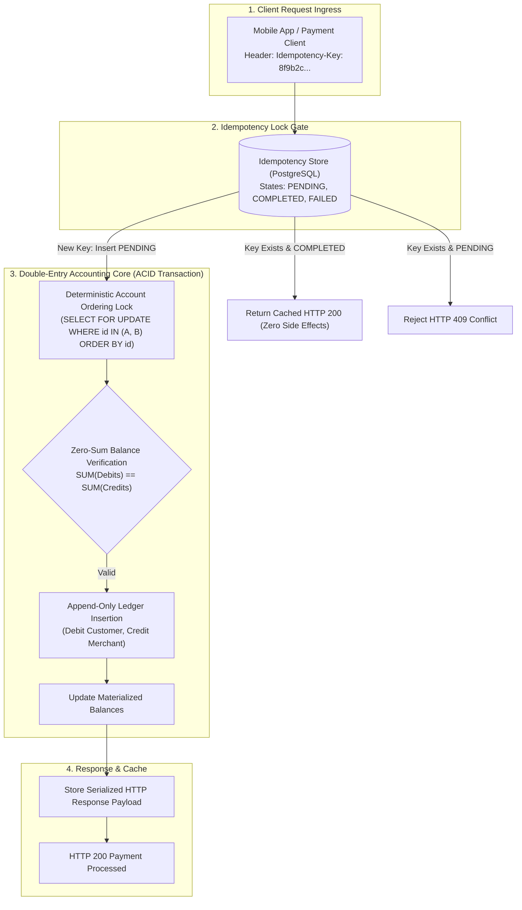

# Idempotent Payment Ledger Architecture

In financial engineering, network timeouts and client retries are inevitable. If a customer clicks "Pay $100" and the mobile connection drops before receiving the HTTP 200 response, the client will retry. Without strict **Idempotency** and **Double-Entry Bookkeeping**, the customer is double-charged or money vanishes into an un-reconcilable discrepancy.

This blueprint implements an immutable financial ledger with ACID double-entry accounting guarantees, deterministic account locking, and cryptographic idempotency key resolution.

---

## 1. System Architecture



---

## 2. The Double-Entry Bookkeeping Rules

In double-entry accounting, money is never created or destroyed; it only moves between accounts. Every transaction must contain at least two entries whose net sum equals zero:

`Total Debits (Dr) == Total Credits (Cr)`

| Account Type | Debit Increases | Credit Increases | Normal Balance | Real-World Example |
| :--- | :--- | :--- | :--- | :--- |
| **Asset** | Yes (+) | No (-) | Debit | Bank Reserves, Customer Cash Balances |
| **Liability** | No (-) | Yes (+) | Credit | Customer Wallet Deposits (Owed to user) |
| **Equity** | No (-) | Yes (+) | Credit | Company Retained Earnings |
| **Revenue** | No (-) | Yes (+) | Credit | Platform Processing Fees Collected |
| **Expense** | Yes (+) | No (-) | Debit | Stripe / Interchange Fees Paid Out |

---

## 3. PostgreSQL Database Schema & Constraints

Save this migration script into your database:

```sql
-- PostgreSQL Financial Ledger Schema

CREATE TYPE account_type_enum AS ENUM ('ASSET', 'LIABILITY', 'EQUITY', 'REVENUE', 'EXPENSE');
CREATE TYPE entry_direction_enum AS ENUM ('DEBIT', 'CREDIT');
CREATE TYPE transaction_status_enum AS ENUM ('PENDING', 'COMPLETED', 'FAILED');

-- 1. Chart of Accounts
CREATE TABLE IF NOT EXISTS accounts (
    id UUID PRIMARY KEY DEFAULT gen_random_uuid(),
    account_number VARCHAR(32) UNIQUE NOT NULL,
    account_type account_type_enum NOT NULL,
    currency VARCHAR(3) NOT NULL DEFAULT 'USD',
    settled_balance_cents BIGINT NOT NULL DEFAULT 0,
    created_at TIMESTAMPTZ DEFAULT NOW()
);

-- 2. Idempotent Ledger Transactions
CREATE TABLE IF NOT EXISTS ledger_transactions (
    id UUID PRIMARY KEY DEFAULT gen_random_uuid(),
    idempotency_key VARCHAR(128) UNIQUE NOT NULL,
    description TEXT NOT NULL,
    status transaction_status_enum NOT NULL DEFAULT 'PENDING',
    response_payload JSONB,
    created_at TIMESTAMPTZ DEFAULT NOW(),
    completed_at TIMESTAMPTZ
);

-- 3. Immutable Append-Only Ledger Entries
CREATE TABLE IF NOT EXISTS ledger_entries (
    id UUID PRIMARY KEY DEFAULT gen_random_uuid(),
    transaction_id UUID NOT NULL REFERENCES ledger_transactions(id) ON DELETE RESTRICT,
    account_id UUID NOT NULL REFERENCES accounts(id) ON DELETE RESTRICT,
    direction entry_direction_enum NOT NULL,
    amount_cents BIGINT NOT NULL CHECK (amount_cents > 0),
    created_at TIMESTAMPTZ DEFAULT NOW()
);

CREATE INDEX idx_entries_account ON ledger_entries(account_id);
CREATE INDEX idx_entries_tx ON ledger_entries(transaction_id);
```

---

## 4. Production Python Implementation: Deadlock-Free Ledger

Save this financial service under `src/ledger/payment_service.py`.

```python
"""
Double-Entry Idempotent Payment Service
Framework: Python 3.11 + Asyncpg / Psycopg3
"""

from __future__ import annotations

from dataclasses import dataclass
from enum import Enum
from typing import Any, Dict, List, Optional
import psycopg
from psycopg.rows import dict_row


class EntryDirection(str, Enum):
    DEBIT = "DEBIT"
    CREDIT = "CREDIT"


@dataclass
class LedgerLine:
    account_id: str
    direction: EntryDirection
    amount_cents: int


class PaymentLedgerEngine:
    def __init__(self, db_connection_url: str):
        self.db_url = db_connection_url

    async def execute_idempotent_transaction(
        self,
        idempotency_key: str,
        description: str,
        entries: List[LedgerLine]
    ) -> Dict[str, Any]:
        """
        Executes a double-entry transaction with strict idempotency and deadlock prevention.
        """
        # Step 1: Mathematical validation - Debits must equal Credits
        total_debits = sum(e.amount_cents for e in entries if e.direction == EntryDirection.DEBIT)
        total_credits = sum(e.amount_cents for e in entries if e.direction == EntryDirection.CREDIT)
        
        if total_debits != total_credits:
            raise ValueError(f"Unbalanced transaction: Debits ({total_debits}) != Credits ({total_credits})")

        with psycopg.connect(self.db_url, row_factory=dict_row) as conn:
            with conn.transaction():
                # Step 2: Idempotency Lock Check
                # Attempt to insert or read existing transaction
                with conn.cursor() as cur:
                    cur.execute(
                        """
                        SELECT id, status, response_payload 
                        FROM ledger_transactions 
                        WHERE idempotency_key = %s 
                        FOR UPDATE;
                        """,
                        (idempotency_key,)
                    )
                    existing_tx = cur.fetchone()

                    if existing_tx:
                        if existing_tx["status"] == "COMPLETED":
                            # Return cached response (Zero side-effects!)
                            return existing_tx["response_payload"]
                        elif existing_tx["status"] == "PENDING":
                            raise RuntimeError("Concurrent transaction in progress with identical Idempotency-Key.")

                    # Insert new PENDING transaction record
                    cur.execute(
                        """
                        INSERT INTO ledger_transactions (idempotency_key, description, status)
                        VALUES (%s, %s, 'PENDING')
                        RETURNING id;
                        """,
                        (idempotency_key, description)
                    )
                    tx_id = cur.fetchone()["id"]

                    # Step 3: Deadlock Prevention - Lock Accounts in Strict Lexicographical Order
                    # If Transaction 1 locks A then B, and Transaction 2 locks B then A, Postgres deadlocks.
                    # Sorting IDs ensures every concurrent thread acquires row locks in the exact same sequence.
                    account_ids = sorted(list({e.account_id for e in entries}))
                    cur.execute(
                        """
                        SELECT id, settled_balance_cents 
                        FROM accounts 
                        WHERE id = ANY(%s) 
                        ORDER BY id 
                        FOR UPDATE;
                        """,
                        (account_ids,)
                    )
                    locked_accounts = {row["id"]: row["settled_balance_cents"] for row in cur.fetchall()}

                    # Verify all accounts exist
                    for aid in account_ids:
                        if aid not in locked_accounts:
                            raise ValueError(f"Account {aid} does not exist.")

                    # Step 4: Write Immutable Ledger Entries and Update Balances
                    for entry in entries:
                        # Append immutable journal line
                        cur.execute(
                            """
                            INSERT INTO ledger_entries (transaction_id, account_id, direction, amount_cents)
                            VALUES (%s, %s, %s, %s);
                            """,
                            (tx_id, entry.account_id, entry.direction.value, entry.amount_cents)
                        )

                        # Update running balance snapshot
                        delta = entry.amount_cents if entry.direction == EntryDirection.DEBIT else -entry.amount_cents
                        cur.execute(
                            """
                            UPDATE accounts 
                            SET settled_balance_cents = settled_balance_cents + %s 
                            WHERE id = %s;
                            """,
                            (delta, entry.account_id)
                        )

                    # Step 5: Finalize Transaction & Cache Response
                    response_data = {
                        "transaction_id": str(tx_id),
                        "status": "SUCCESS",
                        "amount_cents": total_debits,
                        "description": description
                    }

                    cur.execute(
                        """
                        UPDATE ledger_transactions 
                        SET status = 'COMPLETED', response_payload = %s, completed_at = NOW() 
                        WHERE id = %s;
                        """,
                        (psycopg.types.json.Jsonb(response_data), tx_id)
                    )

                    return response_data
```

---

## 5. Production Hardening Checklist

- [ ] **Integer Cents Only**: Never store monetary values in floating-point columns (`FLOAT` / `REAL`). Always use `BIGINT` representing the smallest currency denomination (cents, satoshis, wei) to eliminate IEEE 754 precision rounding bugs.
- [ ] **Deterministic Lock Ordering**: Always sort account IDs (`ORDER BY id`) prior to acquiring `SELECT ... FOR UPDATE` row locks. Random lock acquisition causes catastrophic deadlock aborts under concurrent traffic.
- [ ] **Zero-Sum Database Check Trigger**: Deploy an `AFTER INSERT ON ledger_entries` constraint trigger that verifies `SUM(debit) == SUM(credit)` before committing the transaction.
- [ ] **Nightly Reconciliation Cron**: Run an automated reconciliation script every midnight verifying that `accounts.settled_balance_cents == SUM(ledger_entries.amount)` across all active customer accounts.
