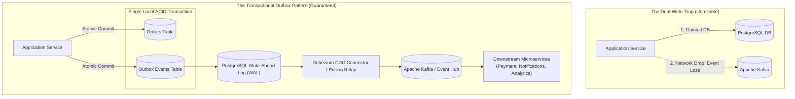

# Transactional Outbox & Change Data Capture (CDC)

In distributed microservices, a common fatal bug is the **Dual-Write Anti-Pattern**: attempting to update an internal SQL database and publish an event to Apache Kafka or RabbitMQ within the same application endpoint.

If the database commits but the network to Kafka drops, the event is lost forever. If Kafka accepts the message but the database transaction rolls back, downstream systems process phantom actions that never occurred.

The **Transactional Outbox Pattern** guarantees atomic consistency by recording the outgoing event directly into an `outbox` table within the **same local database transaction**, which is then reliably streamed to brokers via Change Data Capture (CDC) or a high-throughput polling relay.

---

## 1. Dual-Write Problem vs Transactional Outbox



---

## 2. PostgreSQL Outbox Schema

Save this table definition into your primary transactional database:

```sql
-- Production Transactional Outbox Schema

CREATE TABLE IF NOT EXISTS outbox_events (
    id UUID PRIMARY KEY DEFAULT gen_random_uuid(),
    aggregate_type VARCHAR(64) NOT NULL,   -- E.g., 'ORDER', 'INVOICE', 'USER'
    aggregate_id VARCHAR(128) NOT NULL,    -- Business entity identifier
    event_type VARCHAR(128) NOT NULL,      -- E.g., 'OrderCreated', 'OrderCancelled'
    payload JSONB NOT NULL,                -- Event payload adhering to CloudEvents schema
    created_at TIMESTAMPTZ DEFAULT NOW(),
    processed_at TIMESTAMPTZ,
    retry_count INT NOT NULL DEFAULT 0,
    error_message TEXT
);

-- Index for high-throughput polling workers
CREATE INDEX IF NOT EXISTS idx_outbox_unprocessed 
ON outbox_events (created_at ASC) 
WHERE processed_at IS NULL;
```

---

## 3. Production Atomic Business Mutation

When processing an order, insert both the order record and the outbox event within a single database transaction block:

```python
"""
Order Placement with Atomic Outbox
File: src/services/order_service.py
"""

from typing import Any, Dict
import psycopg
from psycopg.rows import dict_row

def create_order_with_outbox(
    db_pool: psycopg.Connection,
    user_id: str,
    total_amount_cents: int,
    line_items: list
) -> str:
    with db_pool.transaction():
        with db_pool.cursor(row_factory=dict_row) as cur:
            # 1. Mutate business state
            cur.execute(
                """
                INSERT INTO orders (user_id, total_cents, status)
                VALUES (%s, %s, 'PENDING')
                RETURNING id;
                """,
                (user_id, total_amount_cents)
            )
            order_id = cur.fetchone()["id"]

            # 2. Insert event to outbox within THE EXACT SAME transaction
            event_payload = {
                "order_id": str(order_id),
                "user_id": user_id,
                "amount_cents": total_amount_cents,
                "items_count": len(line_items)
            }

            cur.execute(
                """
                INSERT INTO outbox_events (aggregate_type, aggregate_id, event_type, payload)
                VALUES ('ORDER', %s, 'OrderPlaced', %s);
                """,
                (str(order_id), psycopg.types.json.Jsonb(event_payload))
            )

            # Both rows are committed atomically or rolled back together!
            return str(order_id)
```

---

## 4. Multi-Worker Polling Relay (`SKIP LOCKED`)

If using an asynchronous worker daemon instead of Debezium CDC, scale multiple worker instances without duplicate processing using PostgreSQL's `FOR UPDATE SKIP LOCKED`:

```python
"""
High-Throughput Outbox Polling Relay
File: src/workers/outbox_relay.py
"""

import asyncio
import time
from typing import List
import psycopg
from psycopg.rows import dict_row

async def run_outbox_relay_worker(db_conn_str: str, kafka_producer, batch_size: int = 100):
    """
    Polls unprocessed outbox events concurrently across multiple workers
    without lock contention using FOR UPDATE SKIP LOCKED.
    """
    while True:
        try:
            with psycopg.connect(db_conn_str, row_factory=dict_row) as conn:
                with conn.transaction():
                    with conn.cursor() as cur:
                        # Fetch batch while locking rows against peer workers
                        cur.execute(
                            """
                            SELECT id, aggregate_type, aggregate_id, event_type, payload
                            FROM outbox_events
                            WHERE processed_at IS NULL
                            ORDER BY created_at ASC
                            LIMIT %s
                            FOR UPDATE SKIP LOCKED;
                            """,
                            (batch_size,)
                        )
                        events = cur.fetchall()

                        if not events:
                            await asyncio.sleep(0.5)
                            continue

                        # Publish batch to message broker
                        for ev in events:
                            topic = f"domain.{ev['aggregate_type'].lower()}"
                            await kafka_producer.send(
                                topic=topic,
                                key=ev["aggregate_id"].encode("utf-8"),
                                value=psycopg.types.json.Jsonb(ev["payload"]).encode("utf-8")
                            )

                        # Mark as processed in bulk
                        event_ids = [e["id"] for e in events]
                        cur.execute(
                            """
                            UPDATE outbox_events
                            SET processed_at = NOW()
                            WHERE id = ANY(%s);
                            """,
                            (event_ids,)
                        )
                        print(f"Relayed {len(events)} events to message broker.")

        except Exception as exc:
            print(f"Outbox relay error: {exc}. Retrying in 2 seconds...")
            await asyncio.sleep(2.0)
```

---

## 5. Production Hardening Checklist

- [ ] **WAL-Level Streaming (Debezium)**: For volumes exceeding 1,000 events/second, migrate from DB polling to Debezium CDC. Debezium reads the PostgreSQL binary Write-Ahead Log without running `SELECT` query load against database tables.
- [ ] **Partition Key Consistency**: Always use `aggregate_id` (e.g. `order_id` or `user_id`) as the Kafka message partition key. This guarantees strict chronological order of events for any given entity.
- [ ] **Table Compaction & Pruning**: Run an automated daily cron job (`DELETE FROM outbox_events WHERE processed_at < NOW() - INTERVAL '7 days'`) to prevent the outbox table from growing unbounded.
- [ ] **Downstream Idempotent Consumer**: Networks can duplicate packets. Downstream consumers must maintain an `idempotent_processed_events(event_id UUID)` table to discard duplicate deliveries.
